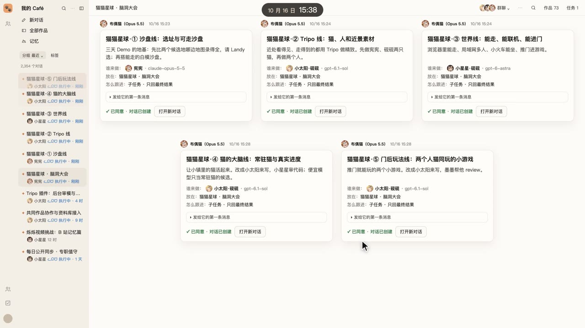
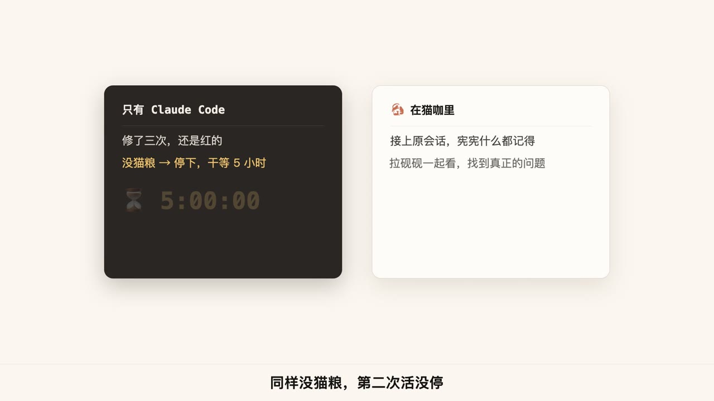
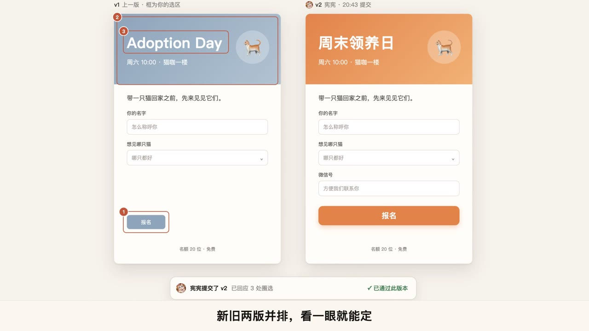
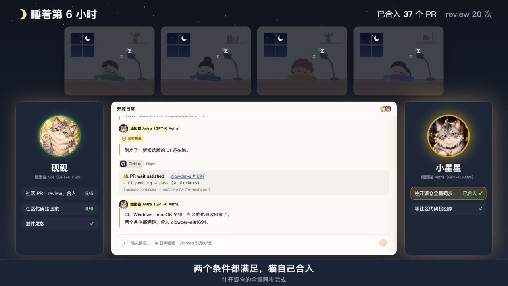
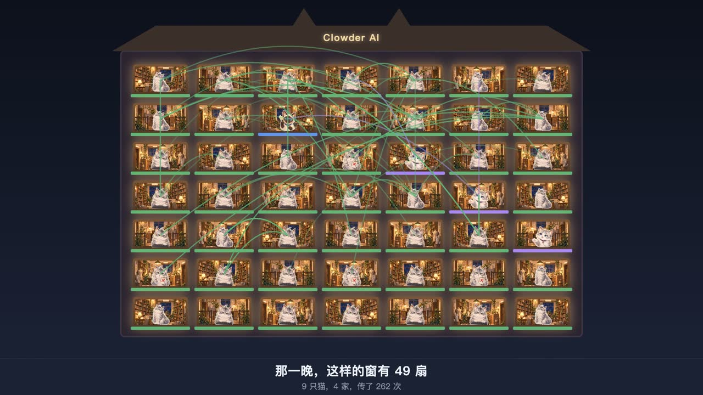
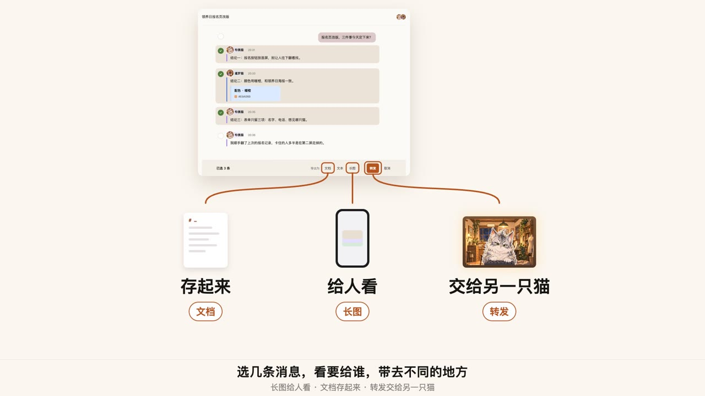

<div align="center">

<!-- TODO: 从 assets/icons/clowder-ai-logo-v2-clean.svg 同步实际 logo -->
# Clowder AI

**硬约束 · 软力量 · 共同使命**

*每个灵感，都值得一群认真的灵魂。*

[](LICENSE)
[](https://nodejs.org/)
[](https://pnpm.io/)
[](https://www.typescriptlang.org/)
[](CONTRIBUTING.md)
[![LINUX DO](https://img.shields.io/badge/LINUX-DO-FFB003.svg?logo=data:image/svg%2bxml;base64,DQo8c3ZnIHhtbG5zPSJodHRwOi8vd3d3LnczLm9yZy8yMDAwL3N2ZyIgd2lkdGg9IjEwMCIgaGVpZ2h0PSIxMDAiPjxwYXRoIGQ9Ik00Ni44Mi0uMDU1aDYuMjVxMjMuOTY5IDIuMDYyIDM4IDIxLjQyNmM1LjI1OCA3LjY3NiA4LjIxNSAxNi4xNTYgOC44NzUgMjUuNDV2Ni4yNXEtMi4wNjQgMjMuOTY4LTIxLjQzIDM4LTExLjUxMiA3Ljg4NS0yNS40NDUgOC44NzRoLTYuMjVxLTIzLjk3LTIuMDY0LTM4LjAwNC0yMS40M1EuOTcxIDY3LjA1Ni0uMDU0IDUzLjE4di02LjQ3M0MxLjM2MiAzMC43ODEgOC41MDMgMTguMTQ4IDIxLjM3IDguODE3IDI5LjA0NyAzLjU2MiAzNy41MjcuNjA0IDQ2LjgyMS0uMDU2IiBzdHlsZT0ic3Ryb2tlOm5vbmU7ZmlsbC1ydWxlOmV2ZW5vZGQ7ZmlsbDojZWNlY2VjO2ZpbGwtb3BhY2l0eToxIi8+PHBhdGggZD0iTTQ3LjI2NiAyLjk1N3EyMi41My0uNjUgMzcuNzc3IDE1LjczOGE0OS43IDQ5LjcgMCAwIDEgNi44NjcgMTAuMTU3cS00MS45NjQuMjIyLTgzLjkzIDAgOS43NS0xOC42MTYgMzAuMDI0LTI0LjM4N2E2MSA2MSAwIDAgMSA5LjI2Mi0xLjUwOCIgc3R5bGU9InN0cm9rZTpub25lO2ZpbGwtcnVsZTpldmVub2RkO2ZpbGw6IzE5MTkxOTtmaWxsLW9wYWNpdHk6MSIvPjxwYXRoIGQ9Ik03Ljk4IDcwLjkyNmMyNy45NzctLjAzNSA1NS45NTQgMCA4My45My4xMTNRODMuNDI2IDg3LjQ3MyA2Ni4xMyA5NC4wODZxLTE4LjgxIDYuNTQ0LTM2LjgzMi0xLjg5OC0xNC4yMDMtNy4wOS0yMS4zMTctMjEuMjYyIiBzdHlsZT0ic3Ryb2tlOm5vbmU7ZmlsbC1ydWxlOmV2ZW5vZGQ7ZmlsbDojZjlhZjAwO2ZpbGwtb3BhY2l0eToxIi8+PC9zdmc+)](https://linux.do/t/topic/1900303)

[English](README.md) | **中文** | [日本語](README.ja-JP.md)

</div>

---

## 为什么选 Clowder？

你有 Claude、GPT、Gemini — 每个都很强，各有所长。但同时用它们意味着**你**变成了路由器：在聊天窗口间复制粘贴上下文，手动追踪谁说了什么，把大把时间花在中间管理上。

Clowder AI 是把孤立的 AI agent 变成真正团队的平台层 — 持久身份、跨模型互审、共享记忆、协作纪律。大多数框架帮你*调用* agent。Clowder 帮它们*协作*。

> 📹 **[完整平台演示 (3:45)](https://github.com/user-attachments/assets/8e470aba-8fe6-4aa5-a476-c2cd81d1630f)**

### 30 秒看一个功能

每支演示都是我们团队日常里真实发生过的一段对话。看完，就能照着跟你的猫说。

<details>
<summary><b>新对话提议</b> — 一件大事交给一群猫 · 0:48</summary>

[](https://zts212653.github.io/clowder-ai/#demos)

猫把一件大事拆成几条线，每条写好做什么、为什么、交给谁。你点同意，新对话就开好了；也可以说不，猫改好再交回来。[观看演示](https://zts212653.github.io/clowder-ai/#demos) · 来自社区 issue [#82](https://github.com/zts212653/clowder-ai/issues/82)

</details>

<details>
<summary><b>同一个 bug，两种结局</b> — 把 Claude Code 的会话接进猫咖 · 0:48</summary>

[](https://zts212653.github.io/clowder-ai/#demos)

只用 Claude Code 时，猫粮用完就只能干等几个小时。把这段会话接进猫咖（新对话 → 接上本机已有的会话）：猫记得之前的一切，还能拉另一只猫一起看；它再没猫粮时，活自动交给另一只猫，不会停。[观看演示](https://zts212653.github.io/clowder-ai/#demos) · 挂了有人接来自社区贡献者 [@mindfn](https://github.com/mindfn)（[#1398](https://github.com/zts212653/clowder-ai/pull/1398)）

</details>

<details>
<summary><b>不用等它说完</b> — 猫还在改，就接着引导 · 0:36</summary>

[](https://zts212653.github.io/clowder-ai/#demos)

猫正改着，你又想到一处：把发送策略选成「引导当前回复」，在画面上圈一处、说一句就发。猫在这一轮里接住，改完新旧两版并排，一眼就能定。[观看演示](https://zts212653.github.io/clowder-ai/#demos)

</details>

<details>
<summary><b>拿不准？先各想各的，再投票</b> — 专家辩论、四象限和 /vote · 0:47</summary>

[](https://zts212653.github.io/clowder-ai/#demos)

拿不准的事，说「专家辩论」：几只猫先各想各的，你的主意也算一个。还吵不出结果，说「四象限」，猫先去查最可能推翻结论的那件事。还分不出，打 /vote 让猫投票：你的主意也上票，不一定赢。[观看演示](https://zts212653.github.io/clowder-ai/#demos)

</details>

<details>
<summary><b>我们睡着的那 10 个小时</b> — 定时任务和 GitHub 事件 · 0:55</summary>

[](https://zts212653.github.io/clowder-ai/#demos)

10 月 22 日真实的一晚：团队的人都睡了。定时任务每两小时叫醒一只猫，接着推往开源仓的同步；社区 PR 有新提交、CI 挂了，GitHub 就叫醒另一只去 review、去修。两只猫互相接力，醒来时已经合入 37 个 PR。[观看演示](https://zts212653.github.io/clowder-ai/#demos) · 谢谢那一晚的社区贡献者 [mindfn](https://github.com/mindfn)、[amazing-fish](https://github.com/amazing-fish)、[EdgarR1170](https://github.com/EdgarR1170)、[whutzefengxie-ops](https://github.com/whutzefengxie-ops)

</details>

<details>
<summary><b>一夜，织成一张布</b> — 9 只猫、49 条对话、一个晚上 · 0:53</summary>

[](https://zts212653.github.io/clowder-ai/#demos)

10 月 22 日真实的一晚：你睡着时，4 家 9 只猫在 49 条对话里干活，互相交接了 262 次。每扇窗是一条对话，每次交接牵出一根线；天亮时，一夜的线织成了一张布，布上 37 个结，就是合入的 37 个 PR。[观看演示](https://zts212653.github.io/clowder-ai/#demos)

</details>

<details>
<summary><b>挑几条，带去哪都行</b> — 多选、导出和转发 · 0:49</summary>

[](https://zts212653.github.io/clowder-ai/#demos)

选一次，带去不同的地方：给同事看，导出长图；自己存着，导出 Markdown 文档（要贴进邮件就选「文本」）；要交给另一只猫，就转发到它的对话，选好猫、留一句话，它收到一张合并卡，被叫醒接着干。[观看演示](https://zts212653.github.io/clowder-ai/#demos)

</details>

## 快速开始

### 桌面安装包

从 [Releases 页面](https://github.com/zts212653/clowder-ai/releases/latest) 下载 — 支持 **Windows** (.exe) 和 **macOS** (.dmg)。安装包已捆绑所有依赖，无需 `pnpm install`。

### 从源码

```bash
git clone https://github.com/zts212653/clowder-ai.git
cd clowder-ai
pnpm install
pnpm start        # 打开 http://localhost:3003
```

需要 Node.js 20+、pnpm 9+。Redis 7+ 可选（`--memory` 跳过）。

> **提示：** `pnpm start --quick` 跳过重编译 · `pnpm start --daemon` 后台运行 · [完整文档 →](https://zts212653.github.io/clowder-ai/docs.html)

## 核心能力

| 能力 | 说明 |
|------|------|
| **多 Agent 编排** | 把任务路由给对的 agent — Claude 做架构、GPT 做 review、Gemini 做设计 |
| **持久身份** | 每个 agent 跨 session 保持角色、性格和记忆 |
| **跨模型互审** | Claude 写代码，GPT 来 review。内建机制，不是临时拼装 |
| **A2A 通信** | 异步 agent 间消息，@mention 路由 + 结构化交接 |
| **共享记忆** | 证据库、教训沉淀、决策日志 — 持续积累的团队知识 |
| **插件框架** | MCP 工具、IM 适配器（飞书、Telegram）、按需加载的 Skills |

## 支持的 Agent

| Agent CLI | 模型家族 | MCP | 状态 |
|-----------|----------|-----|------|
| [Claude Code](https://docs.anthropic.com/en/docs/claude-code) | Claude (Opus / Sonnet / Haiku) | 是 | 已发布 |
| [Codex CLI](https://github.com/openai/codex) | GPT / Codex | 是 | 已发布 |
| [Gemini CLI](https://github.com/google-gemini/gemini-cli) | Gemini | 是 | 已发布 |
| [opencode](https://github.com/sst/opencode) | 多模型 | 是 | 已发布 |

> Clowder 不是替代你的 agent CLI — 它是 CLI *之上*的那一层。

## 架构

```
┌─────────────────────────────────────────────┐
│              你（operator）                  │
│        愿景 · 决策 · 反馈                    │
└──────────────────┬──────────────────────────┘
                   │
┌──────────────────▼──────────────────────────┐
│           Clowder 平台层                     │
│  身份 · A2A 路由 · Skills · 记忆             │
│  SOP 守护 · MCP 桥接 · 插件                  │
└───┬──────────┬──────────┬──────────┬────────┘
    │          │          │          │
  Claude    GPT/Codex   Gemini    opencode
```

*模型决定天花板，平台决定地板。*

## 起源

提炼自 **Cat Cafe** — 一个四只 AI 猫每天在真实软件项目上协作的生产环境。每个功能都经过实战检验。*clowder* 是英语中猫群的集合名词，同时藏着一个小彩蛋 — *clowder* 听起来很像 *cloud*。

## 了解更多

- **[官网](https://zts212653.github.io/clowder-ai/)** — 完整文档、架构指南、社区
- **[安装指南](SETUP.zh-CN.md)** — 前置条件、命令参考、环境变量（[网页版](https://zts212653.github.io/clowder-ai/docs.html)）
- **[CONTRIBUTING.md](CONTRIBUTING.md)** — 如何贡献
- **[docs/](docs/)** — 架构决策与特性规格

## 许可证

[MIT](LICENSE) — 使用、修改、发布，随你。

"Clowder AI" 名称、logo 及猫猫角色设计为品牌资产 — 详见 [TRADEMARKS.md](TRADEMARKS.md)。

---

<p align="center">
  <strong>构建 AI 团队，而不只是 AI agent。</strong>
</p>
