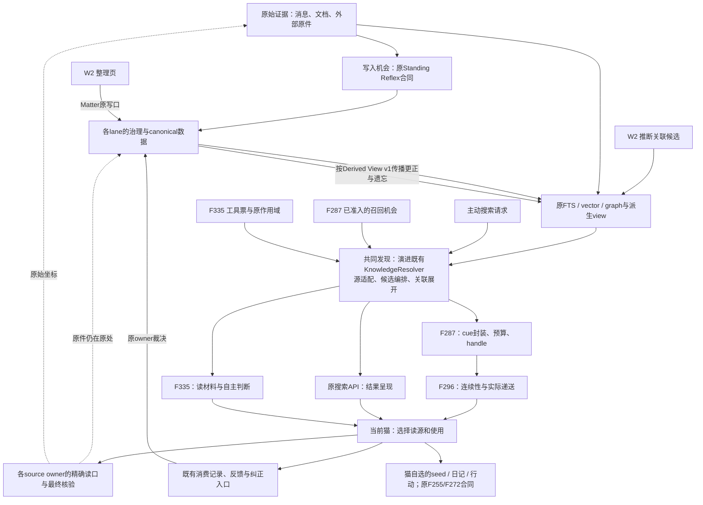

# Clowder AI 记忆系统全景

> **迷路时先回 [Memory Architecture Atlas](./memory/README.md)。** Atlas 负责一分钟心智模型、
> 六层/八模块/九观察面的映射、问题路由与 claim 产权登记；本文只拥有 current + target
> 拓扑，不再承担唯一导航入口。
>
> **时间语义**：拓扑与权力边界是 current/target 混合视图；运行数字和闭环账本是
> `as_of: 2026-08-15` 的快照。phase、AC、`landed/live/UAT/verdict` 的现在时始终回对应
> feature doc 与 roadmap，不能从本文的旧快照推断。
>
> **11-07目标增量**：You843要求共同发现归一并迁退旧路；下方
> [F332目标拓扑](#f332共同发现目标拓扑2026-11-07)取代此前发现分路的目标画法。
> 这是已规划、尚未实现的重构，未把8月运行快照整体更新成今天，也不复活旧Feature施工。
>
> 面向 You、新猫与工程实现者。本文同时回答“家里现在有什么”和“终态应怎样连成一个
> 系统”：一段经历如何成为 canonical truth；写入机会与召回机会为何是两张并列的 plane；
> 派生 view 如何加速而不夺权；动态上下文如何按连续性呈现；纠错/遗忘如何传播到全部读面。
>
> **文档分工**：[memory-philosophy.md](./memory-philosophy.md) 管长期原则；本文管当前系统地图；
> [retrieval-pipeline-deep-dive.md](./retrieval-pipeline-deep-dive.md) 管 pull recall 执行细节；
> [memory-cue-source-map.md](./memory-cue-source-map.md) 管 F287 逐 lane ownership；
> [context-injection-reflex-source-map.md](./context-injection-reflex-source-map.md) 管所有 model-facing
> 注入面的触发、权力、预算、失效与 owner；
> [memory-standing-reflex-contract.md](./memory-standing-reflex-contract.md) 冻结 WriteOpportunity
> entry/disposition 合同；[memory-derived-view-contract.md](./memory-derived-view-contract.md) 冻结
> lineage/invalidation/fail-closed 回源合同；
> [memory-outcome-attribution-source-map.md](./memory-outcome-attribution-source-map.md) 管召回消费、
> 任务结果与单 anchor 因果归因之间的观测边界；
> 2026-08-15 Research-First roadmap (internal)
> 管剩余工作的依赖顺序；2026-08-02 closure plan 只保留历史运行凭据。
> 各 feature doc / task 才是 phase 与 AC 的 canonical truth。
> [发展史与未解问题](./memory/history/memory-history-map.md)另讲每次改变背后的痛点、取舍与尚未解决的问题；
> 它保留历史时态，不替代本文的拓扑或 feature 的当前状态。
>
> **Freshness**：2026-08-15 增量核验加入 F276 首个真实
> approve→materialize→recall slice、F282 `propose|defer|abstain`、F296 frozen-v1 contract 与已合入的
> W0-E carrier/continuity census；
> F271/F256/F227 等运行数字仍是各 feature 截至 2026-08-04 的历史快照。运行态、UAT 与
> verdict 必须单列，不能由 main commit 推断。

---

## 三十秒结论

Clowder AI 的记忆系统不是一个数据库，也不是“自动把旧聊天塞进 prompt”。终态是八层、两张
opportunity plane、一个回源闭环：

1. **Evidence substrate** 尽早保存可回到原文的证据与坐标；索引是可重建导航，不是真相。
2. **Write Opportunity Plane** 把机械可观察场景变成一次写入判断机会；猫必须明确
   `propose | defer | abstain`。全局 [Standing Reflex Contract v1](./memory-standing-reflex-contract.md)
   已冻结逻辑合同；entry/runtime 迁移尚未开始。
3. **Governance + Canonical Truth** 由各 typed lane 决定批准、修改、scope、retire 与 forget。
4. **Projection / Derived View** 提供索引、graph、摘要、card 与拉式物化 cache；全部带 lineage，
   永不获得 truth 权力。[Derived View Contract v1](./memory-derived-view-contract.md) 已冻结逻辑合同；
   通用 runtime propagation 尚未落地。
5. **Pull Recall + Recall Opportunity Plane** 分别负责“猫主动搜”和“明确判断点主动浮现”；F332目标把
   候选发现/关联展开收进演进后的`KnowledgeResolver`，搜索、准入后的F287和F335共用；
   F287仍持closed typed catalog，源owner仍持读取/更正权。该发现重构尚未实施。
6. **Context Presentation** 由 F296 按 cold/hot、证据 tier、version/epoch 决定如何呈现与去重；
   v1 合同已冻结，provider-start handshake/epoch/mapper/ledger runtime 尚未实现。
7. **Outcome + Invalidation** 把消费、纠错、遗忘和结果回源；F276→F287 已有 typed 样板，
   通用 derived view / 引用污染传播仍缺。
8. **Cat-owned Memory & Action** 让猫把 cue 采纳为私人 seed、日记、意图与行动：F255/F272。

截至 2026-08-15：

- 存储、索引、下钻、实体 revision、typed proposal、lifecycle trace 与 Cue Plane A–E 实现已进入 main。
- F281/F282 已闭工程；F282/F276 已有写侧 `propose|defer|abstain` 与 known-person dual path，
  但它们不是全场景 standing reflex 规范。F287 已完成 lifecycle/delivery/budget 加固，canonical
  Alpha 完成 Person、operational precedent 与 Taste integrated UAT；production 仍按 source 保持
  `dormant/unverified`。
- F276 首个真实 InteractionEvent approve→materialize→recall slice 已通过；完整 source drill、
  correct/forget、reject/not-now absence、runtime health 与 utility 仍开放。
- F296 Context Presentation / Continuity v1 已冻结并 push main `82a49bb20`；provider-start
  handshake、epoch owner、mapper/ledger runtime 尚未实现。它是动态记忆候选的呈现合同，
  不是新的 memory truth owner。
- F271 session-close 已有 durable output；daily 的 120 秒 timeout 已修并在 `11.874s` 内 delivered，但该 run 的五条候选全部被 household-day budget 拒绝且 `quiet=false`，尚无合法 daily outcome。
- F256 `f256-health-v2` 已在自然 `natural_topk` 路径通水；21 条 durable row、16 个 eligible/presented event 与 56 个 presented hint 关闭了 health/observability 缺口，`followed=0 / used=0` 仍不支持效用结论。
- F152 external bootstrap 与 distillation route 实测读取不同 store，generalizable mark 返回 404；AC-C1/AC-C5 必须先修产品链再做 You UAT。F227 已完成 cat-side Alpha 预演，只欠视觉与 teleport 签字。
- 注入/reflex W0-B census v0.1 已完成：F237 Phase 2 已有 46 个 per-hook YAML、HookRegistry、
  generated manifest view 与 S*/D* delivered trace，是“per-lane contract + generated read-only
  catalog”的 partial precedent；旧 guard 之外仍有 staging、F225、F276、F229、F260/F287、
  F282、F281、F167、F254 等独立生命周期面，最终 prompt 也晚于现有 trace。Wave 1 已完成
  既有 schema 的 reflex 字段覆盖审计，冻结为 reflex-candidate per-lane entry + generated read-only
  catalog；不扩充全部非 reflex hook，也不预设中央 mutable registry；
  ASR→F276 只作首个纵切候选。
- W0-C/W0-D v0.2 已补齐两处 current-main 坐标：Taste canonical approve→isolated
  `origin/main` publication→index/read 与 Profile canonical root→logical URI→authenticated read 均存在；
  public writer 不再把 primary-main local commit 当完成 terminal；开放项收窄为 speaker provenance、
  standing trigger、organic consumption 与 view invalidation，不再拿历史 split-brain/landing bug 代证。
- W0-F 四篇论文一手审计已完成：LazyMem 只测显式 query 后的 construction；PM-Bench 测固定
  合成周里的 opportunity monitoring + action；RWM 测 fixed invocation 后 intervention；
  Always-On survey 提供 governance taxonomy。四篇均未直接验证 write trigger，不能作为
  detector 实现授权；详见 source audit (internal)。
- W0-G outcome/attribution census 已完成：F200 能记录 presented、窗口式 inspected proxy 与
  trajectory/thread 级强成功信号，但没有单 anchor→outcome 的 typed edge；F263
  `harmful_consumption` 已有 schema/store/read 面，生产 emitter 缺席，零条必须读作 no-data。

---

## 一段经历经过哪些状态

| 状态 | 谁拥有 | 可以做什么 | 不代表什么 |
|---|---|---|---|
| raw event / source | 原 thread、外部项目或 owner-private artifact | 作为 provenance 被精确引用 | 它已经值得长期保存 |
| write observation | scene detector / source adapter | 只陈述机械事实与 source coordinate | “这件事值得记” |
| `WriteOpportunity` | Standing Reflex entry + current cat | 要求 `propose / defer / abstain`；有界送达一次判断机会 | proposal、canonical truth、utility |
| candidate / proposal | producer + destination lane | 等待验证、批准、拒绝、not-now 或降档 | canonical truth |
| canonical truth | F152 / F221 / F227 / F231 / F260 / F276 / F255 等 typed owner | 修改、replace、retire、forget；生成可重建投影 | 任意 consumer 可以改源 |
| index / derived view | F102/F186/F188/F209 + view constructor | 搜索、排序、解引用、缓存与重建；携带 source lineage / valid-time | 第二套真相库、永久新鲜的答案 |
| `RecallOpportunity` | closed typed producer + F287 catalog | 声明“当前判断点可能需要既有记忆” | 写入机会、开放式 RAG query |
| cue | F287 在 admitted recall opportunity 上投影 | 让当前猫知道“这里可能有相关东西”，可 drill 或忽略 | 自动结论、欲望、prompt dump |
| context presentation | F296（目标合同） | 按 cold/hot、tier、version/epoch 决定 directive/state/pointer/omit | producer 获得新的 authority 或 truth ownership |
| outcome / episode | F281/F200/F263/F287 content-free ledger | 观测 presented/drilled/applied/dismissed、纠正、沉默与 invalidation | 单一指标直接证明有用 |
| owned seed / action | F255/F272 的猫本人 | 采纳、改写、先做一步、表达 | 系统替猫宣布意图 |

---

## F271“主动写入”到底是什么

### 人话

以前，只有 You 说“记住这个”，或者某只猫当场自觉调用写入工具，经历才比较可能
留下来。F271 补的是**供给缺口**：

> 猫收工时和每天低频巡逻时，主动检查刚发生的事情，只捡会蒸发且以后真可能有用的
> delta，做成有类型、有原文锚点、有预算的 candidate 或 cue。

它捡的是 delta，不是聊天摘要：

| 增量 | 例子 | 交给谁 |
|---|---|---|
| decision | 选了 A 而不是 B，以及为什么 | F152 durable truth / F227 |
| correction | “以后不要这样”“这才是我们家的做法” | F221 taste proposal |
| identity / relationship | 对人、猫或关系的稳定修正 | F231 proposal；第三方人物归 F276 |
| open loop | 已承诺但尚未完成的事 | task / event owner |
| desire cue | 猫可能想在私人时间重访的线索 | F255 private cue sink |

### 它不是什么

- 不是每天总结所有聊天。
- 不是自动升级 canonical truth；F271 不拥有 promotion / rejection / retirement。
- 不是系统替猫宣布“我想要这个”；`cue ≠ owned seed`。
- 不是 F272 的主动消息。F271 供给线索，F272 才负责形成意图、先做一步、再来开口。
- 不是 F287 的 cue resolver。F287 只消费 closed typed opportunity，F271 在 catalog v2 不是隐式 producer。

### 当前状态

- **Phase A 已有真实产物**：`reflection_outputs` 中有 5 条 `f271-session-close-v1` durable outputs。
- **Phase B 工程已落**：`f271-daily-context-reflection` 按 04:15 household timezone 注册。
- **Phase B timeout 已修、outcome 未闭**：`1ba70d6a3` 已被 live runtime 加载；production
  scheduler 同 job 手工触发后在 `11.874s` 内 `RUN_DELIVERED`。但结果为
  `extracted=5 / accepted=0 / rejected=5 / cues=0 / quiet=false`，全被 household-day budget
  拒绝；它既没有 durable delta，也不是合法 quiet day。自然预算 reset 后仍需再跑一次。
- **Phase C 未闭**：要把 producer output 与 destination-lane 的 approve/reject/retire 结果
  串成 trace，并让 F263/F192 产生首个 live verdict；不能私建第二套 truth engine。

---

## F332共同发现目标拓扑（2026-11-07）

Architecture cell: memory；Map delta: **W1/W3 landed，W2 offline-only**。来源为You843
`[thread-id]#private-source-id`。
共同发现演进自现有`KnowledgeResolver`，是原读取/导航模块的重构，不增设新的truth owner、数据库或常驻服务。
实施顺序、每条旧路的删除完成点由联合路线 (internal)持有。

**施工前快照**（当时核`90245ad815`，保留历史，不是当前production状态）：文档与聊天各自编排候选；
`TopkExpansionService`由evidence route专门构造；Matter目录先逐页核源再子串筛选；
Cue装配是八个原family加线程概况，其中部分是精确读源而非搜索。下图保留原目标拓扑；当前已实现范围见下文，B1/B2尚未接生产。

**W1工程接线（#6793，正式加载待原链）**：`KnowledgeResolver.discover`统一原始候选读取、
有界准入/补位、去重与合并；文档、消息和Matter暴露原owner source adapter。`resolve()`继续原文档API，
图的非精确发现、Hub文档/品味/聊天搜索及coverage读口消费同一编排。关键词/来源线程/约定边算法归入
`knowledge-associations`，evidence route只取共同结果及做最终响应边界；精确`GraphResolver`遍历仍是原语。
Matter目录从SQLite排序/trigram索引取候选，原`project()`核全部支持源、版本及发布边界；不再先逐页投影全目录。
旧`resolveLegacy`、`TopkExpansionService` facade、`collectMessageSearchCandidates`及Hub独立候选循环退出。
**W3工程接线（#6800）**：明确的HTML/video准备事件经Host绑定原身份、scope与epoch，复用共同发现；
ContextProject重复发现与旧配置已退，其他family必要的准入/精确reader保留。准备返回仍为delivery unknown，
真实显式读源才按F287原账本写presented/drilled，Matter不写applied。完整合同仍在原[source map](memory-cue-source-map.md#f332-w3工作准备的生产者与呈现合同)。
W2 #6788本批简化为人工导航及离线草稿，图中B1/B2不代表已投入生产。W1/W3官方Alpha受控旅程已验，
正式runtime及W4实际效用未代签，证据与后续责任见联合路线 (internal)。



`D`是所有**通用发现**的同一入口：不把两套终态搜索结果简单拼接，也不保留“新核心失败再跑旧搜索”。
文档、聊天、Matter的底层索引与精确reader仍作为不同source adapter存在，因为它们的版本、权限和内容合同不同。
这些adapter不各自持另一套通用候选/图扩展编排。原API与cue可以保留适合各消费者的格式/预算。

已知Profile/Event/Seed的状态读取、原F321专用策展，以及直接按精确ID回原件不被强行变成关键词搜索；
逐族取舍记在[source map](memory-cue-source-map.md#f332发现迁移目标2026-11-07)。
人/Taste/Profile的批准与更正、Matter写入、守望触发/游标/是否递话仍由原owner持有。
离线整理页沿Matter原写口形成页的canonical版本；页中归纳仍是归纳，不升级为人物/画像/Taste事实。
推断关联只进导航投影，不进canonical权威层。W2试点不直接批量发人物/画像/Taste提案；
这类线索在合法整理页中标候选，在场猫实际需要时再沿原lane判断是否提案。
本批只借Dreaming方法，不默认接外部托管或另建隐性库。

共同发现也覆盖`graph_resolve`的非精确query；精确anchor解析仍保留，图边遍历与关联展开复用同一实现。
`KnowledgeResolver`的perspectives、F163审计/回放，以及Hub人用搜索、前台猫和答案卡/来源导航消费方，
全部列入W1迁移验证清单 (internal)。

三项派生登记回[既有census](memory-derived-view-census.md#f332计划内增量2026-11-07未实施)，
生命周期只遵循[Derived View Contract v1](memory-derived-view-contract.md)。W1切换搜索/Matter/扩展的发现编排，
W3切换cue重复发现，W4同时验新旅程和旧分支删除；回放按实现/数据版本冻结或重建基线，不能把换实现当效用。
没有实现证据前本节持续标target。

### 为什么是两张 Opportunity Plane

| Plane | 它回答的问题 | 当前 owner | 禁止越界 |
|---|---|---|---|
| Write Opportunity | “新经历/修正现在是否值得进入某条记忆 lane？” | 目标合同由 Standing Reflex Spec 管；F282/F276 是局部先例 | detector 不判重要性；不能直接 materialize truth |
| Recall Opportunity | “已有 canonical memory 在这个判断点是否值得浮现？” | F287 closed typed catalog | 不能变成开放式 RAG；不能写回 source lane |

两者可复用 server-owned scope、预算、dedupe、expiry、source coordinate 等**不变量**，但不合并
catalog：前者的终点是猫的 disposition 与 destination-lane proposal，后者的终点是有界 cue 与 drill。
把它们合并会让“提示旧记忆”和“建议创建新记忆”共享错误的权力语义。

### Standing Reflex Contract v1

Standing reflex 不是“在 prompt 里多写一句提醒”，而是一个版本化 entry。完整冻结合同见
[Memory Standing Reflex Contract v1](./memory-standing-reflex-contract.md)：

这里的 entry set 是**逻辑合同面**，不预设必须有中央 runtime registry。F237 Phase 2 已有
per-hook YAML + HookRegistry + generated manifest view 的 partial precedent；Wave 1 字段审计确认其
缺 owner/consumer/source/disposition/budget/dedupe/expiry/invalidator/health/sunset。v1 因而冻结为
“reflex candidate 的 per-lane entry + generated read-only view”：冻结 owner、权力边界与可验证
不变量，不偷定存储拓扑；非 reflex 的 identity/history/control hook 不被强制塞进 reflex schema。

```text
observable fact
  → registered predicate (mechanical only)
  → typed WriteOpportunity
  → F296 presentation + delivery budget/dedupe/expiry
  → cat disposition: propose | defer | abstain
  → one destination-lane proposal contract
  → outcome / correction / sunset evidence
```

每个 entry 必须有 owner、consumer、source coordinates、eligible lanes、epistemic ceiling、immediate /
deferred 分路、surface、token budget、dedupe、expiry/re-arm、ACL/privacy、invalidator、health signal 与
sunset owner。真正每轮适用的家规反射才可编译进 native L0/ADR-038 staging；ASR 这类场景反射只能在
机械事实命中时动态送达。runtime entry 迁移仍须满足
Research-First roadmap §3.1 (internal)
与 contract trial ready gate。

### Derived View Contract v1

lineage、状态、失效矩阵和读时动作的唯一语义是
[Memory Derived View Contract v1](./memory-derived-view-contract.md) §2–7；本总图不另抄一份状态表。
F332的整理归纳、推断关联与Matter索引按该合同在原census登记；W0逐项映射现有字段与实现缺口。
合同存在和局部typed invalidation先例都不等于全库runtime已完成传播，须回各view的实际实现证据。

---

## 十条硬边界

1. **Observation / opportunity 不等于结论**：detector 只报机械事实；`WriteOpportunity` 必须由猫明确 disposition。
2. **Standing reflex 不等于 prompt 片段**：没有 owner、consumer、预算、失效和退役合同的提醒，只是未登记注入债务。
3. **Producer 不等于 truth owner**：F271/F282 可以发现，不替 destination lane 批准。
4. **Cue 不等于欲望或结论**：F287 投影线索；只有猫能把 cue 采纳为 owned seed。
5. **索引 / derived view 不等于真相源**：projection 可重建；cache 变快不能换来 authority。
6. **Cue Plane 不等于万能 RAG**：只认 closed typed opportunity；未知输入、未授权、过期、被纠正或 forgotten source 一律零 cue。
7. **Presentation 不提升 authority**：F296 只映射 tier/mode/version；系统 prompt 位置不得把 T2 候选洗成 T0 指令。
8. **观测不等于干预**：F263 看见生命周期，不顺手成为 soft-forget 执行器。
9. **`main ≠ live ≠ UAT ≠ verdict`**：代码合入、runtime 加载、owner 验收和效用裁决分别取证。
10. **Owner memory 与真相仲裁都有外置边界**：owner-specific payload 不以模型权重作 truth store；投票/共识不替代 canonical source。公开方法可以进入 skill/training 演化，但不得夹带私有 payload，也不得用多数票覆盖 M16（kangrui 对读 (internal) D 档）。

> 远期注记：everywhere/多端愿景落地那天，privacy-preserving sync 须前置到 schema 设计层，
> 不是事后补丁（W5"只回流方法论"是它的家规先例；位阶判断来自 kangrui 对读 C 档）。

---

## F287 Cue Plane 在全景里的位置

F287 解决的是“记忆已经存在，但当前猫在正确判断点没有想起”的执行时缺口。它只拥有：

- closed `RecallOpportunity` catalog 与 admission；
- lane-specific resolver routing、budget、dedupe、expiry；
- bounded `CueEnvelope`、opaque drill 与 outcome；
- owner/revision/source invalidation；
- content-free consumption episode。

Catalog v2 的 producer 只有四个 closed pairs：

1. `subject_seen`：来自 server-owned Entity nudge；
2. `delivery_decision`：来自 typed GitHub CI / gate evidence；
3. `judgment_surface_entered`：来自显式 workflow selection。
4. `approved_taste_invoked`：来自当前 direct-owner message 的 closed `ELI5` trigger，绑定 exact F221 source coordinate。

Profile 与 project knowledge 在 v2 注册为 zero-only；F152、F188、F200、F256、F263、F271
是 substrate、health/eval consumer 或 convention，不得被偷偷变成 implicit producer。F282 负责
lane-neutral candidate detection/readiness，也不会因为频率高就直接出生 cue。

### 当前交付边界

- Phase A–E 实现已进入 main：source census、readiness、Cue Contract、三条 golden slice、lifecycle replay、direct connector delivery 与 canonical billing budget hardening。
- Post-close explicit Taste hardening 增加 closed `ELI5` trigger、exact approved-vignette drill，以及“drilled + same-invocation html_widget” applied proof；不把搜索命中冒充应用完成。
- canonical Alpha 已完成 Person、operational precedent 与 Taste 的 presented→drilled→applied journey；Person correction/hard-forget、scope 与 over-budget 负向也已闭合。
- 三个 family 的 utility birth certificate 均为 `keep`，且不存在跨 lane total score。
- production `3002/6399` 未激活、未验证；它是授权边界，不是 F287 的 deferred AC。

因此，F276 lifecycle 与 Cue Plane integrated UAT 均不再由非 F287 总计划重复派工。

---

## Feature Map

### A. 存储、索引与 pull recall

| Feature | 当前角色 | 状态 |
|---|---|---|
| [F102](../features/F102-memory-adapter-refactor.md) | `evidence.sqlite`、passage、FTS/vector、统一 evidence 接口 | done；长期底座 |
| [F163](../features/F163-memory-entropy-reduction.md) | authority/status/salience 与 lifecycle metadata | done；不等于通用遗忘器 |
| [F186](../features/F186-library-memory-architecture.md) | collection federation 与安全边界 | done |
| [F188](../features/F188-library-stewardship.md) | rebuild/health/graph/recent/collection lifecycle | done |
| [F209](../features/F209-evidence-recall-optimization.md) | passage recall、entity anchor、typed drill、Perspective | done |
| [F256](../features/F256-memory-search-strategy-evolution.md) | 三入口策略、coverage 补刀、related directions、doc-code bridge | A–C landed；D 待健康漏斗与 utility verdict。appearance 目前 not_observable，5/4816 已撤回，不能据组件绿宣称有效 |

### B. Typed truth 与写侧 lanes

| Feature | 它拥有的真相 / 责任 | 状态 |
|---|---|---|
| [F152](../features/F152-expedition-memory.md) | 外部项目冷启动；generalizable candidate→approve→personal durable truth→compiler | durable supply 已闭；只欠 AC-C5 You 全链 UAT |
| [F221](../features/F221-taste-lane.md) | 可复用品味 vignette 与 propose/approve | public approve 以隔离 `origin/main` publication 为完成 terminal，push/crash 可恢复；长期有机增长继续观察 |
| [F227](../features/F227-event-memory.md) | 认知转折、magic-word Event Memory、timeline/teleport | Phase A code complete；alpha backfill+视觉/teleport acceptance pending；B/C 未做 |
| [F231](../features/F231-user-profile-capsule.md) | You profile 与 cat↔You relationship primer | A–C + D code landed；AC-D6 live migration blocked on OQ-7 granularity |
| [F260](../features/F260-write-side-autopsy-entity-deref.md) | entity registry/alias/conflict/revision ledger | 主链 closed；管理入口与三项 maintenance 待明确 owner |
| [F276](../features/F276-people-relationship-memory.md) | owner-private 第三方人物、关系、互动事件与 bounded card | 工程 contract landed；F287 Alpha lifecycle + correction/hard-forget journey pass |

### C. 主动供给、反馈与 Cue Plane

| Feature | 当前角色 | 状态 |
|---|---|---|
| [F271](../features/F271-pragmatic-memory-reflection.md) | session-close + daily typed delta producer；只产 candidate/cue | A 有真实产物；B 工程落但 daily live 未证活；C pending |
| [F282](../features/F282-proactive-memory-pipeline.md) | lane-neutral detector、typed source bundle、preflight/pending lifecycle、冷启动判断入口 | done；main landed，运行投影按 source 保持 dormant/需独立验证 |
| [F281](../features/F281-feedback-channel-first-class.md) | structured human why、durable disposition receipt、exact-subject bounded reflow | done；不拥有 source truth |
| [F287](../features/F287-memory-cue-plane.md) | typed opportunity→resolver→bounded cue→drill/outcome/invalidation | done；implementation main landed；Alpha loaded/UAT；production dormant/unverified |

### D. Context presentation

| Feature | 当前角色 | 状态 |
|---|---|---|
| [F296](../features/F296-continuity-aware-context-injection.md) | 以 `providerCarrier × invocationOrigin × routeTopology` + provider-start handshake 确认 continuity，再统一 `cold|hot × deltaSize × contextEpoch` 与 T0/T1/T2/omit 呈现 | frozen-v1 contract；W0-E census 已合入，runtime 尚未实现；下一步从 B0 坐标归一化与 handshake 开始 |

### E. 私人时间与主动行动

| Feature | 当前角色 | 状态 |
|---|---|---|
| [F255](../features/F255-auto-dream.md) | Present Loop、日记/余温、private cue、owned seed、stable home | 第一纵切片闭；旧 Phase B schema frozen，后续只走当前产品路线图 |
| [F272](../features/F272-cat-jumps-on-the-table.md) | seed→intent→first action→expression→home→echo | 第一纵切片闭；world contact 与长期 echo/eval 是后续产品线 |

### F. 观测、评估与慢裁决

| Feature | 当前角色 | 状态 |
|---|---|---|
| [F200](../features/F200-memory-recall-eval.md) | RecallEvent、检视代理、trajectory 级 outcome 与 ranking feedback | 长期 measurement active；不提供单 anchor 因果贡献 |
| [F263](../features/F263-memory-lifecycle-repair-and-metrics.md) | 诚实消费合同、push governance、lifecycle trace、三轴账本、慢裁决 | A/B/C complete；D pending |
| F192 / F267 | versioned verdict、living bench 与 measurement validity | 只承载有 consumer 的效用决策；不决定 memory truth |

### G. 邻接基建，不属于 memory truth owner

| Feature | 关系 |
|---|---|
| F139 | 执行 schedule；不拥有 F255/F271 的候选、生活配置或欲望 |
| F153 | 观测超时、stage health、漏斗与稳定性；运行健康默认不塞进 Eval Hub |
| F229 / F258 | 身体与入口投影；不是第二消息库或第二 seed store |
| F246 | 审批外部/不可逆动作与 typed proposal；普通“我发现/我惦记”不因此一律审批 |

---

## 当前闭环账本（2026-08-15）

| 环节 | 当前判定 | 人话 |
|---|---|---|
| 检索与下钻 | ✅ 基本闭 | scope/limit/cursor、collection、entity、typed reader 与 drill 有合同 |
| Typed truth + revision | ✅ 主链闭 | 事实按 lane 拥有；实体/人物能 conflict、replace、revision、forget，索引可重建 |
| F281/F282 生产与反馈基础 | ✅ 工程闭 | lane-neutral detection、source bundle/preflight、human disposition/reflow 已落 |
| F276 首个真实纵切 | ✅ 单例闭 | InteractionEvent approve→materialize→recall 已通过；不升级为完整 lifecycle/health/utility verdict |
| Write Opportunity Plane | 🟡 合同闭 / runtime 未迁移 | F282/F276 已有局部骨架；Standing Reflex v1 已冻结 entry/disposition/admission 边界，尚无首个 migrated entry |
| F287 Cue Plane | ✅ main + Alpha UAT 闭；post-close correction 验证中 | A–E + budget hardening landed；catalog v2 新增 explicit approved Taste consumption，production dormant/unverified |
| F296 context presentation | 🟡 合同闭 / runtime 未实现 | frozen-v1 已闭三坐标、handshake、epoch、mapper/ledger 权力边界；现有 runtime 无 `contextEpoch` / presentation ledger，B0 handshake 必须先于 epoch 与 mapper |
| 通用 derived view lifecycle | 🟡 合同闭 / runtime 未迁移 | Derived View v1 已冻结 lineage/valid-time/facet invalidation；F276→F287 有局部先例，generic propagation 未实现 |
| F271 session-close | ✅ 有真实产物 | 已有 5 条 durable typed outputs |
| F271 daily | 🟡 timeout 闭 / outcome 未闭 | live run 已由 120 秒失败降至 11.874 秒 delivered；预算拒绝且 `quiet=false`，不算 durable delta 或合法 quiet day |
| F152 durable supply | ❌ 产品链未闭 | external bootstrap 写 project collection，distillation route 读 root store；generalizable mark 404，AC-C1/AC-C5 重开 |
| F256 search guidance | 🟡 health 闭 / utility 未闭 | `f256-health-v2` 自然通水；21 rows / 16 events / 56 hints，但 follow/use 仍为零 |
| F263 lifecycle | 🟡 A–C + D0 闭 / D1 未闭 | D0 已校准 abandoned/appearance 并孵化两个 measurement fixtures；1b 已通水，首个周频窗口仍待自然 follow/use 与 sample floor |
| Outcome / anchor attribution | 🟡 trajectory 相关链可见 / 因果不可见 | F200 可见 presented→inspected→thread/trajectory 强信号；单 anchor helped/harmed 不可见，F263 harmful producer 尚缺 |
| F227 Event Memory | 🟡 Phase A cat-side READY | exact Alpha backfill、38 tests 与真实 teleport 通过；只欠 You 视觉/跳转 acceptance，B/C 非核心水管 |
| 私人主动性 | 🟡 第一纵切片闭 | F255/F272 已有 seed→first-action 骨架；完整 home/world/echo 是后续产品线 |
| 通用 soft-forget | ❌ 未立项 | 等 Phase D 退休证据后出 Decision Packet；不塞进 F263，不提前造号 |

---

## 检索面已知薄弱（2026-08-03 对读，2026-08-04 可观测性校准）

1. **未裁决矛盾对在读侧结果中不可见**（conflict surfacing 缺位）：写侧已有 contradiction detector / supersedes / revision，但"还没人发现它们打架"的两条记忆在检索结果里仍是互不相干的条目，靠猫自己扫。LL-081 只是同构 failure mode 的 review 通道类比，不是已发生的 memory 事故。未来机制只能检测与标注，不自动裁决。
2. **temporal 只是过滤器，非推理维度**：三个检索入口都不把时间范围推断进 query plan。
3. **现有 trace 看不见两枚观察候选的语义**：`RecallEvent.candidates` 记录 anchor / rank / consumption / result set，`LifecycleTrace.kind` 只覆盖 `harmful_consumption` / `unmet_demand` / `verification` / `attention_cost`；它们不能确定两个 candidate 语义互斥，也没有“猫又做了一次现场综合”的 episode。因此 F263 D0 对 conflict / repeated synthesis 只能返回 `observed | no_data | not_observable`；静默不得作为“问题不存在”的证据。

候选解法与升级触发器见 kangrui 对读 §5 (internal)。D0 已对 conflict / repeated synthesis 均返回 `not_observable`，因此不立项、不加塞；conflict surfacing 继续等真实错选事故或可观测 trace，物化 Perspective 继续等重复综合浪费证据，temporal query plan / EvidenceNeed 继续等自己的时间推理或证据槽位失败。最后一组可在 F256 keep/tune 时共用 Decision Packet，但不继承 hint 路线的生死结论。

---

## F263 现在到底还欠什么

F263 A/B/C 已完成：

- **A**：诚实检索合同、continuation 与有毒观测面止血；
- **B**：纳管存量 push recall，拆清 personal→global 与 private→authorized 两道门；
- **C**：append-only lifecycle trace、verification、true-zero 分桶和三轴 RecallLedger。

Phase D 分成两个不同证据时点：

1. **D0 基线裁决（2026-08-04 closed）**：69 条 verification trace 与 127 个零活动小时通过 gate。全盘 abandoned 因类别混淆降级为 `keep_observe`；F256 appearance 判为 `not_observable`，旧 5/4816 LIKE 代测正式撤回；conflict / repeated synthesis 均为 `not_observable`。详见 versioned verdict。
2. **D1 修复后效用**：F256 健康漏斗稳定且达到预先冻结的 sample floor 后，再判 keep/tune/sunset；新失败孵化进 living bench，连续稳定且已有低成本 guard 的 fixture 才退役。

F263 不接走两个外部责任：F260 maintenance 需单独归属；soft-forget 是带副作用的干预 feature，必须另过 operator Decision Gate。

---

## 当前施工的直线路径

以下是2026-08-15的历史排程切面。11-07的F332发现重构按联合路线 (internal)，
本次目标图更新不恢复下列旧Feature排程。

详细 Ready/Done/evidence 合同见
2026-08-15 Research-First Roadmap (internal)。
这里只有依赖骨架：

1. **先画清**：Wave 0 七项 census/research 已完成；W0-C/D 的两处历史快照也已按 current main
   深读更正。四篇论文只按 source-audit verdict 引用，不用相邻 benchmark 代证 write trigger。
2. **再冻结**：Standing Reflex v1、Derived View v1 与 F296 Context Presentation / Continuity v1
   三份逻辑合同均已冻结；runtime entry/handshake/epoch/propagation 均未实现；
   `WriteOpportunity` 与 `RecallOpportunity` 只共享不变量，不合并权力语义。
3. **只造一根纵切审判合同**：W0-C/W0-D/W0-G 合并后，按合同覆盖、层间接缝、可裁决
   outcome、最少新基建与负例能力选候选；ASR→F276 是强候选，不是预设答案。
4. **再 dogfood**：分别看 contract delivery、runtime health、owner burden/utility 与
   correction/forget/invalidation；单一 approve rate 不作总分。
5. **最后扩张或退役**：纵切 verdict 为 keep/tune/sunset 后，才选择下一 lane；F255、检索下放、
   存储 review、soft-forget 继续保持独立 Decision Gate。

旧 2026-08-02 Closure Plan (internal) 的运行凭据仍可引用，
但不再驱动总调度。

---

## 几个容易混淆的词

| 词 | 含义 |
|---|---|
| candidate | 有来源、可被真实任务消费的待定资产；不等于 canonical truth |
| proposal | 进入某个 typed owner 的可批准/拒绝变更请求 |
| cue | 执行时有界线索；不等于结论或欲望 |
| owned seed | 猫自己采纳、改写或原创的种子；真相归 F255 私人产品面 |
| active | 当前 recall 可见并参与任务 |
| retired | 可逆移出 active recall，但保留 provenance/audit |
| forgotten / erased | 经 owner 授权删除或 redact payload；与退休不是同一动作 |
| tombstone | 证明某对象曾存在及为何不可再取回的最小审计事实，不应偷偷保留 payload |
| archive | collection/产品容器状态；不自动等于其中每条记忆被遗忘 |

---

## 阅读顺序

1. 原则：[memory-philosophy.md](./memory-philosophy.md)
2. 全景：本文
3. Pull recall：[retrieval-pipeline-deep-dive.md](./retrieval-pipeline-deep-dive.md) + F102/F188/F200/F209/F256
4. Cue Plane：[memory-cue-source-map.md](./memory-cue-source-map.md) + F287
5. 写侧：[memory-write-side-autopsy-2026-07.md](./memory-write-side-autopsy-2026-07.md) + F152/F221/F227/F231/F260/F271/F276/F282
6. 主动性：F255 + F272 + “猫是会自己跳上桌的”愿景 (internal)
7. 呈现：F296 + continuity-aware context discussion (internal)
8. 生命周期与排程：F263 + Research-First roadmap (internal)

## 主要真相源

- [Memory Philosophy](./memory-philosophy.md)
- [Retrieval Pipeline Deep Dive](./retrieval-pipeline-deep-dive.md)
- [Memory Write-Side Autopsy](./memory-write-side-autopsy-2026-07.md)
- [F287 Memory Cue Source Map](./memory-cue-source-map.md)
- [Memory Outcome & Attribution Source Map](./memory-outcome-attribution-source-map.md)
- [ADR-020: F102 Memory System Architecture](../decisions/020-f102-memory-system-architecture.md)
- ADR-028: Trust, Provenance, and Authority
- [F152](../features/F152-expedition-memory.md) · [F256](../features/F256-memory-search-strategy-evolution.md) · [F263](../features/F263-memory-lifecycle-repair-and-metrics.md)
- [F271](../features/F271-pragmatic-memory-reflection.md) · [F276](../features/F276-people-relationship-memory.md) · [F281](../features/F281-feedback-channel-first-class.md) · [F282](../features/F282-proactive-memory-pipeline.md) · [F287](../features/F287-memory-cue-plane.md) · [F296](../features/F296-continuity-aware-context-injection.md)

[小太阳·Maine Coon/GPT-5.6 Sol🐾]
