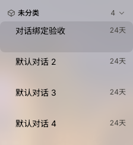
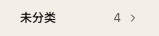
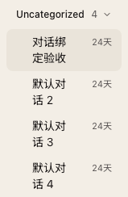

# Default 项目分组标题修复（#2113）

用户截图只显示立方体、数量和箭头。实际 PDL sidebar 模型将 `default` 名称设成空串，又漏传 `unassigned`，导致现有组件的“未分类”分支没有生效。

设计依据：本线程原始授权 `0001795765856029-000000-52ddd106`；小多子设计回执 `0001795769462364-000034-cbe693c2`；`DESIGN.md` 的项目名约定与现有 `threadRow.unassigned`。

修复将分组显示为“未分类 / Uncategorized”，用户自定义名优先；补齐中英文主题字典、传递默认分组语义和空 tooltip，沿用已有布局与隐藏新建按钮的声明。经典组件保留自定义名；v2 项目段头使用同一个 `CS.projOpen` 开关，折叠后仍显示名称与计数。

## 验证

- RED：四个实际 PDL runtime 用例（两主题 × 中英文）均因默认名称为空失败；补齐标题后，v2 的折叠回归继续失败，修正状态绑定后通过。
- `node scripts/run-with-node-env-test.mjs pnpm exec vitest run src/pdl/__tests__/runtime.test.ts src/components/ThreadSidebar/__tests__/project-display-name.test.ts src/components/__tests__/thread-utils.test.ts --reporter=dot`（`packages/web`）：269 项通过，无异步错误。共用夹具补齐空账号列表/选择返回值，以覆盖真实 v2 读取路径。
- Web `tsc --noEmit`、改动 JS 的 `node --check`、`git diff --check` 通过。Biome 无 error，保留既有 warning。
- 无头 Chromium：使用工位的实际 PDL scripts、chatModels、组件与主题加载器，接口与数据为独立的合成 fixture；按与宿主相同的加载顺序启动渲染器。两主题 × 中英文 × 240/160px × 展开/折叠，共 16 个状态通过：名称/数量、无水平溢出、折叠开合、选择对话。浏览器控制台无错误。浏览器和临时 HTTP 服务均已关闭，未连接运行实例的数据。

这份浏览器证据验证生产渲染代码和操作绑定，接口使用测试数据；不是 Alpha 或 live 部署验收。测量见 [browser-results.json](evidence/browser-results.json)，四张代表截图见下。

经典主题，240px 展开：

经典主题，160px 折叠：

v2，160px 中文折叠与英文展开：

## 关联前置修复

#2114 单独修复 AGY default 线程工作区 admission，当前 UI 分支不依赖或包含它。两处旧 API 测试标题按宪宪建议改为其实际保护的“线程记录不匹配 admission”，只改名称，不改断言或行为。
