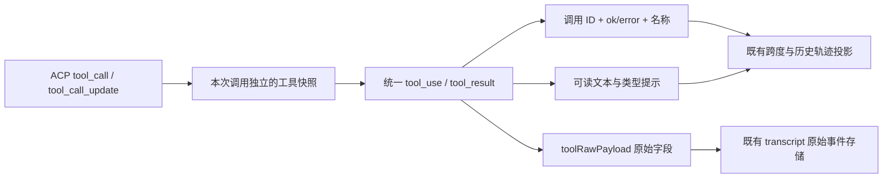

# #1466：DSH 接入审计的判断与通用 ACP 工具事件修复

## 原始输入与判断

用户指定的整改输入为研究 worktree 的 `docs/project-research/2026-10-12-multi-agent-client-configuration/dsh-integration-issues.md`。该文审计 PR `c6bb52f09` 与 DSH 参考源码 `d7432673`；本文实施基线是本 PR 后续 `3faa8a292`。两者之间只改验证环境和说明，ACP 缺口没有变化。本文没有修改研究 worktree 原稿。

前三项成立，已经用当前消费端重现：标准 `rawInput` 被遗漏、`ToolCallContent[]` 被当作对象、原生调用 ID/结果状态未输出且终态名称丢失。DSH 参考 `updates.ts` 确实发出这些字段。它们是宿主通用 ACP 映射缺陷，不能据此判断 DSH 没有返回结果或 ACP 不适合接入。

[ACP 官方工具调用合同](https://agentclientprotocol.com/protocol/v1/tool-calls)支持内容数组和任意 JSON 形状的 raw 输入/输出；更新可省略未变化字段，raw null 与省略不覆盖原值。官方区分程序名称 `name` 与显示 `title`，所以进度标题不应改写已知的工具名称。

| 审计项目 | 判断与本轮处理 |
|---|---|
| rawInput、结果数组、调用 ID/状态/名称关联 | 成立，同一组映射修复，适用于通用 ACP consumer |
| session/load 与 session/resume 错配 | 已在本 PR 修正；继续覆盖客户端和恢复回归，不重复登记为当前缺陷 |
| 模型/强度分组、opaque value、采用校验 | 已有实现，保留；本轮不修改模型、覆盖、command/argv/profile |
| L0/systemPrompt、steering、compact、原生子 Agent | 参考桥没有相应公开合同；需上游桥扩展和生命周期设计，不伪造支持 |
| capability/clientInfo/meta 协商 | 缺口成立，后续按实际实现与权限边界声明；本轮不为解析修复扩大文件/终端权限 |
| 权限/真人 question | 保持现有治理与默认策略；完整真人交互需桥与宿主共同支持 |
| usage/cost、媒体、跨进程恢复与取消静止 | 仍按实际供应数据与同版本运行证据判断，不从配置探针或本轮 fixture 外推 |

## 实施方案

唯一入口仍是 `transformAcpEvent`。工具分支抽到 `acp-tool-events.ts`，显示投影抽到 `acp-tool-content.ts`，避免两种终态分支继续各自漏字段；主转换器从原有超长文件缩减，不新增 DSH 专用分发路径。

- `rawInput` 优先于旧 input 别名。对象保持原参数形状；字符串、数组、数字、布尔在 `toolInput.rawInput` 中明确保留，不伪装成空参数。原始值同时保存在可选的 `toolRawPayload.rawInput`。
- 标准内容数组按顺序生成文本；diff 与资源保留类型/路径信息，媒体、terminal、未知块明确标识展示限制。完整原始块及 `rawOutput` 保留在 `toolRawPayload`；历史摘要沿用既有截断规则，不把展示摘要当完整审计数据。
- 原生 `toolCallId` 写入 `toolUseId`，`completed`/`failed` 只按真实状态映射 `ok`/`error`。未知或进度不凭结果文字提升为成功。没有真实 ID 或名称时不造一个。
- 每次 `AcpAgentService.invoke` 仍创建独立状态。新增调用快照由这个状态持有，不使用模块级 Map；结果完成后释放快照，已有 final 集合处理重复终态。不同调用、角色和 invocation 不共享参数或名称。
- 元数据更新沿用先前未变化的字段。已有程序名称不会被更新的显示标题覆盖；仅初次没有程序名称时兼容 title。旧 `toolName/name/tool_name/title`、`toolInput/input/tool_input` 及平铺文本结果继续支持。

| 收到事件 | 输出和状态 |
|---|---|
| 首次 pending/in_progress | 一条 tool_use，原生 ID 与输入进入快照 |
| 已知调用的重复或进度 | 更新可选事实，不重复生成待执行项，不当作结果 |
| completed/failed，先前有调用 | 一条同 ID tool_result，回用名称/必要原始数据，清理快照 |
| 首次看到的就是终态 | 同 ID 的 use/result 对；缺失名字仍未知，避免孤立结果 |
| 重复终态、终态后重投 pending | 丢弃重复，不重新开启已结束跨度 |
| 调用结束或另一个 invocation | 状态独立回收，不把上一轮映射变成全局会话配置 |

兼容边界：新增消息字段可选，旧消息和旧 transcript 无需迁移；不重写历史。配置、认证、安装版本、默认继承、ACP profile、command/argv、会话恢复和权限策略均未修改。

## 取证与验证

- 第一批 19 条标准字段反例在修复前全部失败；保留 `standard-fields-red.log`。随后另复现“仅更新显示标题覆盖程序名”的失败反例，保留 `name-update-red.log`。
- 修复后的工具事件与旧转换器初步回归 50 条通过；补齐名称边界与调用链验证后，最终全部 ACP 回归 **326 条：325 通过 / 0 失败 / 1 条 POSIX 权限检查在 Windows 明确跳过**。API TypeScript 编译 exit 0。
- 全量回归发现 9 个已有 Windows 断言问题；相关源码和测试在修前与 `3faa8a292` blob 一致。修正硬编码 `/` 的路径比较及拆分，权限测试明确仅检查 POSIX mode bits。Linux/macOS 继续保留原 0700 断言，Windows ACL 未由此测试验收；未修改运行时 bootstrap 或权限策略。
- `acp-tool-pipeline.test.js` 使用真实 `AcpAgentService`、`toStoredToolEvent` 和 `TranscriptWriter`，仅传输层使用确定性 DSH 形状 fixture。验证原生 ID 和失败状态穿过调用链、历史摘要截断、媒体不进入可读输出，以及写入 JSONL 的原始输入/结果块完整保留。生成独立临时目录，保留 fixture 数据，不清理既有存储。
- 没有调用真实模型，也没有操作当前 DSH 登录或生产 Redis。该证据是代码与存储投影验证，不是独立浏览器实测或安装版本 `0.2.0-rc.2` 的全功能运行验收。
- 后续同版本实测仍需要成功/失败工具、取消后上游静止、有历史的跨进程恢复，以及角色间模型/强度/MCP/身份隔离。L0、steering、compact、子 Agent 等桥扩展独立设计，继续列为未完成。

本轮修复统一进入 `feat/onboarding-first-run` / PR#1519，继续锚定 issue#1466，不另开实现线。生产环境未部署本轮 API 变更。

## 2026-10-13：最终输入必须进入用户历史

采纳 [zts 的续接 P1](https://github.com/zts212653/clowder-ai/pull/1519#issuecomment-6136120843)。前述 JSONL 验证不能证明历史界面正确：pending 无输入或仅有部分输入，后续 in_progress 补齐时，首次 tool_use 仍保留旧值；结果只投影输出，用户看不到最终输入。

- ACP 的唯一终态结果携带快照中的 `toolInput`。服务端保存为可选 `inputDetail`，与输出 `detail` 分开；不再次发 tool_use，不重开追踪跨度。
- 共享投影按 `executionRef + toolUseId` 将最终输入折叠回对应调用。v2 回复记录、引用校验与 classic CLI 使用同一输入；前台/后台流式处理保留该字段。原始 transcript 与消息历史转换后的 Story Player、调用轨迹均消费终态输入。
- 旧数据没有新字段时沿用原输入；孤立结果或其他 execution 的相同 ID 不修改当前输入。历史摘要仍有原 200 字符输入 / 1500 字符输出上限，完整原始参数保留在 transcript；不宣称摘要是无限长的完整参数，也不回写旧历史。
- `acp-final-input-history.test.js` 对完整、缺省、部分首帧输入先观察 RED，再验证转换器和可见投影。额外使用真实 `AcpAgentService → toStoredToolEvent → RedisMessageStore.append → 新 MessageStore.getById` 验证持久化边界；Redis 传输用内存 hash fixture，无生产连接。
- 前端新增反例验证真实 active/background 处理器、classic/v2 记录、JSON 往返恢复、Story Player、调用轨迹及跨 execution 隔离。此次定向 API 回归 110 通过；受影响前端回归 87 文件、572 通过 / 1 明确跳过。原有 352 条集成回归属于前一集成提交，未冒充新增提交的全量证据。

该续接修复仍不等于真实 DSH 安装、成功/失败、取消静止或跨进程恢复验收；这些边界维持前述未完成状态。

### 非作者复核后的配对补齐

对 `8a4b0882b` 的复核发现两处横向遗漏：Story Player 按 session/native ID 预索引最后结果，可能拿另一个 execution 的输入覆盖前一条；调用轨迹在显式 ID 未命中时仍回退同名 pending。均采纳，不将共享主投影的正确性外推到所有消费者。

- 消息历史转 raw event 保留工具 `executionRef`。原始消费者统一按 thread、cat、session、工具 execution（缺失时 invocation）界定范围；旧事件缺少 execution/invocation 时仍在原 session 内处理。
- Story Player 只消费先前存在的 pending，配对结果索引到具体 use event，避免同 session 的 legacy ID 顺序重用被未来结果覆盖。无 ID 的旧位置配对也限定同范围；显式 ID 未匹配不退化为无 ID 配对。
- 调用轨迹按同一执行身份匹配；显式 ID 未匹配作为独立结果展示，不能更新同名调用。仅旧无 ID 事件保留同范围的名称/位置兼容。
- 新增 5 条反例全部观察 RED：原始跨 execution、历史转换丢身份、legacy 顺序重用、orphan ID、并发同 ID 轨迹。修后及旧 Story Player/轨迹/实时输入保护集 **9 文件 / 81 pass**，前端完整类型检查另核当前源码。这是后续增量证据，不冒充再次运行前述 572 项。
