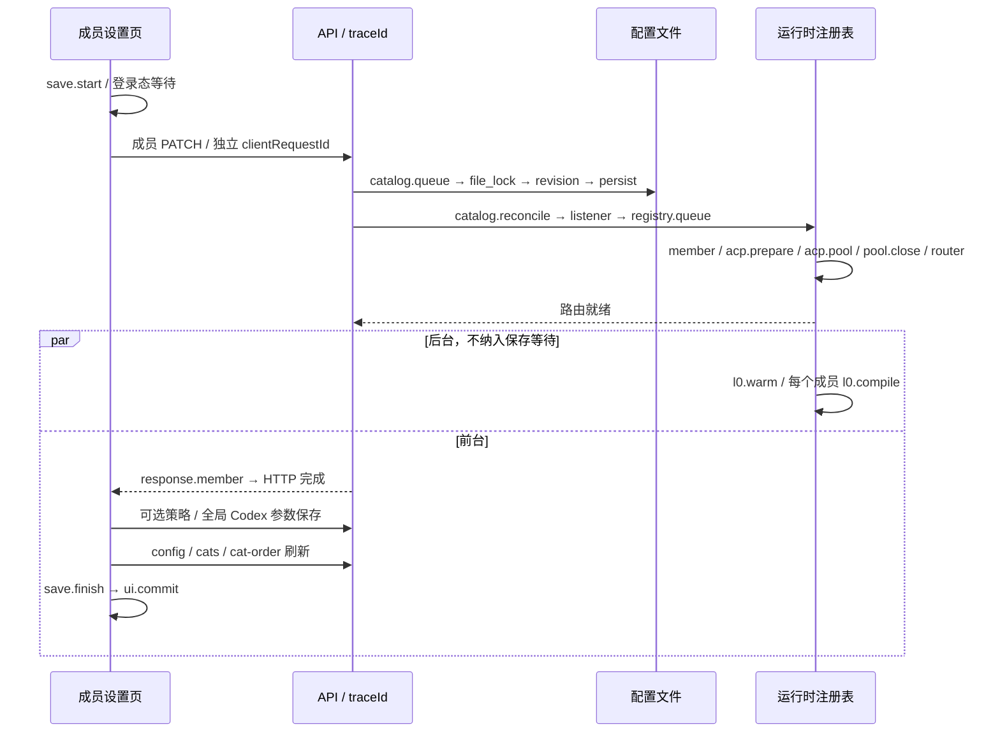

# 成员设置慢保存：诊断链路与取证

## 原问题与本次边界

生产日志曾记录 `PATCH /api/cats/opus-5` 耗时 11347ms（旧进程 req-4bdv）。此前只有请求开始/结束和不带请求 ID 的注册表同步消息，不能定位中间约 11 秒。将 L0 预热移至后台移除了一个已知阻塞点；隔离环境速度正常、生产无字段变更的请求较快，都不能证明原问题已解决。

用户要求：「诊断埋点的日志需要进行实施，保证后续复现可以直接分析出根因。」本次交付可关联的阶段证据，不宣称已经重现或修复原来的 11 秒延迟。继续 PR #1519 / `feat/onboarding-first-run`，不修改成员配置、认证方式或持久化格式。

## 每次点击记录什么



- `event=member_save`，默认 info 级别，复用现有 API stdout + 文件日志及 14 个滚动文件策略，无需打开 debug。主动将 LOG_LEVEL 调高至 warn/error 会过滤诊断，复现时须保持 info。
- 每次点击一个 `traceId`；每个逻辑 API 请求一个 `clientRequestId`；实际 HTTP 尝试仍使用 Fastify `requestId`。401 重试的 attempt=1/2 独立记录。服务端带 PID、构建 revision（开发构建可能没有）、父子 spanId。
- `start` 在操作前落日志；完成/失败带单调时钟 `durationMs`。未结束的 HTTP 每 2 秒记录 `slow`、仍活动的阶段、定时器延迟 `timerLagMs`；客户端每 2 秒保存并上报进度。请求关闭记录 aborted。
- 浏览器区分 session.wait、session.refresh、http.attempt、member.write、strategy.write、codex.write、refresh、ui.commit；失败仅记录固定分类 timeout/aborted/network/other，不记录异常消息。`save.finish` 是异步流程结束，`ui.commit` 是 React 提交退出 saving 状态，页面提前卸载时可能没有后者。
- 服务端区分进程内配置队列、跨进程文件锁、版本校验、持久化、注册表事件监听器、串行重建队列、每个成员的服务创建、ACP 准备/池复用、旧 ACP/Codex 池关闭、响应构造、策略持久化及全局配置审计。
- 字段只记录白名单中的名字，例如 clientId/cli/expectedRevision。配置值、账号、凭据、命令参数、消息正文都不进入新增日志。

## 下次复现后如何分析

正常上报成功时，无需用户打开开发者工具。根据复现时间和普通请求日志里的成员路径定位 `member_save`，或运行：

```powershell
node scripts/analyze-member-save.mjs --log <实际API日志文件>
node scripts/analyze-member-save.mjs --log <实际API日志文件> --trace <traceId>
```

不带 trace 返回日志中最近活动的 10 次保存。跨滚动文件可重复传入 `--log`。生产 stdout 的实际位置由启动器记录；常规日志目录通过 `/api/config/env-summary` 的 LOG_DIR 确认，默认是 API 工作目录下 `data/logs/api`。应保留对应日期的所有相关文件，不能只截最后几行。

汇总输出包含浏览器总耗时、UI 提交、每个请求及阶段、修改字段名、后台阶段和未完成 span；浏览器重复上报按 seq 去重。

| 证据 | 可以得出的结论 |
| --- | --- |
| session.wait 长、服务端尚无成员请求 | 发出请求前卡在登录态准备 |
| http.attempt 长、服务端 http.request 短 | 排查网络/代理、浏览器请求排队或接收响应；不可归因于配置写盘 |
| catalog.queue / file_lock 长 | 有配置写入竞争，结合其他请求找持锁者 |
| registry.queue 长 | 等前一个注册表重建；按各请求 span 交叉核对 |
| registry.member / acp.prepare / pool.*.close 长 | 具体成员/客户端初始化或旧池回收阶段阻塞 |
| PATCH 短、refresh 长 | 成员已落盘，慢在后续页面数据刷新；继续看三个关联 GET |
| save.finish 短、ui.commit 晚 | 浏览器渲染提交存在额外等待 |
| 只有 l0.warm 长且 background=true | 后台预热耗时，不是保存 await 链的一部分；它仍可能争用 CPU/磁盘，不能据此排除资源竞争 |
| start 后无 finish | 在所给日志里未完成；先排除日志缺段、进程重启，再判定是否卡住 |

计时包含子阶段且可能并行，禁止把所有 durationMs 相加。`timerLagMs` 高提示事件循环调度受阻，仍需系统 CPU/磁盘/进程证据才能区分底层原因。这套日志用于定位阻塞阶段和责任链，不保证仅凭应用日志解释任意操作系统故障。

## 上报失败与安全边界

浏览器通过独立 `/api/diagnostics/member-save` 最佳努力批量上报，2 秒超时，不等待上报完成才结束保存。接口要求真实 session，拒绝任意字段/阶段、负数/无效耗时、超过 120 个事件或 32KiB 的请求；每分钟最多接收 3000 个事件。浏览器耗时标记 `source=browser/trustedTiming=false`，不作为鉴权或服务端事实。

上报复用 API 客户端的 401 会话恢复，覆盖 API 重启后旧标签页 cookie 失效、普通写入仍能成功的情况；持续上报失败不弹错误提示。上报自身不带保存追踪头，避免递归记录。

即使网络或上报失败，当前标签页 sessionStorage 的 `member-save-diagnostics:v1` 保留最近 10 次保存、每次最多 120 个事件；控制台 `[member-save]` 给出 ID 和总耗时。不要在取证前关闭该标签页。若服务端汇总明确显示缺少浏览器证据，需补充此本地记录，不能将缺失视为零耗时。页面完全崩溃且本地存储禁用时无法保全浏览器记录，但埋点不阻断保存。

## 验证证据

- 回归 RED：原页面没有 x-clowder-save-id；后端排队/未完成阶段没有关联日志。新增断言失败后才实现。
- Fastify 真实请求钩子测试：人为阻塞 pool.codex.close，请求完成前已记录 slow + 活动阶段，随后记录 HTTP200；并发保存、后台预热、409、无 session/伪造身份、非法数据和诊断 logger 异常均覆盖。
- 前端测试：401 两次请求、登录态恢复、保存后刷新尚未返回时保持追踪、UI commit、超时分类、离线/存储失败和容量上限。
- 实际隔离页面 `localhost:5122` Claude→Codex→Claude，两次真实字段写入并恢复。首个 trace `24c85ca6-6221-4f70-885e-7eb67f2869d4`：浏览器 207.1ms、UI210ms、成员 PATCH107.88ms、后台 L0 707.34ms，三个刷新 GET 同 ID；恢复 trace `25e31ea8-0465-41b8-bdac-89837bd60dd0`：浏览器152.2ms、Codex 池关闭0.12ms。
- 上述数据验证日志覆盖，不替代原生产 11 秒问题的验收。原始日志/截图仅在本机 artifacts 中保存，凭据和生产历史不提交到 Git。
