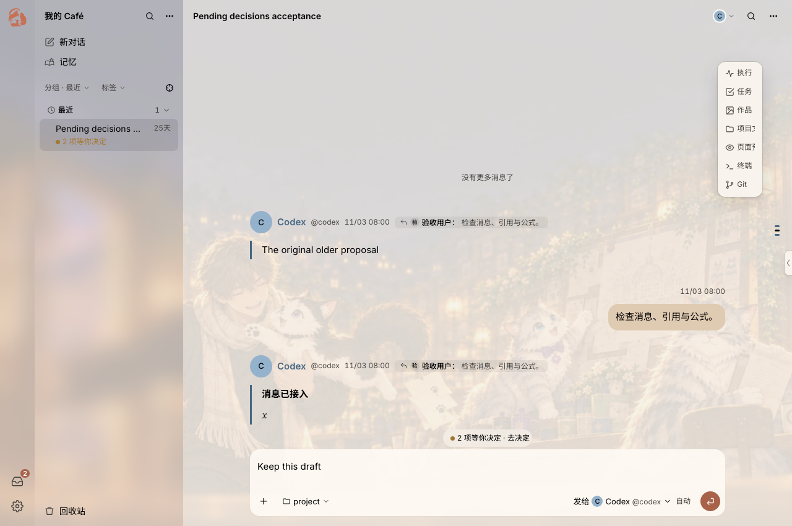
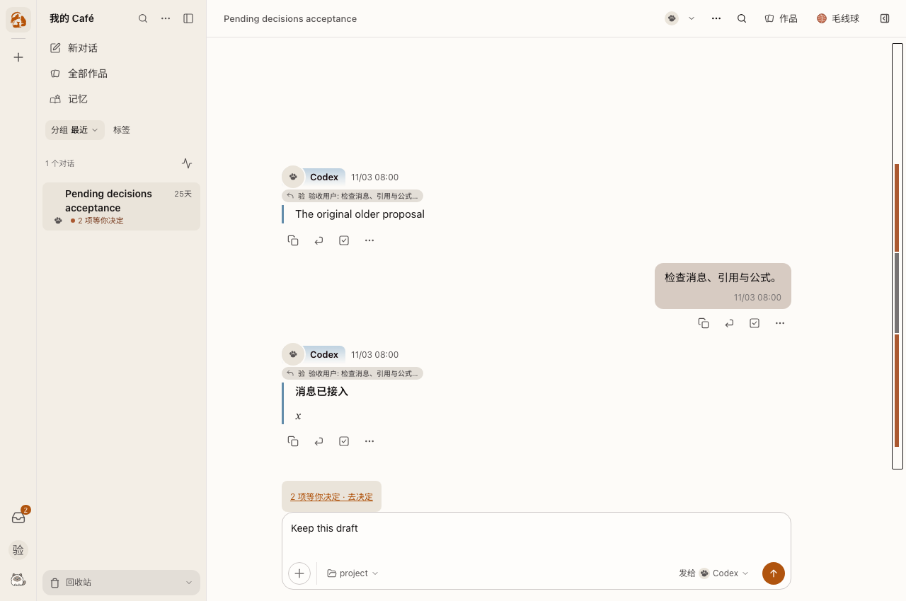
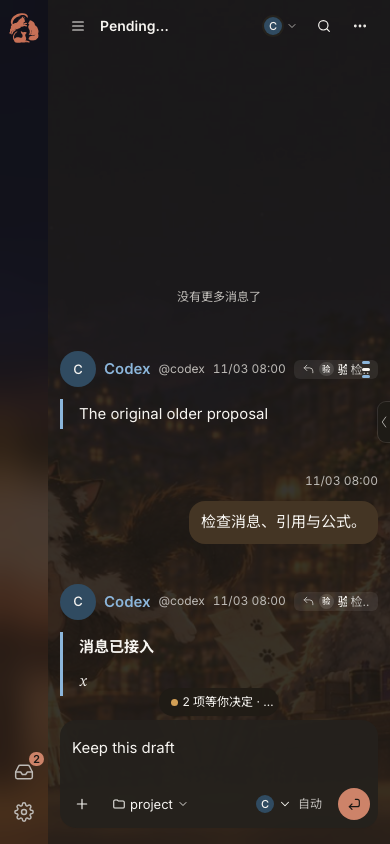
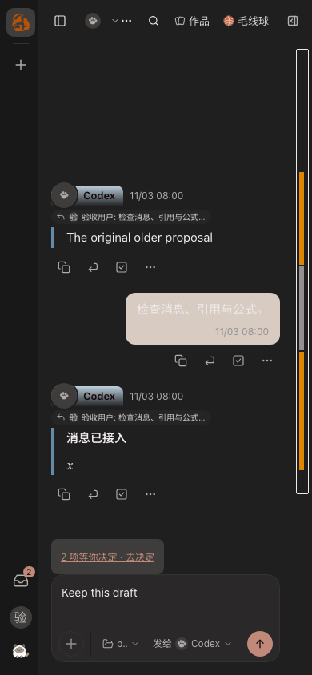

# 宿主待决审批与定位核验（#2128 / #2130）

原始要求：通用问题应在宿主全局修复。对应 [#2128](https://github.com/zts212653/clowder-ai/issues/2128) 与 [#2130](https://github.com/zts212653/clowder-ai/issues/2130)。实现基线 `next@77042acc6ae52ecb3001a2fe08885e38dd822e6b`，工作分支 `fix/issue2128-2130-pending-decisions`。

## 会话内的待决入口

侧栏出现「N 项等你决定」时，点击该提示或输入框上方的「去决定」。一项会直接定位原消息，多项会先列出事项摘要、时间和陈旧提示，再定位所选原消息；尚未加载的历史消息会继续分页读取。没有可用消息坐标的事项回到全局待办核对。原卡中的批准、拒绝仍使用原审批接口，决定被权威来源确认后，提醒随刷新更新，输入中的草稿保留。

读取失败或分页未完成时保留「已知 N 项待核对」，不声称这是完整总数。切换账号立即清掉上一账号的待决投影。陈旧提醒不等于提议已失效，实际是否可操作仍由当前业务状态和原卡来源校验决定。

## 实现与信任边界

- F221/F231 按真实公开 GET `{ proposalId, status }` 读取；不扩大 API 字段，尤其不暴露服务器的写入路径。F231 展示原卡中已有的 diff，结合认证用户、统一待办的精确原卡发布证明与 Approval Hub 的同版记录恢复操作。
- F231 的卡片投影与共享原始 GET 使用不同缓存部分；同步校验 owner、thread、message、block，复制卡片不能借用另一张原卡的授权。终态必须与该用户、该原卡的权威 settled 记录一致。
- 审批前强制重读并比对证据。F221 的 decisionDigest 继续来自原提议；来源变化、换账号、无效响应或不可证明的结果都不能写入。
- 逐一核对现有适配器：F128/F221/F231/F321 的提醒阈值为 7 天，F193 为 3 天，F225 为 24 小时，F260 为 14 天。这七种来源只有 canonical `open` 可以越过陈旧阈值；身份、生命周期、版本、坐标、内容凭据等匹配仍执行。其他来源的过期判断保留。
- 会话摘要与刻度只投影现有 inbox 数据，不另建审批状态。分页等待合并在当前加载上，渲染完成后续接；旧会话的加载结果不能完成新会话的定位。

Architecture cell：既有 PDL 聊天宿主、Approval Hub / 原卡读取；Map delta：none。新增文件仅为 F231 原卡投影的纯读取模块，未增加存储、后台调度器或审批 authority。共享读取器原有 F193/F221/F260 消费者保持原入口，F231 显式复用精确原卡证明。

## 核验入口与结果边界

作者工作目录 `/Users/yuki/Documents/AINest/fix-workspace`。浏览器测试通过随机独立 loopback 端口启动该 checkout 的真实 PDL scripts、主题包与模型，所有收据为公开合成夹具；持久展示使用同一夹具的 `http://127.0.0.1:3288/?theme=sys:1` / `?theme=pkg:v2`。未连接生产 API 或操作真实提议。Hub typed preview 回执为 `unconfirmed / no_matching_client`，不声称已在用户面板打开。

浏览器路径：default/v2 桌面与 390px 深色窄屏 → 会话摘要 → 多项菜单 → 历史原消息定位 → 来源确认处理完成后的提醒刷新 → 草稿仍在。截图在同目录，来自真实渲染器；审批读写由 React 绑定集成测试单独验证，未把浏览器夹具中的导航动作冒充生产审批。

| default 桌面 | v2 桌面 |
| --- | --- |
|  |  |

| default 深色窄屏 | v2 深色窄屏 |
| --- | --- |
|  |  |

从 `packages/web` 执行：

```sh
node scripts/run-with-node-env-test.mjs pnpm exec vitest run src/pdl/__tests__/runtime.test.ts src/pdl/__tests__/memory-message-proposals.test.ts src/pdl/__tests__/proposal-models.test.ts src/pdl/__tests__/read-entry.test.tsx src/pdl/__tests__/inbox-refresh-authority.test.ts src/components/rich/__tests__/domain-approval-source.test.ts src/components/shell/mailbox/__tests__/approval-match.test.ts src/pdl/__tests__/appearance-default.test.ts src/pdl/__tests__/plugin-raw-contract.test.ts src/pdl/__tests__/v2-recovery-notice.test.ts
node scripts/run-with-node-env-test.mjs node --test test/browser/pdl-pending-decisions.test.mjs
node scripts/run-with-node-env-test.mjs node --test test/browser/pdl-message-jump-race.test.mjs
pnpm exec tsc --noEmit --incremental false
```

作者核验结果：10 份单测/绑定测试共 **302 项通过**；原生滚动竞态浏览器测试 **16 项通过**；待决入口浏览器用例覆盖 default/v2 × 桌面/深色窄屏四个场景。TypeScript 检查与 capability-tips 检查通过（后者仍提示公开仓已有未导出来源的警告）。

回归覆盖真实 id/status、已审批结果确认、复制原卡拒绝、换账号、失真 mock 拒绝、陈旧提议与内容变化、并发分页、旧会话分页晚到、部分读取和草稿保留。部署后的真实用户会话验收仍需在合入后的隔离验收环境完成，两个 Issue 在独立审查和验收前保持打开。
