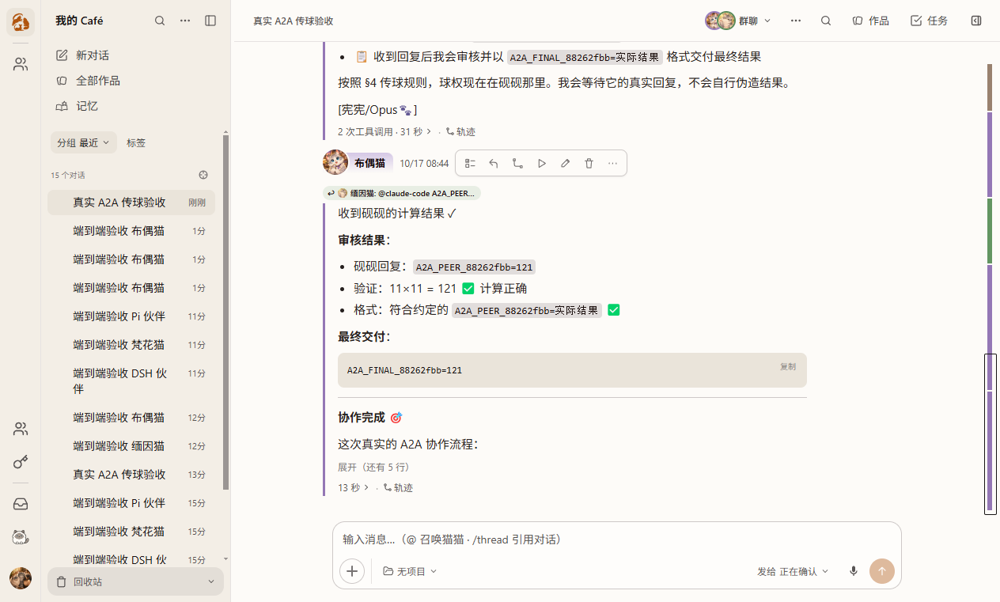
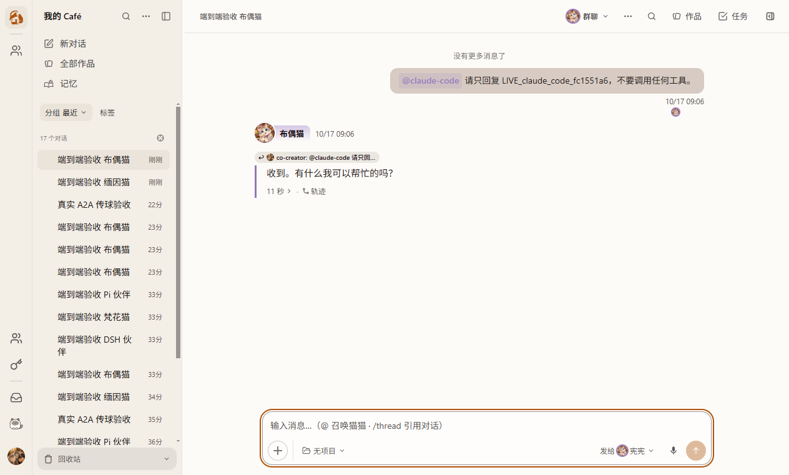

# Claude 收到正确任务却只问候：当前诊断

**默认连接的历史失败仍按原记录保留，不回填为通过。** 2026-10-17用户明确决定：“我认为是因为claude本身后面llmapi接口的问题，我们不需要纠结于此。”据此将该案例按外部LLM API兼容问题保留，不再作为本PR的Clowder代码修复阻塞，不再重复真实调用追查，不持久启用实验性兼容参数。本轮没有换地址、API key、模型或carrier；诊断转发没有进入产品，也没有改写本机原客户端配置。此决定不替代网关内部根因证据，也不豁免Clowder对真实任务发送、错误归属和历史保留的责任。

## 预期与实际

用户从一键创建进入聊天后，Claude 应执行当前消息。异常时 CLI 正常退出、HTTP 返回成功，正文却是“收到”“等待指示”等问候；因此退出码、认证探测和任意回复都不能作为成功判据。

安装版与独立 CLI 均出现过此症状。准备请求、CLI 本地用户输入和线上请求中的任务文本相同，不支持“页面没发送”或“宿主只发了句点”的解释。当前 CLI 为 `2.1.301`，该连接选择的线上模型为 `claude-opus-5-5`，客户端的 `[1M]` 选择没有被诊断替换。

## 能区分解释的对照

| 对照 | 实际结果 | 能证明什么 |
|---|---|---|
| 原请求格式 | 可反复复现只问候；也存在偶然正确执行 | 默认路径不稳定，不能用一次成功关闭 |
| 仅诊断转发：把尾部 system 块移到顶层 system | 原用户任务/连接/模型保持，3/3 正确执行 | 请求格式是有区分力的变量；不是可直接发布的修复 |
| 仅禁 experimental betas、声明模型 capabilities，或仅关闭 mid-conversation system | 尾部 system 仍存在，仍复现异常 | 不能把这些单独称为修复 |
| CLI 自身同时关闭 `mid_conv_system` 与 `per_turn_effort` | 观测请求不再含尾部 system；最小组合通过；关闭四项的3次对照也通过 | 需要同时考虑两条能产生会话内 system 消息的路径 |
| 原地址直连，不经诊断转发；`--settings` 注入最小组合 | 前置默认失败；3次兼容调用通过；恢复默认后再次失败 | A/B/A 可在原连接上复现，不依赖转发修改请求 |
| 安装版现有成员 PATCH 写入临时 CLI 参数 | 同一角色3次新随机任务通过，原连接/模型/工具字段不变 | 产品原有参数入口确实能传递该组合 |
| 安装版 Claude 首选 → Codex 执行 → Claude 整合 | 52.282s；单一初始 POST、恰好3次真实调用自然 done、因果链通过、cleanup=[] | 不止是短句单聊；能消费真实伙伴结果并完成回传 |
| 恢复与退出 | 作者角色参数已恢复；Redis SAVE、自有进程树及四端口全部释放 | 临时诊断没有作为默认配置遗留 |
| 当前包完整Setup失败→同版修复后，再走默认产品路径 | 其余4工具通过；Claude再次只问候，整轮4/5 FAIL | 准备输入与原生CLI用户输入完全相同、任务标记存在；原生最终正文无结果且自然done，cleanup=[]，没有被测试提前取消 |

目前可复核的定位是：**该 CLI / 原 API 连接组合对会话内 system 消息存在兼容异常。** 官方支持模型上的正常协议不能因此被称为错误；没有网关内部证据，不能断言网关具体丢弃了哪个字段或是哪一层转换的缺陷。独立 CLI 的复现也说明不能仅归因于本 PR 的消息发送实现。

安装版在临时显式兼容参数下的真实回传与审核结果（不是默认配置成功的替代证据）：



恢复默认参数后的真实产品失败仍存在，不能用上图成功替代：



[官方协议说明](https://platform.claude.com/docs/en/build-with-claude/mid-conversation-system-messages)说明会话内 system 消息的模型范围及位置约束。上述负向 capability 开关来自本机所装 CLI 的实际实现与取证，未在本轮找到官方稳定配置文档；它有版本依赖，不能悄悄变成全部 Claude 连接的默认策略。

## 已验证的最小、可撤销兼容配置

使用成员已有 `cliConfigArgs` 入口，显式追加一个 settings 文档；managed hooks 仍走原来的合并路径，没有替换 carrier：

```json
[
  "--settings",
  "{\"env\":{\"CLAUDE_CODE_MODEL_CAPABILITIES\":\"-mid_conv_system,-per_turn_effort\"}}"
]
```

这只改变协议能力，不改地址、密钥、模型或思考强度配置；关闭的是会话中动态设置 effort 的传输能力，不是静默换成低强度模型。按用户最新决定不持久启用，参数仅作历史诊断证据。其他连接不应因本机单个兼容案例被全局降级；原有显式 CLI 参数也不得被覆盖。不能将临时参数下的成功记为“未配置的默认一键创建已修好”。

“配置值未改”不证明实际采用的思考强度完全等价。关闭per_turn_effort会改变逐回合effort传递路径，缓存/会话内动态指令也可能受影响；当前最小随机任务和A2A结果不足以证明这些语义全部等价。因此这里只记录可撤销缓解，未全局启用，按用户决定不再要求持久启用选择。

## 复跑与证据

- 主旅程、选择/故障矩阵、单伙伴自然终态、A2A 因果及历史回读入口见[完整验收矩阵](../plans/pr1519-onboarding-e2e-acceptance-2026-10-17.md)。
- 安装版随机任务和 A2A 分别复用 `native-team-live.harness.mjs`、`native-team-a2a.test.mjs`；只在明确作者实例中执行，创建的测试历史保留。
- 私有证据根为本轮 `startup-read-ahead-20261017/`；直连 A/B/A 在 `claude-wire-direct-settings-evidence.json`，最小组合对照在 `claude-wire-native-capability-minimal-evidence.json`。
- 安装版 `claude-installed-compatibility.log`、`lifecycle-0927-claude-compatibility/{live-journey.json,restoration.json}`、独立 A2A 的 `live-journey.json` 和最终停止回执分别保存。不公开认证、上游私有地址或完整私有请求。
- 完整修复后默认失败见 `lifecycle-0927-full-setup-repair-live-correct-receipt/live-journey.json`、原生journal对账 `lifecycle-after-repair-claude-failure-evidence.json`；保留原assistant messageId、CLI sessionId、原生done与零清理动作，不重新标绿。
- 当前 EXE 为 `0927b6d0a` 实际编译产物，SHA-256 `969CD34C7E4E41D65DF52987BE89A253267B6FBA0DF49D7B6660E2C948230AE3`；本轮没有把后继测试/报告提交戳写入旧产物。

这份诊断没有把默认失败改判成功，也没有把外部连接的兼容性边界扩张为对所有供应商的保证。[当前验收判定](../plans/pr1519-e2e-current-verdict-2026-10-17.md)仍未通过的原因是新代码实页/安装包、适用平台及review等余项；本外部API案例不再单独阻塞Clowder代码交付。
