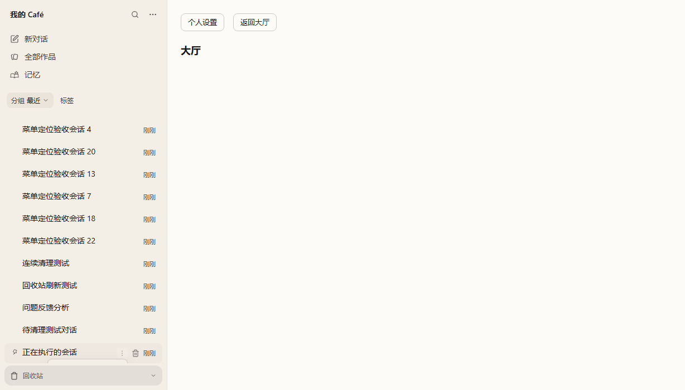
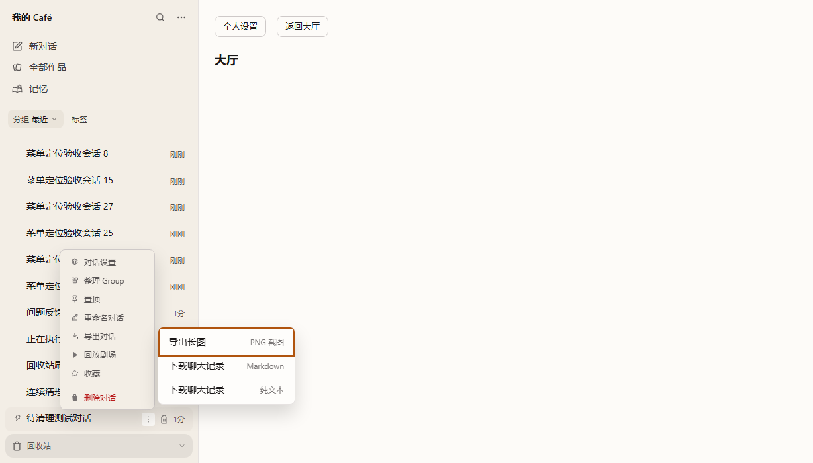

# 侧栏会话菜单可见性

用户在侧栏底部打开会话「更多操作」时，菜单被列表裁切，必须再次滚动才能使用。
本次由鲸鲸设计、砚砚审核实现；验收目标是点击后菜单立即可用，列表位置不变。

## 根因与修复

`ThreadItem.tsx` 原本把菜单以 `absolute right-0 top-5` 放在会话行内，而
`ThreadSidebar.tsx` 的列表使用 `overflow-y-auto`。提高 z-index 无法避开祖先的裁切。

主菜单和导出子菜单共用 `useAnchoredMenu`：

- 菜单通过原生 `popover="manual"` 进入浏览器顶层，使用 fixed 定位。仓库已有
  `FileActionMenu` 使用相同顶层机制，无新增依赖。
- 保留 DOM 归属及行点击 guard，父菜单仍能识别子菜单内部的点击。
- 主菜单优先向下，放不下时整体上翻；两侧都不足时，选择空间较多的一侧并内部滚动。
- 导出格式优先在父菜单右侧打开，右侧不足则放左侧，并限制在视口内。
- 保留原菜单项、顺序、文案、宽度和表面样式；保留侧栏滚动和虚拟列表实现。
- 侧栏尺寸改变时重新定位；窗口缩放或锚点祖先容器滚动时关闭。菜单内部滚动不会带动列表。
- 支持方向键、Home/End、分层 Escape、子菜单 ArrowRight/ArrowLeft、Tab 退出和焦点返回。

原设计建议使用 body portal。本次审核选择现有的原生顶层机制，实现相同的裁切隔离，
同时保留主题继承、父子 contains 判断和现有组件测试的 DOM 归属。
窗口缩放会连带触发列表布局和滚动，因此采用统一关闭策略，重新打开时按新尺寸定位。

## 滚动与焦点约定

只在滚动可能移动当前锚点时关闭：侧栏列表滚动会移动或卸载会话行，fixed 菜单不能留在旧坐标继续操作。
主聊天区域等无关容器滚动不移动侧栏触发器，因此保留两层菜单及焦点，不做无意义的重定位。
父菜单内部滚动保留父菜单；如果导出项随之移动，只关闭导出子菜单。子菜单内部滚动不关闭任何一层。
滚动或 resize 关闭时，只有焦点仍在被关闭面板中才归还锚点，不从其他页面控件抢焦点。

点击或键盘打开主菜单时聚焦首个可用项；导出子菜单打开时聚焦首个格式，让使用者随时能接着用方向键操作。
`Escape` / 子菜单 `ArrowLeft` 是分层返回：子菜单关闭并聚焦「导出对话」，父菜单关闭并聚焦 ⋮。
`Tab` / `Shift+Tab` 则离开整个菜单层级，关闭主菜单和子菜单，以根触发器为页面顺序的参照，
让同一次按键继续到它后一个 / 前一个可聚焦页面控件，不停在 ⋮，也不逐项遍历菜单。
v2 浏览器场景中分别落到同一行的快捷删除按钮 / 会话标题链接；菜单项或导出格式都不因 Tab 被激活。

## RED / GREEN

基线：`6c2021d494b7fe0f7a5423868709d4ae99c097ed`。

Windows Chromium、1228×700、v2、滚到底部再点击菜单：

| 观察项 | 修复前 | 修复后 |
|---|---|---|
| 菜单纵坐标 | 644–887，超出视口 | 377–620，完整上翻 |
| 菜单项中心点击命中 | 0/8 | 8/8 |
| 打开是否需要改变列表滚动位置 | 需要用户再次滚动 | 不需要 |





## 验证入口

```powershell
pnpm --filter @cat-cafe/api exec node --import tsx --test ../web/test/browser/thread-menu-visibility.test.mjs
pnpm --filter @cat-cafe/web exec vitest run src/components/__tests__/thread-item-actions.test.tsx src/components/ThreadSidebar/__tests__/thread-row-v2.test.tsx src/components/ThreadSidebar/__tests__/thread-settings-flow.test.tsx src/components/__tests__/export-button.test.ts
pnpm --filter @cat-cafe/web exec tsc --noEmit --pretty false
```

浏览器用例加载真实 ThreadSidebar、菜单和产品 CSS，复用隔离的线程 API fixture，
覆盖 v2/classic、顶部/底部、360px 暗色、矮窗口、两层菜单、键盘、下载和删除确认。
导出响应使用合成 Markdown，检查实际 ExportButton 下载链路。
该用例已接入 Web `test:browser` 默认入口。

验证不连接生产 Redis，不调用模型。浏览器及内存 API 在测试结束时关闭，临时数据保留。
截图是隔离 Chromium 中的合成会话，不是在线安装版验收；本次不包含客户端部署。
