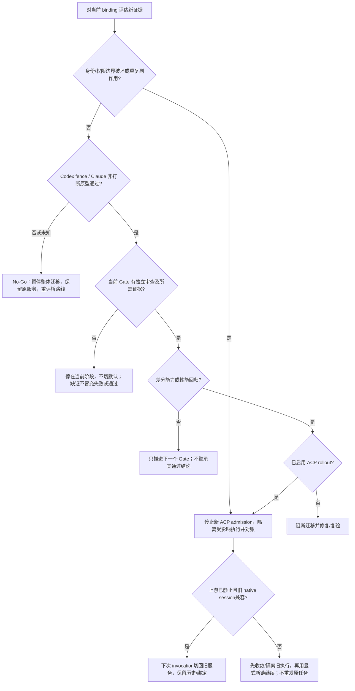

# ACP 统一 client：可实施方案与不退化合同

状态：方案草案；统一路线已获本地用户支持，协议扩展与默认迁移尚未通过设计审查和运行验收。

实施与独立审查进展见 [执行回执](execution-evidence.md)：W1 已取得真实 CLI/官方 SDK、持久历史及组件 UI 刷新证据，W2.S 安全下限已落盘；[W4.P/W5.P 已各自独立 Go](prototype-gates.md)。[W2 公共 consumer](w2-public-contract-evidence.md)已实现；[#1598 图片产品链](product-image-ui-evidence.md)已在冻结产物上完成真实模型、持久历史、温刷新及 API/Redis 保存重启后的冷重放。完整 G0–G5 与整体迁移仍未放行；CodeAgentCLI/MiniMax 按用户意见暂时跳过，未记通过。

## 目标与原始需求

用户在 2026-10-13 要求：先建立独立 worktree，沿 #1590 的统一方案完善可落地技术方案，用该方案验证 ACP，必要时实现整体优化；必须定义功能可用性、可验证性，保证实际能力不下降。

本方案选择 **ACP 作为本地 agent 的统一宿主 wire，标准能力 + 协商扩展承接现有原生增强**。不是仅增加一个可聊天的 ACP provider，也不是在现有原生路径旁永久新增另一套控制入口。

先补确证的 Claude tool_result 漏接；随后以相同用户旅程对照完整 ACP 路径。原生后端可以继续存在于桥内部，宿主侧会话、事件、权限、控制统一经过 ACP。迁移未通过时原路径保持可用，但该成员的统一工作仍记为未完成。

## 讨论来源与决定边界

- [#1590 原文](https://github.com/zts212653/clowder-ai/issues/1590)提出 ACP-first 公共层与原生增强/兼容路径，并要求同合同对照。
- [zts 首轮](https://github.com/zts212653/clowder-ai/issues/1590#issuecomment-6140080514)与[第二轮](https://github.com/zts212653/clowder-ai/issues/1590#issuecomment-6140218308)认可先补漏接，但判定证据不足以决定默认 ACP-first。
- 本地用户进一步授权完整统一方案的构建；**这不等于上游接受迁移，不代替 #1519 review，不分配其他维护者的工作**。
- #1463 的 availability owner、#1466 的用户旅程继续复用；#718/#483 的关闭状态不变。

本稿把“能通过 ACP 表达”与“当前桥已实现”“宿主已消费”“真实环境已验收”分开。源码可行性不能替代运行可用性。

## 设计初稿冻结现场（2026-10-13）

此表保留方案来源；公开PR的新main基线见[复验回执](public-pr-evidence.md)，原型的当前fixed pins见[原型回执](prototype-gates.md)。

| 对象 | 本次基线 | 用途 |
|---|---|---|
| 本地 main / 新 worktree | `3add05c161b822a3acfc306cc94570cab4f58c91` | 当前接口与原生能力盘点 |
| 上游公开 main | `dc582b899ebdcb6f7bb3c6abf2eb81090f8c1c3d` | 对应 zts 的漏接证据 |
| #1519 候选 | `a89f25ab0eaecdb3d1a9e23b6b0e5de33bfdb2a2` | 已有 ACP 工具/恢复补齐；未合入不能算 main 已有 |
| Claude ACP | v0.70.0 / `d0aafb1ca26427285ffaeac8d8a4452fff28e9c3` | tool_result、systemPrompt、steering 源码 |
| Codex ACP | `51f78d67e46c3a96ee8d8bf4e43fc917ab21c73e` | 指令扩展与精确 turn 差异 |
| ACP 文档 | 2026-10-13 读取的 v1 官方页面 | 标准与扩展边界；实现时另冻结 schema/SDK hash |

main 比 origin/main 多 33 个提交；为保护已有现场，本次没有推送或重置 main。worktree 位于 `worktrees/feat-acp-unified-client-plan-1590`，分支同名 `feat/acp-unified-client-plan-1590`。本次不操作生产服务与持久数据。

## 设计阅读顺序

1. [架构与运行状态](architecture.md)：统一在哪层、桥的实现策略、生命周期与真相源。
2. [协议合同](contracts.md)：能力协商、指令、工具、权限、turn 输入与遥测。
3. [能力对照](capability-matrix.md)：哪些现有能力必须承接，哪些已有修复应复用。
4. [验证与迁移门禁](validation.md)：可运行检查、真实差分旅程、性能和不退化定义。
5. [实施路线](implementation.md)：具体工作单元、源码落点、依赖与回滚。
6. [来源与本次证据](sources.md)：版本、源码锚点、未决项和实测范围。

## 范围

完整方案覆盖 Claude print/SDK/bg daemon/interactive PTY（含 OAuth/API-key 与 canary/fallback）、Codex app-server/exec、现有通用 ACP 成员及本地 legacy agent 的迁移规则；包括身份、账号环境、工具与多模态、权限/真人交互、恢复、取消、usage、压缩、子调用、steering、结构化原生控制与现有 experimental opt-in。

第一条验证切片是 **Claude 成功/失败工具 → 持久历史/实时与重放 → 跨进程恢复**；最有决定性的两条扩展切片是 Codex expectedTurn 和 Claude 非打断 notice。三条同时服务统一终态，不能用第一条成功宣布全部可行。

A2A、云浏览器、远程 task agent 保留其不同 runtime contract，不强装成本地 ACP session。Kimi/OpenCode/DSH 等按自身已用能力验收，不要求获得从未拥有的 Codex goal 等特性。AGY 的 L0 与权限要求沿 F325，桥缺必需能力时阻断该成员迁移，不能偷偷换身份或计费方式。

## 不退化的定义

对每个实际成员绑定 `b`，冻结迁移前能力集合 `B(b)`、产品必要能力 `R(b)`、已启用实验能力 `E(b)` 和各自语义/证据。ACP 路径必须满足：

`B(b) ∪ R(b) ∪ E(b) ⊆ ACP_verified(b)`

`verified` 需满足对应语义、权限与数据边界、运行层证据和性能门槛。修补已有 bug 后的合同作为对照；不能把原 parser 丢结果当成可接受的等价行为。unknown 不进入 verified，禁用现有按钮不算能力保持，原生回退不算统一完成。

| 完整方案验收项 | 文档落点 |
|---|---|
| D1：统一目标、范围和原生增强策略明确 | 本文、architecture |
| D2：逐项能力、可用条件、缺口与实现落点 | capability-matrix |
| D3：会话/turn/permission/control 状态与 crash/并发合同 | architecture、contracts |
| D4：同版本差分验收、真实 UI/历史证据、性能与回滚 | validation |
| D5：先补漏接、复用 #1519、到完整迁移的依赖路线 | implementation |
| D6：事实来源和本次实际验证范围可追溯 | sources |

上述是**方案交付验收**；运行实现的 G0–G5 见 validation，当前不能标通过。

## 快速决策：暂停、回滚或继续

技术 No-Go 不等于否定 ACP 标准，也不能自动降低能力要求。携原型 raw wire/native receipt、失败反例及桥维护成本重新评估；W1 窄修复继续独立交付。完整回滚条件见 [validation](validation.md)，原型与长期补丁成本见 [feasibility-spikes](feasibility-spikes.md)。

## 判断与未决项

我的判断：ACP 的扩展机制足以容纳目标合同，统一方向值得进入实现验证；现有两个桥版本不能直接证明所有原生能力等价。最先应证伪的是精确 turn 与非打断 notice，而不是重复证明单轮文本能通。

技术未决：冻结 ACP schema/SDK；桥补丁维护与发行物；新旧 session 映射；权限政策实际接线；原生 hooks 的桥内闭包；模型配置真实采用；遥测来源可信度。这些均有明确验证工作单元，见 implementation。

已接受的价值约束是能力不退化。没有提出删功能、换认证/计费或降低权限边界的授权请求。若某项原生能力经过验证无法桥接，需带失败证据重新决策；不得以“先统一”自行缩减需求。

## 现有 Feature 与架构归属

沿 [F143](../../features/F143-hostable-agent-runtime.md)现有 provider 迁入方向细化，复用 [F161](../../features/F161-acp-carrier-generalization.md)与 [F149](../../features/F149-acp-runtime-operations.md)，兼容 [F241](../../features/F241-agent-provider-plugin.md)的 host-owned transport/声明式 provider 扩展点；F241 当前仍为 spec，不是本稿的已实现依赖。不另立重复 F 号、不改已有 owner、不关闭 Feature。

Architecture cell: `identity-session`；相关 `thread-chat-surface`、`routing-context`。Map delta: 方案阶段 none；实施改变桥 extension point 与 runtime binding 时须更新现有 cell 的 anchors/boundary。Why: 复用同一 identity/session、审批、轨迹与 UI 真相源，ACP 只改变执行边界。
