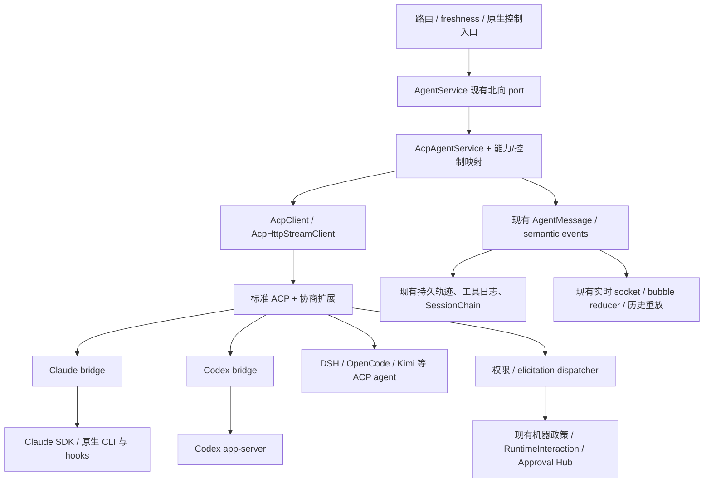

# 统一架构与运行状态

## 统一边界

现有北向 `AgentService` 已统一 invoke 与部分原生控制。继续保留这些接口及其调用方，替换的是它下面分散的 client/control 接线。

图中是目标结构。框的名称不代表已实现新模块；控制映射与 dispatcher 需按实施路线补齐。无需新建 ACP 消息库、审批库或 UI renderer。

## 桥策略

优先补固定版本的社区 Claude/Codex bridge。它们已把供应商后端变成 ACP，适合贡献缺失合同；不能仅写宿主 `_meta` 就假定桥已经支持。

当上游无法及时接纳必要增强时，可维护小范围、锁版本的桥补丁发行物：记录 upstream SHA、patch SHA、包完整性、许可、测试与负责人归属，桥实现仍复用原生 SDK/app-server。补丁的治理归本实现线，不替上游承诺支持。宿主只知道协商后的 typed capability，不散落 vendor RPC 分支。

对无法改造的 legacy carrier，需要桥包装后再迁入。**不得让宿主的 `requestNativeGoal` 等绕过 ACP 直接操作第二个原生 client**；这会导致双 session、不同权限与回执，也使统一无法验收。

迁移过程可保留旧服务供回滚，但一次 invocation 只走一个 carrier。新桥不得递归调用已路由到 ACP 的 `AgentService`；复用应发生在原生 transport/parser 的叶模块，避免 ACP→AgentService→ACP 环。

Claude bg/PTY 不能默认替换为 SDK：bridge 可承载既有 daemon/PTY 叶 transport，但保留原生命周期、terminal/transcript 与 chain-key 恢复语义。canary/fallback 保持现有派发前置条件；出现 outcome_unknown 不可为了 fallback 重发任务。F241 的声明式扩展点只引用 host allowlisted transport，不为桥加载任意 same-power JS factory。

## 所有权

| 状态/资源 | 权威 owner | ACP 的职责 |
|---|---|---|
| 人/猫身份、member/account/project 绑定 | 现有 catalog、身份与调用上下文 | 传正确 L0 与作用域，不能自行更换身份 |
| 平台 thread/invocation、durable admission/终态 | 现有 routing 与持久执行链 | 映射 native session/turn；上报终态证据 |
| 原生 session/turn/SDK hook | 对应桥与供应商 runtime | 执行操作并给真实回执，不再造平台调度 |
| 进程租约、single-flight、多路复用、回收 | 现有 AcpProcessPool / registry | 按新 binding fingerprint 隔离、退休旧池 |
| 工具输入输出/原始归档/持久投影 | 现有 tool log、archive、transcript、MessageStore | 类型化映射与 ID/执行范围关联 |
| 人类问答/权限政策 | 现有 RuntimeInteraction/审批与政策 owner | 对接 wire 请求，匹配 principal 与 native request ID |
| freshness 通知/结果消费 | F254/F318 既有 owner | 保留输入语义、关联回执，不能另建 notice queue |
| usage/压缩/continuity | 既有 context epoch/presentation owner | 给带来源的 observation，不代替 context owner |
| availability | 成员绑定 + carrier + 执行节点的真实事实 | 提供 resolved executable/ready facts，UI 只投影 |

## 绑定与隔离

运行 binding 的 fingerprint 至少覆盖：成员、账号引用、执行节点、桥版本/发行物、实际 binary、HOME/profile、cwd、MCP 配置及 credential scope、指令版本、模型/强度/政策配置。不把 secret 放进键或日志；使用既有 env/pool signature 的安全摘要机制。

同一个 clientId 不能自动共池。账号、HOME、指令或执行作用域不同必须分开。session 归属按已有 RuntimeSession/SessionChain 存储；补充 native mapping/revision 到对应 owner，不另起独立 ACP binding store。

已运行 invocation 使用冻结 binding。配置改变只影响下次 admission；旧池 idle 退休，不能在运行中热换认证。未知 multiplexing 默认 single-flight；不同 session 必须持各自 lease，不能靠通知到达顺序猜归属。

## Session / Turn 生命周期

| 对象与状态转移 | 成功证据 | 失败与恢复 |
|---|---|---|
| process: absent → initializing → ready | initialize 完成、版本兼容、能力归档 | 超时/退出 → unavailable；错误分类与 bounded stderr |
| session: unbound → creating/loading/resuming → ready | native ID + 所选恢复方法 + ready response | 恢复失败显式 interrupted/recovery-blocked；new 产生新链节点 |
| invocation: admitted → active → terminal | 现有 admission + 原生 prompt terminal + 现有持久终态 | crash 依既有 reconciler 收敛；不自动重发可能有副作用的 prompt |
| turn: starting → active → cancel_pending → cancelled | matched native turn + prompt cancelled + quiescence witness | deadline 后 lease/process 隔离；未证静止不释放复用 |
| control: admitted → sent → acknowledged → settled | 同 operation ID 的原生回执与最终 observation | timeout → outcome_unknown；查询/对账，禁止盲重发有副作用的操作 |
| interaction: pending → answered/rejected/cancelled/expired | native request ID 与既有交互终态一致 | cancel/crash/超时后响应 cancelled；拒绝迟到回答 |

上述名称是便于描述的合同状态，实施优先映射到现有 owner 的状态，而非平行持久状态机。

### 恢复原则

load 带历史 replay，resume 只恢复执行上下文；按桥协商选择。新建不冒充恢复。平台恢复失败可以展示明确的“新会话继续”动作，但不能自动用 prepend 重建后宣称 continuity 未变。

同供应商旧 session 只有在桥能证明 native ID、cwd/profile、模型/指令与历史格式兼容时导入，导入需只读核验再绑定。跨桥/供应商不能翻译 opaque ID 后假装继续原 session；保留旧历史、新 session 和 replacement provenance。

replay 标记与 live admission 分开；有 native message/event ID 用真实 ID 去重。缺稳定 ID 时 load 历史不能再次进入 live 工具执行/消息发布路径，也不能用文本 hash 全局去重（相同文本可能合法重复）。沿现有轨迹/重放 reader 合并，有歧义保持未知并阻断迁移。

### 终态与取消

cancel notification 已写入 stdin 只表示请求已发。必须等待匹配 prompt 返回 cancelled，再检查工具/子进程静止；客户端丢弃 late text 不等于上游取消。正常 end_turn 与 cancelled/interrupted/error 保持原有可观察区分。

若桥失联且无法证明静止，隔离整个相关 lease/process 并按既有 supervisor 有序停止；共享进程涉及其他 session 时先冻结派发并逐 session 收敛。保留已完成工具输出，正在执行的副作用写入 outcome_unknown，不能伪造失败或成功。

## 有界消费

JSON-RPC 请求 ID 接受规范合法的 string/number 并精确相关；通知不得伪造响应。parser 有 envelope/schema 校验、frame/content 上限、背压、超时和未识别字段归档。stdout 只承载协议，stderr 单独脱敏。

权限、终态、工具结果与控制回执不能被 token flood 丢弃。超过展示容量时保留完整原始引用和明确截断摘要；图片/resource 走已有媒体机制。未知 notification 可归档并忽略，未知 request 返回 method-not-found，不能默认允许。

## 完成条件

宿主新增本地 agent 时仅添加 profile/能力映射；标准会话、事件、权限、取消、恢复与运营复用同一 ACP client。供应商专有功能在桥内适配并有版本化扩展测试。所有迁移成员的能力与真实用户路径达到 validation 门槛，才可宣布整体统一完成。
