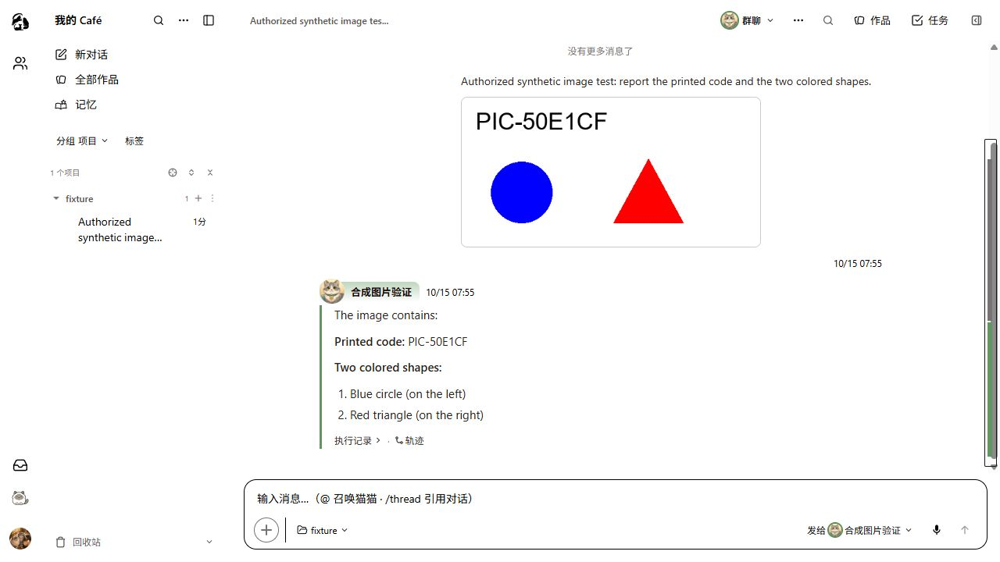

# #1598 产品图片链：真实运行与冷重放

本回执补齐此前受限 session wrapper/内存历史之外的产品链。最终样本 `acp-product-ui-2` 运行代码为 `eab5082c9ba0cea3c090c773a4a7f8c682d8d944`：真实浏览器附件草稿 → 发送 → built API → 生产 factory/service/client → ACP image → 实际 Claude SDK/native → 持久消息 → UI 刷新 → API/Redis 保存重启 → 存储与 UI 冷重放。

#1598 已按维护者意见独立到 [PR #1599](https://github.com/zts212653/clowder-ai/pull/1599)。本样本只归属 #1596 的上述运行代码，**不能作为 #1599 exact HEAD 的验收**；本轮后续 context 修复另有代码/消费链证据，不重标这个样本的版本。

## 冻结与归属

最终 API 重载及模型调用前，于 `2026-10-14T23:49:19.989Z` 冻结 84 个 source/compiled API/bridge/SDK/native/guard/lock 文件 hash；调用、冷重放后逐个复核相同。[运行产物清单](evidence/product-image-runtime-hashes.json)保留每个 hash。Web 进程早于这次冻结启动，Web 本阶段代码无后续修改；私有记录的 `beforeLaunch` 指最终 API 重载及 prompt 之前，不能扩写成早于所有 Web 进程启动。

历史样本 `acp-product-ui-1` 已证明相同真实链，但当时为 `7a2f85379` 加未提交 W2、加载产物未预先冻结，只作历史事实。它的 wire 后续追加过零 prompt 的合同探测；不能以全文件 initialize 数量描述原始会话，不能追认成最终 HEAD 验收。

## 真实输入、回答和重放

合成 PNG 为 512×256、5069 bytes，SHA256 `15ca6f5fc6061a4136ee348429a8094f3579361d7305eaef7c11fd1c719b221b`。验证码 `PIC-50E1CF` 及蓝色圆/红色三角仅存在图片中。UI/实际出站提示只要求报告图片中的文字与形状，没有提供答案。模型返回验证码和两个形状，前后 ACP image bytes 与上传图片 hash 一致。

真实 UI 发送、温刷新、冷刷新均显示同一图片和回答。原生 session 为 `34bffddc-e3df-4632-8990-5e263a1cd4de`；thread、消息 ID、上传 URL、wire/截图/存储响应 hash 见[机器回执](evidence/product-image-ui.json)。全样本只有 1 initialize、1 newSession、1 prompt、1 image、1 end_turn、0 tool call；刷新/冷读没有新 prompt。

冷重放先核验本任务 PID/命令路径，停止 API `2272`，对本任务 Redis `10096` 执行 `SHUTDOWN SAVE`，原目录保存 66 keys。新 Redis `15448` 重载原 AOF，新 API `27896` 使用同一数据目录。重启前后两条持久消息的完整 JSON 完全相同；图片 URL/原回答没有变化。没有删除数据库、flush 或重建消息。隔离端口为 API 3112/Web 5112/Redis 6388；生产端口及存储未用于本次测试。

另有[实时截图](evidence/product-image-live.png)与[温刷新截图](evidence/product-image-refresh.png)。完整私有 wire/日志/存储位于 worktree `.cat-cafe/tmp/acp-product-ui-2/`，公开回执只收录 hash 与合成结果。

冷启动 API 与 Redis 的日志在验收后另复制固定快照并登记 SHA，避免后台继续写入导致回执 hash 失效；保留原活动日志及后续隔离服务退出记录，不截断原文件。

## 认证、guard 与能力边界

认证复用沿用户已明确授权的限定范围。固定 Claude native `2.1.299`、SDK `0.3.285`、桥 `v0.70.0` 加既有固定原型补丁。guard 核验真实选中的 fixture cwd，禁 tools/MCP/hooks/用户指令，`settingSources=[]`，最多一次 prompt、3 turns、1 USD 预算；实际费用 unknown。guard 将出站正文全部替换为固定合成提示，图片字节不改写，不伪造回答。

guard 覆盖 model/system/options，因此这里只证明合成图片的产品传递、真实接收及持久/UI一致；不证明生产 principal/policy/审批、可信 L0 或模型选择器已采用。实际 servedModel unknown。W1 成功/失败/子工具的真实证据继续沿原回执，本图片样本没有工具，不能替代它。

用户明确暂时跳过 CodeAgentCLI/MiniMax；二者状态为未验证。也未将本切片写为完整 G2–G5、V24-C、默认迁移或原生服务退役批准。独立代码与证据审查的范围分别记录，后续 Gate 仍各自审查。

本轮产品 UI 只覆盖成功图片路径及温/冷重放，错误与取消 UI 分支尚未验证；协议与 service 的错误/取消检查不能替代它们。
