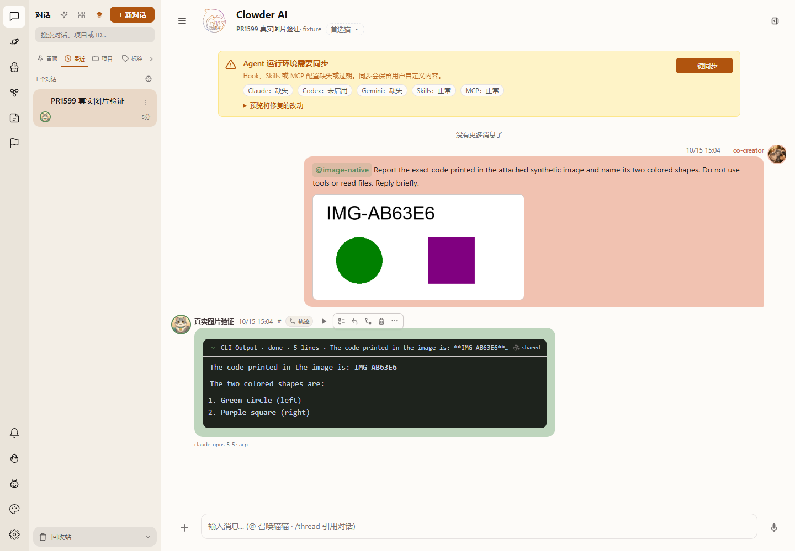

# PR #1599：目录修复、当前产品证据及取消终态缺口

本页更新 [首次拆分报告](2026-10-14-issue-1598-acp-image-input.md)。生产代码提交为 `4a4f69ff8c1ee8ec1f5617d0143033b788932a63`，合入的主干基线为 `7b61230779ba4744cd8c74c61977b3bdfe835c5a`。随后仅强化测试的有效 PNG 对照并增加报告/截图，生产代码未变。机器字段、日志指纹及截图 SHA256 见 [manifest](evidence/issue1599-20261015/manifest.json)。

结论：uploadDir P2 已修复；当前分支的真实图片回答、持久历史/冷恢复和两类错误已验证。实时取消能到 UI，但刷新后的取消终态投影仍有缺口，不能把本次记作完整取消终态验收。PR 保持 Draft，交维护者直接复核。

## Review 反馈及修复

[云端 P2](https://github.com/zts212653/clowder-ai/pull/1599#discussion_r4277491181) 和 [zts 独立复现](https://github.com/zts212653/clowder-ai/pull/1599#discussion_r4277539369) 均指出：已有 `AgentServiceOptions.uploadDir` 没有传入 ACP 图片读取；环境目录与调用目录不同时，可能报不可读或发送另一份同名图片。

service 现在透传调用级目录；helper 使用 `getDefaultUploadDir(uploadDir ?? process.env.UPLOAD_DIR)`，与既有原生 provider 一致。无效 override 明确失败，不回退环境目录；路径/realpath 包含关系检查围绕实际选中的上传根执行。没有改权限策略、初始化声明、Turn/Notice、默认迁移或全局轨迹投影。

[zts 最新安排](https://github.com/zts212653/clowder-ai/pull/1599#issuecomment-6182425708) 是修复后由其直接维护者复核；本轮没有触发额外云审。mind 尚无本轮新反馈，不能记录为其批准。

| 检查 | 实际结果 |
|---|---|
| 未修复提交的新增双 transport 用例 | 2 pass / 10 fail，准确复现 override 漏接 |
| 修复后的 API build | exit 0；F299 census 通过 |
| 受影响 ACP / image-storage 检查 | 285 pass / 0 fail；包含新增 12 项 |
| 对照强化为两张有效、字节不同的 PNG 后 | 新 12 + 原 27 项，共 39/39 通过 |
| 非作者独立复核 | 代码窄审无新 P1/P2；独立 39/39，并复核 test-only 连续性 |
| 代码提交 `4a4f69ff8` 的远端 CI | 16 SUCCESS / 1 SKIPPED；不沿用旧 HEAD 结果 |
| 格式检查 | 完整切片的 Linux LF 字节快照通过 |

12 项新增检查涵盖两个 transport 的 override-only、同名不同图片、无效 override 不回退、越过所选根的 junction/symlink、没有环境变量时的 override，以及两者都缺省时的默认目录。独立复核为同家族非作者，不称跨家族审查或维护者批准。285 项分母仍未纳入首次报告说明的三份 Windows 路径/权限测试，不声称全仓本机测试通过。

## 当前分支的真实产品旅程

使用本 worktree 实际 API 构建及 Next 页面，独立 API 3116 / Web 5116 / Redis 6386，数据和测试 HOME 独立。没有使用生产 3003/3004/6399 或其他人的数据。浏览器通过产品文件输入控件选择 PNG，真实发送 multipart，经 RedisMessageStore、现有 factory/service 和实际 STDIO client；没有伪造 HTTP 回答或替换存储/factory。

真实绑定使用基于 claude-agent-acp 0.70.0 源 pin `d0aafb1ca26427285ffaeac8d8a4452fff28e9c3` 的固定隔离 prototype 副本，SDK 0.3.285、native 2.1.299；不是未修改的上游发行版。图片走标准 content blocks，没有使用私有图片扩展；执行文件哈希另行记录。请求模型 `claude-opus-5-5`，native init 实报 `claude-opus-5-5[1M]`。沿用用户授权的本机认证，不提交凭证或服务地址。

测试 CLI relay 将 native 的工具设为空、禁 hooks/用户指令、限制每次 1 美元和 3 turns，并把出站文本限为固定合成图片提示；实际 image block 字节保持不变。它不是产品审批接线或完整 binding 行为验收。页面中的环境同步提示是此受限测试设置的结果，没有点击“一键同步”。

| 场景 | 实际结果 | 证据边界 |
|---|---|---|
| 真实像素识别 | 模型读出 `IMG-AB63E6`、绿色圆形、紫色正方形 | 随机码不在 host/native 提示文本中；1 次 ACP prompt；native end_turn；工具为空 |
| 原图与接收字节 | PNG SHA256 均为 `8b92ab641dc35ed6c809a58ddb2a9df57203302bc44575108abd1f4ab5639cbf` | 核对实际 ACP image base64；没有借工具读图片 |
| 刷新与冷恢复 | API/Redis 使用原 AOF/数据目录冷重启；两条原消息 ID、图片引用、答案保留 | 先 /api/ready 和真实历史 HTTP 200，再刷新 UI；没有将离线缓存当通过 |
| 不声明图片能力 | UI 显示 image_input_unsupported；0 session/new、0 prompt | 合成 ACP 接收端，故障注入；不是实际 Claude 或 MiniMax 不支持的结论 |
| 上传后图片不可读 | UI 显示 image_input_unavailable；0 session/new、0 prompt | 合成接收端在 initialize 回答前暂存本次新上传文件；随后恢复，未删除附件 |
| 实时用户取消 | 真实模型输出开始后点击明确取消控件；1 次 session/cancel；UI 显示“已取消”；active 执行为空 | 未捕获 native terminal；host 标为 active_unacknowledged 并退役 unsafe 进程 |
| 刷新后的取消状态 | 聊天取消提示消失，轨迹仍显示“运行中” | **未通过完整持久取消终态验收**；不能用文本块的 done 或 active 空列表代替 |

[不支持图片 UI](evidence/issue1599-20261015/unsupported.png)、[附件不可读 UI](evidence/issue1599-20261015/unavailable.png)、[实时取消 UI](evidence/issue1599-20261015/cancel.png)、[刷新后的轨迹缺口](evidence/issue1599-20261015/cancel-trajectory.png)。

## 失败样本和仍未闭合的事项

真实模型共发出 3 次 ACP prompt：1 次图片识别；取消用例首次因两个同名按钮触发自动化 strict locator 错误，没有发出 cancel，模型正常结束，该次不计取消通过；修正测试定位后的第 2 次取消才发送 cancel。原始失败捕获保留。首次 Next 编译超时、首次冷恢复尚未 ready 时的离线界面，也没有计入通过样本。

取消后的轨迹运行中现象与 [#1580](https://github.com/zts212653/clowder-ai/issues/1580) 相似，但本轮没有证明同一根因。当前确认的事实是：用户取消进入实际 HTTP endpoint，host 请求已结算并退役未静止进程，active 列表为空；持久轨迹却仍显示运行中。这里不猜测 native 已确认，也不因 live UI 成功就批准完整终态。请维护者对这个缺口的归属和图片切片的合入边界直接复核；本轮没有把全局轨迹/取消生命周期改动塞进图片 PR。

CodeAgentCLI/MiniMax 仍按用户安排跳过，版本、账号、模型及其真实图片能力均未验证。保留 `Refs #1598`，不自动关闭原绑定问题。完整 #1590/W2、权限审批和迁移也不因本报告获准。
