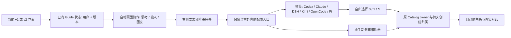

> 以下为实施前方案。当前实现、实际安装截图和剩余验收见 [Windows 实际安装验证回执](issue1466-windows-installed-verification-2026-10-14.md)。

@zts212653 @mindfn 本轮先同步全部未完成项和技术方案，再实施。继续在 `feat/onboarding-first-run` / PR #1519 收敛。当前代码 HEAD `194e44f221652883c3e520da03a4512e9fcaf040`；此前逐项修复回执见 [6160982035](https://github.com/zts212653/clowder-ai/pull/1519#issuecomment-6160982035)。本条是待实施方案，不是完成或合入声明。

## 用户要走通的路径

2026-10-14 入口修正：已有角色时进入原成员列表，检查登录、连接及实际调用状态，不自动弹演示或推荐配置；普通“添加成员”始终进入手动编辑器。没有角色且本人尚未执行该版本引导时才自动演示，完成后可进入推荐配置。部分创建的原流程通过显式恢复入口继续，避免已有角色的保护挡住未完成恢复。存量 ID、历史消息及账号绑定不迁移。

Desktop 首次启动补充：ServiceManager 原先复制完整工厂模板，让 generic bootstrap 预置首个 breed，并按安装 mtime 替换已有模板。统一初始化改为：已有模板原样保留；仅 catalog 存在时补完整菜单来源；两者都不存在的新项目以空 breeds、owner roster 和完整角色菜单启动。首次模板通过临时文件和独占发布创建，不覆写现有数据。该补充的实施前讨论见 [6165684451](https://github.com/zts212653/clowder-ai/pull/1519#issuecomment-6165684451)。

首次进入当前选定的界面 → 自动展示预置的多猫协作 → 思考、输入、回复和右侧成果逐步推进 → 用户选择进入实际配置 → 检测本机客户端、推荐默认角色 → 用户自由选择零只、一只或多只，也可随时手动创建 → 使用自己的伙伴完成真实对话。

演示不依赖用户的 CLI、登录、网络或模型速度。真实伙伴的安装发现、配置可读、登录证据、实际调用成功仍分别呈现，不将“已安装/已登录”当作“已连接”。

## 本轮新增问题与处理

| 问题 | 已核对的机制 / 待核实部分 | 技术方案和验收 |
| --- | --- | --- |
| v1 配置后变成 v2 | `demo-story.ts` 的配置链接写死 `shell=v2`，属于本 PR 的跳转问题。 | 从当前 ShellContext/选择生成链接，配置、返回、取消、刷新保持该选择，不写全局界面偏好。推荐和原编辑器共享组件，但不要求切换外壳。v1/v2 分别验证完整路径。 |
| 演示回复过快 | 当前按事件直接展示整段回复，缺少生成阶段。 | 将演示事件推进拆成思考/输入中/完整回复，再更新成果阶段；保留自动开始、暂停、继续、重播、跳过及键盘操作。预置数据依然明确标注，不伪装真实模型调用。 |
| 首次引导需要手动点击 | 当前演示挂载主要由按钮触发。 | 复用项目已有 operator＋guide 版本的持久状态，身份与状态读取完成后对未执行用户自动打开；关闭/稍后/完成有明确恢复语义。已有用户兼容、刷新不重复弹、多用户隔离及主动重看分别测试。浏览器播放书签不冒充账号级完成状态。 |
| 原手动创建被挡住 | 源码仍有“手动创建单个伙伴”和原编辑器；需要继续定位入口/路由或状态是否把用户带回推荐页。 | 推荐作为可选入口，保留原 main 创建入口。无 CLI、检测失败、不支持客户端、退出推荐，都能进入原编辑器并创建；不以自动探测结果限制手动能力。 |
| 推荐缺少常见客户端 | native discovery 硬编码 Codex/Claude，另发现 DSH/已有 ACP；项目已有 Kimi/OpenCode 执行服务，Pi 没有独立 ClientId。 | 扩展共享能力清单，接入 Kimi/OpenCode 原生服务的发现与配置；核对 Pi 实际协议并提供相匹配的执行适配，不能只显示“可用”却无法调用。Windows/macOS 路径、CLI shim、配置继承和实际回复分别验证；未知认证保持未验证，不套用 Codex/Claude 登录结论。 |
| 单选失败 / 不能不选 | 当前代码未规定必须两只，但有恢复校验及零选择禁用路径；具体单选错误仍需复现。 | 配置流程允许 0/1/N，零选择提供“暂不创建/返回”，不发空创建或空模型调用。只校验选中伙伴；单选不受未选伙伴的名字/认证/草稿影响。部分创建、丢响应、重复检测与旧草稿归属保护继续保留。 |

## Windows 实际安装暴露的未完成项

已经生成并实际运行隔离的 Setup.exe，不能用源码 Web 的通过替代安装验收。此次安装、数据和端口独立；生产 3003/3004/6399 未操作。

1. **安装器未正确处理解压失败。** 实际 System32 `tar.exe` 在 Electron 归档的中文资源路径报 `Invalid empty pathname`、exit 1；Setup 仍返回成功并继续。使用同一个归档，实际捆绑 Node/npm 的 tar 能完整解出 138 个 Unicode 条目，控制结果通过。方案：先解捆绑 Node，再用捆绑 tar 解其余归档，逐项检查退出码和预期入口；失败立即停止安装并保留明确日志，不能清理归档后继续报成功。继续保留冻结依赖、锁文件、外部链接拒绝和安装身份边界。
2. **API 120 秒启动超时。** 实际安装进程 spawn 后约 113 秒才出现第一条 telemetry，随后 Redis/SQLite/索引初始化仍在进行，120 秒超时触发了用户看到的错误框。现有证据不能将其归因于 Defender，也不能靠延长超时宣称修复。先记录 spawn、模块加载、各启动阶段、ready/exit 与耗时，冷/热启动对照定位关键阶段，再针对实际瓶颈优化；错误提示给出实际日志路径。验收必须来自安装后的真实进程。
3. **完整安装旅程尚未通过。** 上述失败意味着“安装成功 → 零角色首屏 → 自动演示 → 配置 → 真实回复 → 完整进程退出重启 → 角色和消息回读”仍待验。会用同一私有实例保留数据测试，绝不清库。

## Review 与 CI 对账

截至本次读取，最近维护者意见仍为 [zts 6162292490](https://github.com/zts212653/clowder-ai/pull/1519#issuecomment-6162292490) 与 [mind 6161659038](https://github.com/zts212653/clowder-ai/pull/1519#issuecomment-6161659038)。此前新增的旧共享请求归属、macOS canonical 工作区、安装/实例协调退出、测试私有日志根、Windows 路径别名及冻结出口旧检查，已按前一回执修复；不重新将它们列为未修产品缺陷。

最新 Windows CI 又暴露实际 OpenCode fixture 清理目录 EPERM，已在 `194e44f22` 加入有界重试，保留原模型请求与进程退出断言。必须核对该 HEAD 的原生 CI 终态；本机有 OpenCode shim，但该特定 npm 可执行文件缺失而跳过，不能用本机 fixture 数字冒称真实 OpenCode 验收通过。

每次最终推送后重新读取最新 main、合流状态及当前 SHA checks。旧 SHA 的“无冲突/CI 绿”不继承。正式 review、完整 #1466 原合同与合入仍归上游；已收口的 ACP 历史、OAuth/API key 继承不重开，#1590/#1591 不扩大进本轮。

## 实施与验证顺序

1. 修复安装解压的失败处理，补实际启动阶段日志并定位安装版超时。
2. 修复外壳连续性、手动入口、0/1/N 选择与恢复边界。
3. 扩展本机客户端能力与配置继承；验证后才显示相应状态。
4. 完善自动首启与演示节奏，复用持久 Guide 状态。
5. 对已核清缺陷保留 RED→GREEN，回归 v1/v2、零 CLI、探测失败、未登录、单选、多选、部分提交与刷新恢复。重新构建并实际安装 Windows；macOS 原生检查与 Windows 实测分开报告。
6. 推送当前 PR、逐条回应、更新文档和真实截图，保留已有角色/历史，在同一隔离数据上重启供用户体验。

这批修改不改写存量角色 ID、默认认证、账号绑定或历史引用。新角色使用已有短 ID 分配与服务端创建归属合同；UI 整理不删除高级接入、账号管理及原手动能力。

本轮实施补充：原 F155 GuideSessionRepository 为内存会话，没有可直接复用的账号级持久完成状态。因此演示不修改原 Guide 会话；在既有 user-preferences 原子写入 owner 下保存 operator＋collaboration-v1 的 dismissed/completed 回执。原设置偏好全部保留。代码检查已覆盖普通添加、检测失败后的手动入口、零/单/多选择、暂停输入、成果延迟更新、账号状态保存与重开。Pi 已安装但本机尚未发现 pi-acp；当前展示待适配，未声称真实 Pi 调用通过。旧 HEAD 194e44f22 CI 19 SUCCESS / 1 SKIPPED，当前修改尚待新 HEAD CI、浏览器与安装实测。
