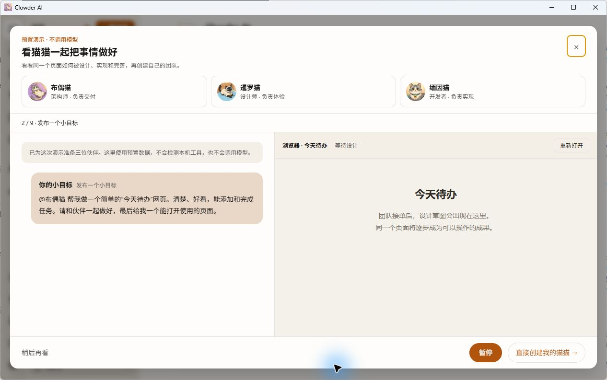
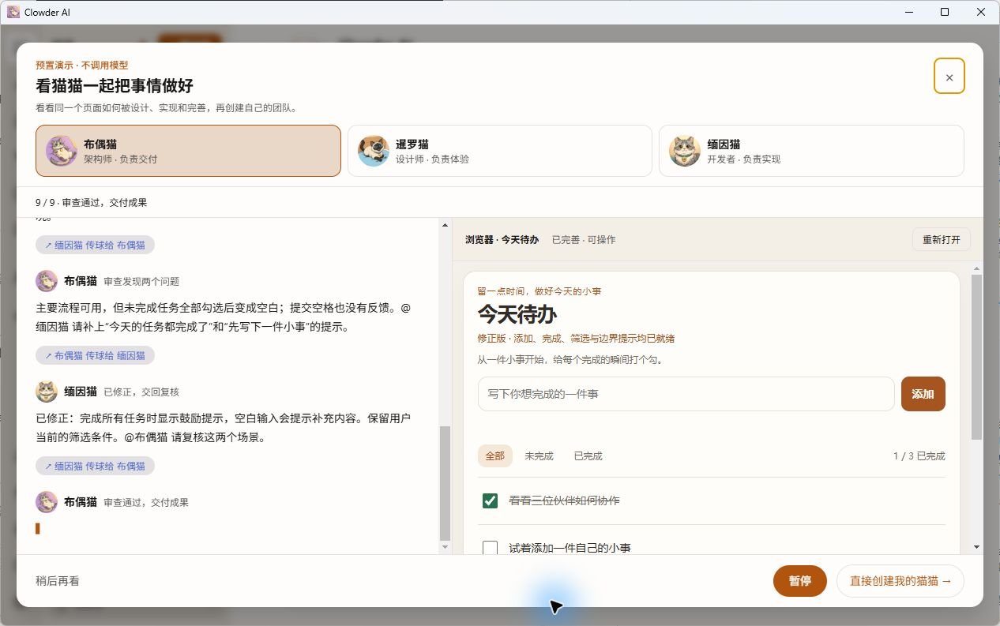
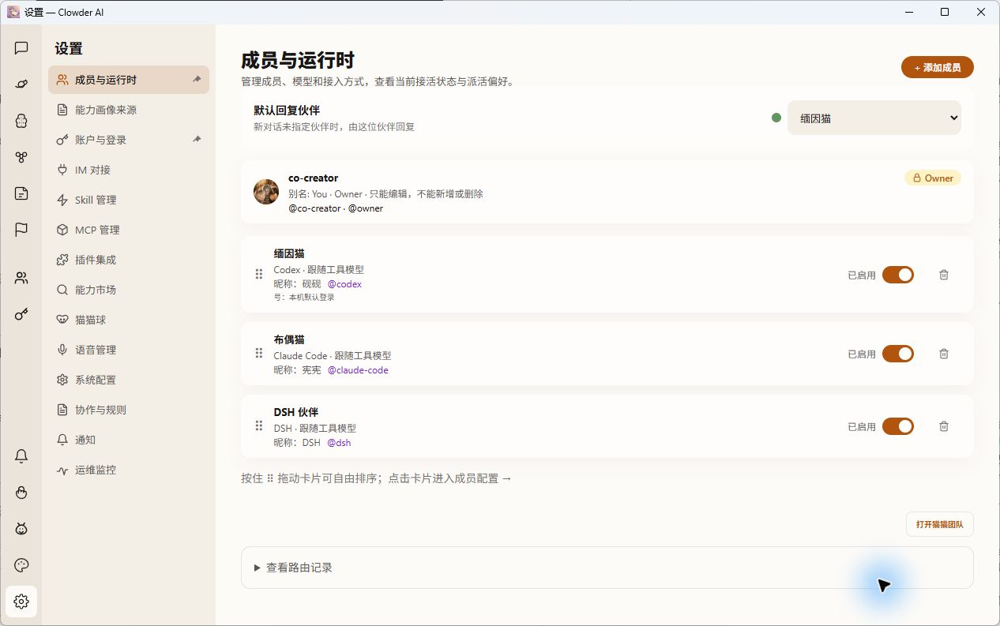
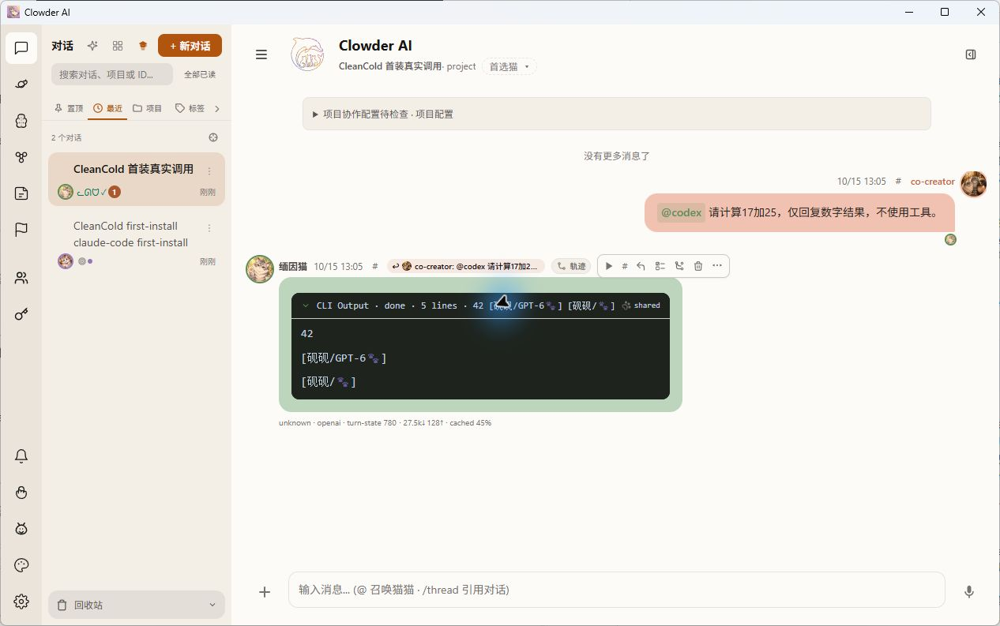

# Windows 零角色首装与真实调用回执

范围：PR #1519 的 Windows 安装布局、首启引导和伙伴创建。本次先执行真正的目录首装，再创建角色、发起真实请求；没有用同目录升级代替首装。速度仍不满足快速首启的目标，不据此关闭 #1466。

## 实物来源

| 输入 | 来源 |
| --- | --- |
| 安装器来源 | `a808d38e24e4edba40ad611ffa9bfef7e921e799` |
| Electron 壳 | `ce72ff04b0068dbbe753fe3eb9a4027e5eec0896` |
| API 正式构建 | `cce4d51179a108a68e47d1de58d3bbf83ee720a9` |
| Web 正式构建 | `dda0b590123bc81156bacf74e19f6bf73d245fcc` |
| frozen lock SHA256 | `913c80f48bc4201046cee1dcb3b44f5236a5522cfaa3d9b972a76d6e4253797b` |

API/shared/MCP 产品源码从 cce 到 a808 无差异，Web 产品源码从 dda 到 a808 无差异，按内容连续性携带原正式构建。依赖从原 frozen 图重新物化；66a 的导出映射与 ce72 私有 peer 修正后的实际 frozen 输入映射逐项一致，另保留该连续性回执。新 API bundle 重新生成。a808 安装后校验脚本已复制进最终 Setup；不是把旧 Setup 的实物结果改写为新版本。

测试和用户交付安装包使用相同运行归档，仅 AppId、安装/资料目录、独立端口和名称不同。Setup 分别为 812588284 与 812588270 字节；用户交付包 SHA256：

`c5ea5349c4a43ce08ba327e764dbdabd4cc8ce5b92ad4a9549959299ede5b86e`

## 首装、首启

CleanCold 安装前 app 与 instance 均不存在。独立 AppId、API3178、Web5180、Redis6326；原定 Web5178 被无关 Vite 占用，使用安装器支持的参数改为5180，没有停止其他服务。Setup 退出后只补用户明确授权的必要连接/认证文件，不复制角色、CLI 会话或 Clowder 历史。随后直接启动产品 GUI EXE；没有 PowerShell 启动包装器，没有失败重试。

| 阶段 | 本轮实测 |
| --- | --- |
| Setup | 117369ms，退出码0 |
| 首次桌面启动至 ready | 112164ms，无重试 |
| 初始成员 | `/api/cats` 为0 |
| 初始历史 | 仅系统 default 线程，无用户消息 |
| 模块图加载 | 60729ms，3275次加载，其中模块读取50855ms、解析5729ms |
| API 进程内 HTTP 监听 | 73921ms |

API 探针起点与桌面启动起点不同，不能直接将两个阶段相减当作精确 Web 用时。首启后 API ready 的 Redis、SQLite 和 sessionHooks 检查通过。

| 归档 | 条目 | 校验ms | 提取ms |
| --- | ---: | ---: | ---: |
| 公共依赖 | 68629 | 5248 | 56213 |
| API | 11484 | 533 | 3583 |
| Web | 1312 | 791 | 924 |
| MCP | 1366 | 67 | 473 |
| Electron | 128 | 1317 | 949 |

原始 runId、逐秒进度、资源采样、Setup 退出码、首次启动 PID/状态和阶段 JSON 均本地留存，不上传认证或完整运行日志。

## 完整产品路径

1. 真实 Electron 首次进入即自动播放预置协作演示，没有额外点击“开始”；演示明确标注不调用模型。
2. 观察到接单、拆解、设计/开发/互审传球，右侧同一个成果页面从等待设计逐步变成可操作的待办列表，主题背景正常。
3. 从完成后的 CTA 进入实际设置。检测出 Codex、Claude、DSH，同时发现 Kimi/OpenCode；后两者本轮不做真实调用验收。Codex/Claude显示“已检测登录 · 实际连接待验证”，DSH明确显示登录状态尚未检查，没有把发现工具等同真实可用。
4. 在界面取消 Kimi/OpenCode，只选 Codex、Claude、DSH，点击“一键创建3位伙伴”。实际落盘 ID 为 `codex`、`claude-code`、`dsh`，默认模型与强度跟随工具，无预置角色复制。
5. 在原生界面创建对话并向 Codex 发送17加25的请求，真实返回42。另通过同一实例产品 API 向新建 Claude 和 DSH 角色发送相同真实请求，分别约12.1秒和20.1秒轮询到42；这些是 API 补充验证，不冒充三个请求都由 GUI 发送。
6. 原生应用分别打开三个真实历史，均显示对应回复；DSH 路由切换/刷新后仍可读。API 再次读取确认消息持久化，预置演示没有当作真实模型输出。

## 保留与交付边界

- 既有 Fresh 与 Runtime2 没有重装、重启、清库或改 HOME。安装前后逐文件哈希、角色摘要和逐线程历史摘要严格一致：Fresh 为0角色/2线程/2消息，Runtime2 为3角色/23线程/20消息。
- 生产3003/3004/6399未用于本轮试验，未连接生产 Redis。
- 另留 CleanUser：独立 AppId、Web5176/API3176/Redis6328。交付前 app、project、electron、data 均不存在；只有用户明确授权的必要认证/连接快照，零角色、零 Clowder 历史、未执行引导、未安装或启动。认证不写进 EXE。
- 本轮没有在新 workspace 布局上重新执行同目录升级/中断恢复。旧载体的这些回执继续保留，但不迁移为本载体已验证。

## 根因判断与未完成项

原120秒失败现场在 API 模块加载阶段已耗94.9秒、CPU约6.7秒，其后初始化仍未监听。当前首启也以逐文件读取/解析等待为主；可以定位到模块加载及后续初始化，不能归因账号认证或 Redis 历史损坏。API bundle、共享依赖和 canonical workspace 去重已落地，但首次启动仍112秒，不宣称慢启动已根治。

相同 installed 图的暖缓存 A/B/A（无探针/有探针/无探针）为4517/4438/4551ms，没有复现明显探针开销；该对照不是冷启动证明。操作系统缓存没有清空，不称受控冷盘/重启基准。

本轮3275次加载仍包含 undici、puppeteer、ajv、zod、插件等外部模块。后续减少首启同步模块图需要独立确认入口/动态资源/单例身份，不能仅凭名字或版本盲目合并。资源采样最低可用内存约32GB、最大磁盘队列9；这些是相关活动记录，不足以证明 Defender 或某个应用卡顿的因果占比。

新五个归档82919条目，上一布局92073条目，减少9154（约9.9%）。本轮首装117.4秒反而慢于同日上一目录首装88.9秒；首启112.2秒也慢于96.2秒。因此条目减少已确认，稳定速度收益尚未确认，不把两次不同负载/缓存的现场记录包装成基准胜出。

a808 的一个 Windows CI 失败来自 GNU tar 负例完成后测试目录 rm 的间歇性 EBUSY，拒绝码/原因/脱敏输出已产生；补测试自有目录有限清理重试，永久锁仍失败，不改产品运行代码或拒绝断言。本地BSD/GNU原生 runner 各6 PASS/1平台条件SKIP；独立 reviewer 的诊断文件各2/2通过。本机没有复现该锁的来源，云端最终结果以新提交为准。

macOS、Kimi/OpenCode/Pi真调用、0/1/N/登录中断/按需安装、原11秒慢保存现场及 #1466 原合同余项仍按原范围验收。此回执不构成正式 approval、合入授权或整单关闭。
