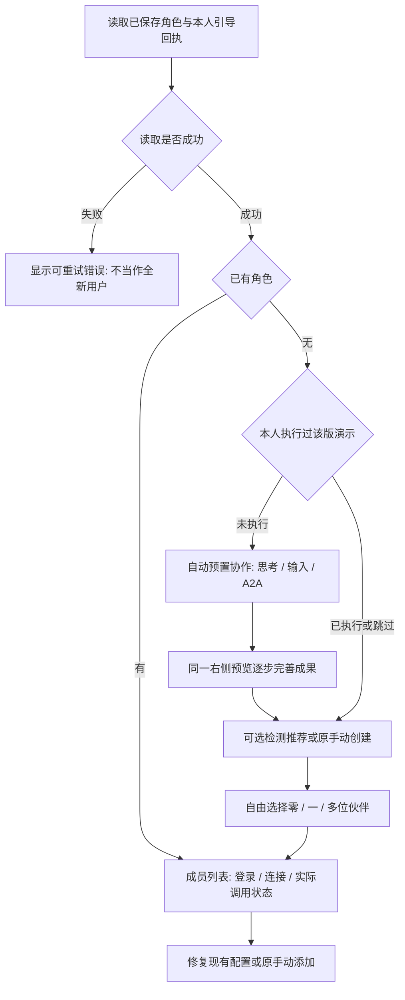

# #1466 Windows 实际安装验证

本文是当前验证回执；此前同日技术方案保留为实施前记录。不作整条 PR approval 或合入声明。

## 已有伙伴与首次使用

用户发现的“已有猫猫还推荐一键检测配置”属于本 PR 入口遗漏，已修复。

自动弹出演示和推荐仅适用空团队。已有角色不删除、不重新生成 ID、不更换账户、不影响历史消息；显式恢复未完成的创建仍保留。手动创建始终可用，导航保留 classic/v2 选择。主动重看演示入口仍存在。

“已发现”“已检测登录”“实际调用成功”分别呈现；本机发现不会保证第三方账户的额度或网络可用。已有团队优先查看并修复自身状态，不靠重建角色掩盖失败。

## 实际安装与回复证据

实际 Inno Setup `0.10.1-pr1519-347df84c0` 安装到专用目录，安装/数据/HOME/Redis 均隔离。归档来自冻结生产依赖；没有借用源码 Web 来替代安装验证。

- Setup 编译约 464 秒；实际安装约 533 秒，退出 0。五个归档均完成提取；捆绑 Node/tar 保留 Unicode 资源。
- 真实安装后的 API 初始角色数为 0；首次自动演示完成，服务器个人回执为 `completed`。完整退出重开未重复自动演示。
- 实际推荐页检测本机支持的工具，已通过 UI 验证零选、单选和多选。Pi 缺少 pi-acp 时为待适配，不冒称 RPC 是 ACP。
- UI 一键创建 Codex、Claude Code、DSH 三位伙伴，保存 ID 分别为 `codex`、`claude-code`、`dsh`。
- 真实安装版 UI 分别发送“只回复 READY，不读写文件，不调用工具”；三位伙伴都回复 `READY`，API 持久历史中的 catId 与角色对应。
- 完整退出重开后，三位角色、两个用户会话、三组用户/助手消息均保留；已有团队的 `view=setup` 回成员列表。原普通添加仍是手动编辑器。

客户端配置使用独立快照；Codex OAuth 不复制 refresh token。DSH 用自有已安装 CLI/profile（不复制用户 sessions），测试 PATH 显式加入该 CLI 的私有 bin。Kimi/OpenCode 有发现与配置读取证据，本轮没有据此声称其真实回复或 Pi bridge 通过。

实际安装后的截图：

| 场景 | 截图 |
| --- | --- |
| 预置 A2A 完成与同一右侧成果 | [协作成果](assets/issue1466-windows-installed-20261014/installed-demo-final-preview.png) |
| 单选 / 零选 | [单选](assets/issue1466-windows-installed-20261014/installed-single-selection.png) · [零选](assets/issue1466-windows-installed-20261014/installed-zero-selection.png) |
| Codex 实际回复 | [Codex](assets/issue1466-windows-installed-20261014/installed-codex-reply.png) |
| Claude Code 实际回复 | [Claude Code](assets/issue1466-windows-installed-20261014/installed-claude-reply.png) |
| DSH 实际回复 | [DSH](assets/issue1466-windows-installed-20261014/installed-dsh-reply.png) |

## 新增 review P1 与回归

维护者原文见 [mind 6167023604](https://github.com/zts212653/clowder-ai/pull/1519#issuecomment-6167023604) 与 [zts 6166980495](https://github.com/zts212653/clowder-ai/pull/1519#issuecomment-6166980495)。实施前补充方案见 [6167720925](https://github.com/zts212653/clowder-ai/pull/1519#issuecomment-6167720925)。

### 偏好读取异常

既有 display reader 吞读取异常，新引导 GET 误返回 `not_started`，PUT 通过空配置覆盖原文件。修复在既有 preference owner 内：仅 ENOENT 表示缺失；读取异常、解析失败和非对象拒绝。新引导 GET/PUT 返回可重试 503；所有 preference updater 的实际读取使用严格接口，原显示降级接口保留。不另建引导 store。

精准回归 9 RED → GREEN，覆盖 JSON 损坏、一次 EIO、array/null、owner 内 updater、真正首次记录与正常 completed；原字节保留。连同正常 receipt/message-disposition，作者 15 PASS。独立 review 在另一 checkout 验证偏好 11 PASS。

### 覆盖升级身份

原实例标记在会被替换的 `desktop-dist` 内，首装参数不重复时可能落回普通实例。修复将身份保存在安装根的 `desktop-instance.json`；PrepareToInstall 在任何 payload 删除前校验并迁移旧标记，失败即终止。新 resolver 优先根标记、兼容旧标记；停机 owner 使用同一位置。已有标记与显式参数冲突时拒绝，不静默切换数据根或端口；普通安装没有标记时保留默认行为。

精准回归 3 RED → GREEN；实际自有 Windows PowerShell 验证迁移、不重复参数、payload 替换、损坏/冲突拒绝。独立 review 的升级/停机/runtime 12 PASS，包括兄弟进程保留。受控文件与 resolver 测试不代替真实 Setup 覆盖升级。

产品提交 `5af3f0a58eee77031ffa4279623670b7b11dda7d`。后续 `22b677d82` 仅将跨平台测试的 Windows 固定根改为本测试的宿主绝对路径；产品源码相同。对应的 Ubuntu `Public contract surfaces` RED 在新 SHA 已 GREEN，其余 CI 以当前远端终态为准。

## 冷启动仍未关闭

首次冷启动实际发生 API 120 秒失败。预加载诊断确认：Node bootstrap 开始后模块图约 94.9 秒，telemetry 约 103.3 秒，随后持久服务仍在初始化；父进程达到 120 秒停止服务。对应 CPU 约 6.7 秒，不能据此直接断言 Defender 或磁盘根因。热启动模块图约 2.6 秒，全应用后续约 9–14 秒，不能用热启动关闭冷启动问题。

失败先写 `startup-state.json`（PID、时间、phase、message），再停止本安装服务并异步提示。测试监督器识别同一次启动的失败回执和退出，不等待用户关闭弹窗。日志改善关闭“感知不到异常”的缺口，但没有关闭原冷启动慢。

剩余：首次冷启动的具体等待根因与修复；实际 Setup 覆盖升级验收；适用 macOS DMG 全旅程；Pi bridge 与真实调用。原 #1466 完整体验合同保持，不用当前局部通过声明全部完成。
