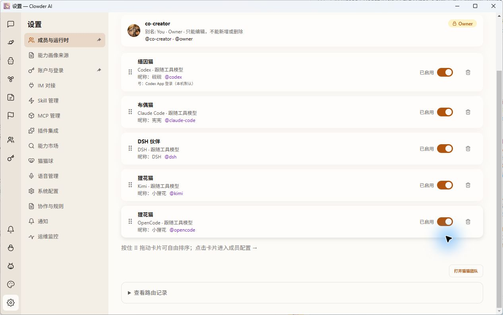

# Windows 受限依赖打包与完整首装复验

本回执接续 PR #1519 的 [首装/恢复记录](issue1466-windows-clean-install-evidence-2026-10-15.md)。这次先在安装与实例目录均不存在的新目标执行完整 Setup，再首次启动、观察自动引导、通过界面一键创建五位伙伴，最后执行真实请求和历史回读。另用作者旧实例验证同版升级的数据保留；没有将升级冒充首装。

## 来源与适用范围

| 输入 | 来源 |
| --- | --- |
| 受限 API 打包、Web 运行依赖选择、Electron 壳 | `df339081ea702c71968bd89fe89ee351f3a8e432` |
| API / Web 正式构建 | `31449021ad1ea1b209e4be18dbf8d0321abf9809` |
| 安装器 / shared 正式构建 | `2f4b759a8ec376a760c13214f340bdd3e90682fc`，相关产品源码连续 |
| 冻结锁 SHA256 | `913c80f48bc4201046cee1dcb3b44f5236a5522cfaa3d9b972a76d6e4253797b` |
| CI 夹具修正 | `ee7a8057a4522503b5a8c7586fb6303ee983a3ba`，仅测试，安装器排除测试文件 |

314→df 的 packages 产品源码没有变化，沿用原构建标识；API bundle 按 df 策略重新生成，Electron 壳重编，不把原 API/Web 构建标成 df。测试和交付 Setup 使用同一套归档，只有名称、AppId、安装/资料路径与端口不同。认证文件不进入 EXE。

## 本轮修改及独立复核

- 仅打包明确选择的纯 JS 依赖与遥测 SDK 闭包；workspace、plugin-contract、zod、原生包和全局遥测入口继续外置。每条 bare external 同时从原 importer 与 API entry 解析，canonical 身份不同即停止构建，避免私有 peer 被公共版本替代。
- Web 使用同版 58 份生产 `.nft.json`，保留其文件所属包及完整依赖闭包，连同其余 workspace 的全部生产依赖；不按包名/版本合并对象，不改 Node 解析链，不泛删包内文件。
- Next 运行期仍会执行配置。保留 `next.config.js`，静态读取其插件和本地 helper 引用；动态 loader 无法证明时拒绝构建。pnpm/private owner 有歧义时全部保留；必要文件缺失、构建标识不一致时拒绝打包。
- 初查 493 个包并非安全排除结论。独立复核发现私有资源 owner、Web 私有包、Next PWA 配置闭包和 loader 别名边界后，最终仅排除 167 个根包，保留约 1.2 万个文件/438 MB 原始体积的减少量。原 frozen 图和锁没有修改。
- API 打包、运行依赖选择、冻结导出、网关和数据边界等受影响检查 38/38 通过；独立复核针对 df 的反例与定向 9/9 通过，未发现该限定范围未关闭的 P1/P2。此复核没有执行 Setup 或真实模型，不是整单 approval。

## 真实首装与启动

| 阶段 | 314 失败候选 | 本轮 df 产物 |
| --- | ---: | ---: |
| 完整新目录 Setup | 296452 ms，退出0 | **123589 ms，退出0** |
| 第一次桌面启动 | 121575 ms，API 未在120秒内就绪 | **100299 ms，ready** |
| 共享依赖归档 | 68629 项 / 424047747 bytes | 54942 项 / 309569936 bytes |
| API 归档 | 11488 项 | 11488 项 |

本轮共享依赖提取阶段约 39.9 秒，API 约6.3秒，Web约1.8秒；另有入口/完整性验证、安装后脚本与配置生成耗时。Setup 总耗时使用外部进程计时，不把单个提取阶段当安装总耗时。

第一次桌面启动的状态记录为99.909秒，外部观察为100.299秒。API从子进程启动到端口就绪约61秒，随后Web约38秒；这些阶段不是“用户需要再等100秒”。首启引导自动出现，观察到 typing、传球和右侧同一成果页面逐步完成，背景色正常。

**速度改善仍有边界。** 系统缓存没有清空，没有控制其他程序或磁盘负载；以上是同机不同新目录的实际记录，不是受控冷盘基准。API模块图完成时2883次加载、52.692秒；读取回调墙钟42.902秒、解析5.336秒、CPU约6.78秒。旧超时现场模块读取回调墙钟约99.6秒，CPU很少。可以定位大量同步模块加载/等待挤占启动预算，不能把 `nextLoad()` 时间当物理磁盘计时，也不能据此断言唯一原因是 Defender。新首启成功及升级重启仍耗百秒，**不关闭120秒冷启动稳定性问题**，不调大产品超时、不停用安全软件。

## 一键创建与真实调用

首启 `/api/cats` 为0，没有复制角色、会话或 Clowder 历史。演示完成后进入实际设置，默认选择 Codex、Claude、DSH、Kimi、OpenCode五项。实际点击“一键创建5位伙伴”，全部创建完成；GET 回读ID为 `codex`、`claude-code`、`dsh`、`kimi`、`opencode`，均为 `native_tool`，模型/强度跟随工具。未再出现前三项成功、后两项400的白名单缺陷。

以下请求来自该实例产品 API，使用刚才由 GUI 创建的角色，不冒充每条请求都由 GUI 发送；每条结果均再次从消息历史读取，并核对回复的 catId，不能让默认猫代答算作目标客户端通过。

| 工具 | 本轮真实结果 |
| --- | --- |
| Codex | 9149ms，回复42 |
| Claude Code | 13621ms，回复42 |
| DSH | 25787ms，回复42 |
| Kimi | 初始授权副本被拒绝 invalid grant；用户为本实例完成官方独立登录后，重新请求9161ms回复42。保留初次失败及Windows CLI异常退出记录，不用旧实例的成功覆盖它。 |
| OpenCode | 未通过。先前测试误触关闭了角色，一次请求被默认Codex回复，该记录明确判失败；恢复启用后，49374端口受本机保留范围限制，仅本实例用官方CLI改为41986。之后真实错误为默认模型403地区不可用。未改用户原端口、provider或模型，不将旧作者实例临时指定模型的结果迁移到新实例。 |

OpenCode 2.0错误事件包含 `error.type/message/status`，目前UI只显示通用错误；该展示与拒绝重试分类仍有优化空间。没有证据证明地区拒绝是 Clowder 生成的错误，也没有证据证明当前选择的其他供应商一定可用。

## 旧配置与历史保留

同版新包用于已停止的作者旧实例：安装141726ms退出0，重启112181ms进入ready。安装前后，catalog、用户偏好、capabilities、Redis dump与SQLite等10个持久化文件指纹完全一致，五个角色ID保留。重启后原三种工具的旧线程、用户请求和42回复逐项回读通过；没有删除、重建、清库或重写旧ID。

该布局之前完整故障 Setup→非零退出5→同版健康 Setup→重启/历史回读的回执继续保留；本轮依赖选择变化后没有重做故障注入，不把旧回执说成本轮新故障实物结果。

生产3003/3004/6399、用户已经在用的 CleanUser 和其它旧实例没有被本轮安装覆盖。为防磁盘耗尽，仅删除两个未交付、未安装的314生成EXE，并保留哈希清单；失败首装包、原始日志及全部实例持久化文件仍保留。

## 干净交付与未完成项

交付包 `ClowderAI-Setup-0.10.1-pr1519-df339081e-CleanDelivery.exe`，700526205 bytes，SHA256：

`c148835a25ed25de5a962d86daf664cd0c457a61798d33bd9994a027c7ab7f9e`

交付目标独立Web5190/API3190/Redis6318。验证时尚无安装目录、project、data或Electron profile，没有角色、历史或引导状态；只有用户明确授权的必要认证/连接快照。它不是没有本机工具或没有账号的干净机器。Kimi在作者新实例完成了独立登录，交付实例的旧认证副本未验证，不能保证它也有效；不将旋转中的认证在多个HOME之间反复复制。OpenCode仍需用户选定实际可用模型。

ee7a8057a 的远端CI为19 SUCCESS/1预期SKIP；当时base为466d4549f，PR MERGEABLE/BLOCKED、无正式reviews。Windows detached测试原25秒fixture短于CIM最多约105.5秒的核验预算，改150秒后本机、独立复验及远端均通过；原38.5秒CI失败保留，缺少当时每次CIM诊断，不能断言寿命是唯一根因。没有改产品identity fence或120秒门限。

原 #1466、F155/F229/F320/DSH适用合同、0/1/N和登录中断/按需安装、Pi、macOS实际安装、原生产11秒慢保存、冷启动稳定耗时和OpenCode真实模型使用继续打开。本回执不是发布稳定版、正式approval、merge或整单关闭。
