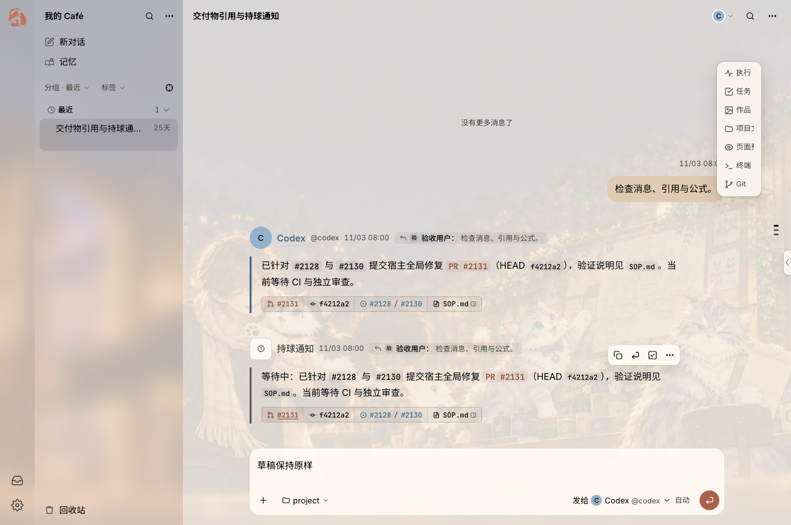
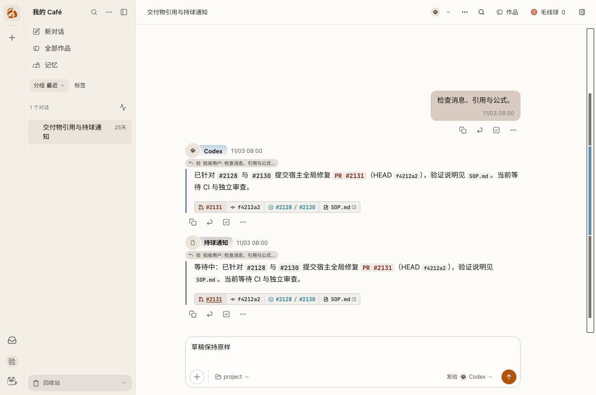
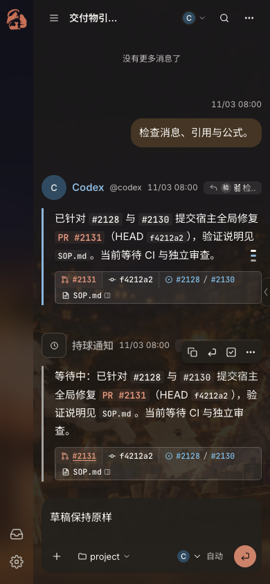
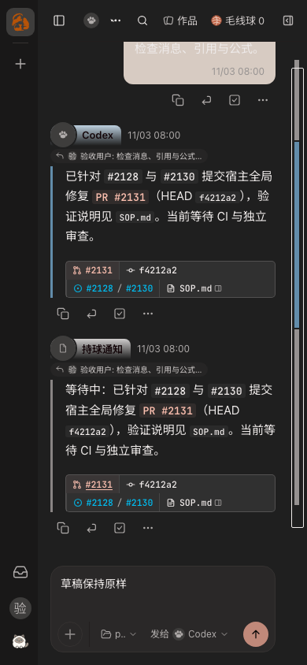

# 消息交付物分段条

按 2026-11-28 定稿实现：过程正文轻量突出显示，末尾用一体式紧凑分段条收拢跳转，图标为单色 SVG。适用于 default/v2 的普通消息与系统持球通知。

## 消息里的交付物入口

正文中的 PR、提交、Issue 和仓库内文件引用显示为安静的等宽标记。完整提交缩为七位，深层文件路径可显示文件名，悬停保留完整值。消息末尾按 PR、提交、Issue、文件分组去重；同类共用一个图标，多个编号以 `/` 分隔且各自可点。点 GitHub 引用会在新标签打开目标；点文件在原生工作台预览。

未写仓库的简写引用按本次约定的 `zts212653/clowder-ai` 上下文解析。跨仓库时写明 `owner/repo#编号` 或完整 GitHub URL。显式 URL 保留评论锚点。完整 SHA 与无歧义的短 SHA 合并为同一个提交；相同编号在不同仓库中保持独立。同一仓库的编号已明确为 PR 时，不再把它列为 Issue。

代码块、行内命令、公式和普通网页链接保持原用途。文件识别覆盖 `docs/`、`packages/`、`src/` 等目录下带扩展名的相对路径，以及 `README.md`、`package.json` 这类根目录文档与配置文件名；不把任意绝对路径的中间部分误当仓库根路径。行内代码中的空格路径保持完整预览目标。识别引用不证明文件存在，实际读取仍由既有文件 owner 核对。

## 实现与原有能力

Architecture cell：既有 PDL 聊天投影/组件库，以及既有 UI 选文读取；Map delta：none。

- 识别器接收仓库上下文，无网络查询、存储或文件访问。宿主在唯一消息正文出口调用共享展示层，避免维护两套 Markdown 引用语法。Markdown 文件预览及其他说明正文不受该展示层影响。
- SVG 图标集中于组件库，统一 `viewBox="0 0 16 16"`、`stroke="currentColor"`、线宽 1.65。分别对应 git-pr、git-commit、issue-dot、doc-file、panel-open。颜色复用主题的前景、强调色、信息色与分层线条；窄屏允许组换行，保持一体边框与独立链接。
- 文件点击复用 `fileOpen` 原动作，权限与工作区准入由既有文件 owner 执行。与在飞 PR #2125 的 Markdown/Windows 路径解析改动分离，未复写其 href 解析器。
- 缩略标记保留既有 `data-quote-source-text` 来源信息，选文读取复用 `readableSelectionText`。完整选中的短值恢复原文，不能证明的部分选文拒绝；有缩略值时不提交失真的 DOM 字符偏移。分段条标记为界面控件，不参与正文引用与导出唯一性证明。正文与其他卡片重复时，原有歧义阻断继续有效。
- 保留用户自定义链接标签，显式 GitHub 目标保留查询/锚点。动态值只通过 DOM 文本和属性写入；不将消息内容拼成 SVG 或可执行 HTML。

## 验证

最终验证：PDL 运行时 197 项、解析与选文 20 项、主题/插件/输入提示契约 6 项通过。浏览器一项完整旅程覆盖四场景，TypeScript、Biome（有非阻断风格提示）、capability tips 与差异空白检查通过。运行时回归顺手修正了缺失账号投影的夹具，并固定两项渲染计数测试的墙钟，避免后台秒数/半分钟刷新干扰测量；产品计时逻辑未改。

本改动先以 Draft PR 提交，供上游维护者确认方向及分配 Feature Doc；本文是本次约定、实现及验证说明，不自行占用 F 编号。

工作树 `/Users/yuki/Documents/AINest/cat-cafe-message-artifact-dock`，基于 `origin/next@77042acc6ae52ecb3001a2fe08885e38dd822e6b` 的独立分支。未修改 PR #2131 的工作树、运行配置或用户数据。

浏览器夹具使用当前分支的真实 PDL 脚本、主题包和模型，合成普通消息/持球通知。文件预览加载当前 checkout 的实际 `docs/SOP.md`；GitHub 新标签跳转通过浏览器路由拦截核对完整 URL，不向真实 Issue 发送请求。四场景覆盖 default/v2 桌面与 390px 深色窄屏：正文标记 → 分段条 → GitHub 新标签 / 工作台预览；另验证选中短 SHA 能恢复完整 40 位原文。

| default 桌面 | v2 桌面 |
| --- | --- |
|  |  |

| default 深色窄屏 | v2 深色窄屏 |
| --- | --- |
|  |  |

从 `packages/web` 执行：

```sh
node scripts/run-with-node-env-test.mjs pnpm exec vitest run src/pdl/__tests__/message-artifacts.test.ts src/pdl/__tests__/message-selection.test.ts src/pdl/__tests__/runtime.test.ts src/pdl/__tests__/plugin-raw-contract.test.ts src/pdl/__tests__/appearance-default.test.ts src/pdl/__tests__/composer-notice-typing.test.ts
node scripts/run-with-node-env-test.mjs node --test test/browser/pdl-message-artifacts.test.mjs
pnpm exec tsc --noEmit --incremental false
```

预览为当前工作树的隔离夹具 `http://127.0.0.1:3289/?theme=sys:1` / `?theme=pkg:v2`，由 launchd 托管至 2026-11-28 11:01 UTC。Hub typed preview 回执 `unconfirmed/no_matching_client`，因此不声称用户面板已打开。截图来自无头浏览器真实渲染，尚未部署到运行实例。
