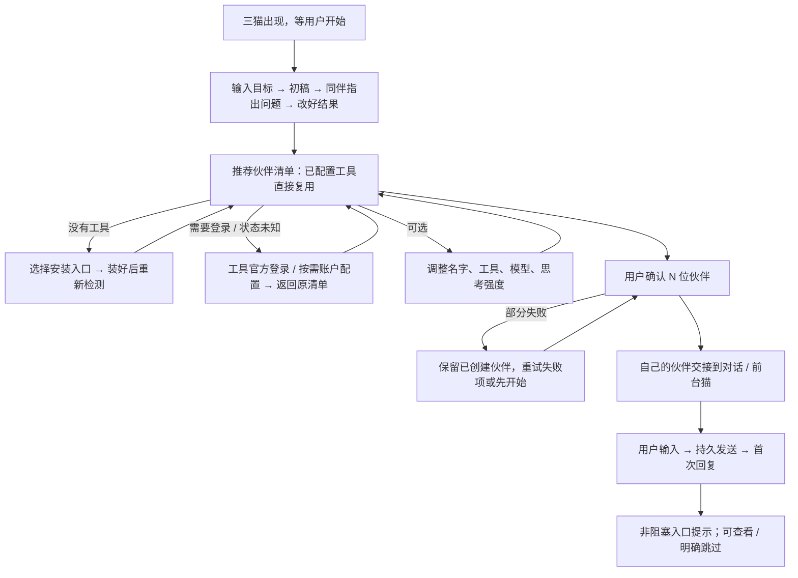

# 首启高保真：看懂一次协作，确认自己的伙伴，然后开口

> **2026-10-12 最新决定**：用户与作者确认改为“全程预置协作演示 → 内置浏览器交付可操作成果 → 设置中创建真实猫猫”。当前实施依据为 [自动协作演示方案](../plans/issue-1466-scripted-onboarding-2026-10-12.md)。下文的旧原型与真实 client 前置引导仅作历史记录；不能据此恢复旧入口。

> 已被用户否定并替代：2026-10-12 最新指令要求取消示范，直接在实际项目配置本机多位伙伴并完成小目标。实施依据见 [真实伙伴引导方案](../plans/issue-1466-native-onboarding-2026-10-12.md)。下文及 `site/issue-1466-onboarding-v3` 仅保留历史，不再作为当前产品规格。

本轮继续 PR #1519 / `feat/onboarding-first-run`，交付可操作的设计原型。配置优化已获用户体验认可；本轮不部署生产、不把原型作为真实认证或模型验收。10 月 9 日草案仍为历史文档，不恢复其中已被否定的规则。

## 1. 重新阅读后的结论

截至 2026-10-12，已读取 #1466 正文及全部 zts212653 / mindfn 评论、#1519 正文及两人的全部评论；PR 无 inline review 评论、无 formal review。以下保留相互补充的要求，后发更正覆盖旧位置和术语。

| 依据 | 本次采用的规则 | 对用户的改善 |
|---|---|---|
| [原 issue](https://github.com/zts212653/clowder-ai/issues/1466)、[三猫交接](https://github.com/zts212653/clowder-ai/issues/1466#issuecomment-5677941449)、[设计回应](https://github.com/zts212653/clowder-ai/issues/1466#issuecomment-5690816786) | 保留三猫脚本、互相 @、同一结果被改好；示范与自己的成员分开 | 先理解团队的价值，不先学配置术语 |
| [模板与继承](https://github.com/zts212653/clowder-ai/issues/1466#issuecomment-6093411123) | 探测后列推荐伙伴，用户一次确认；模板推荐工具，模型/强度持续跟随 | 多工具不重复填表，不复制探测值为覆盖 |
| [真实设置宿主要求](https://github.com/zts212653/clowder-ai/issues/1466#issuecomment-6094825401) | 正式接入沿现有 SettingsShell / FirstRunQuestWizard；原型复刻当前布局、字号和导航，标明未挂载 | 引导与日常配置语言一致；不再比较三种外壳 |
| [首启与持久状态](https://github.com/zts212653/clowder-ai/issues/1466#issuecomment-6095373455) | 先复用已有 OAuth / API 配置，缺什么补什么；读取失败不是新用户；提示与固定分开 | 不重复填 key，离开回来继续，不每次重播 |
| [最新账号更正](https://github.com/zts212653/clowder-ai/issues/1466#issuecomment-6102393831) | 猫猫团队 › 账户与登录；一份账号列表；“本机默认登录”与“正在用”分开 | 账号位置稳定，登录成功不偷偷换号 |
| [10/9 草案评审](https://github.com/zts212653/clowder-ai/pull/1519#issuecomment-6079936214) | 不删除示范、不自动创建；输入发送、得到回复、复杂任务完成分开 | 主界面不被教程/长任务锁住，失败仍可使用 |
| [最新 PR 复核](https://github.com/zts212653/clowder-ai/pull/1519#issuecomment-6117065363) | 未修的运行时、CI、账号宿主和真实旅程仍登记为缺口 | 不把高保真通过包装成产品完成 |

## 2. 原型契约

- `demo_kind`: `journey_validation`。
- `delivery_lane`: `internal_product_gate`。
- 判题：新用户能否看懂团队价值，在新版配置语义下确认自己的伙伴，并自然进入第一句交流；中断和失败是否仍知道下一步。
- `visual_source_of_truth`: 当前 `MemberSettingsPage.tsx` 的 1024px 内容上限、左目录和底部保存条，`SettingsShellV2.tsx`、`settings-ia.ts` 的设置宿主，`HubMemberOverviewCard.tsx` 的名字/昵称语义，以及主题 token。对照隔离设置页和生产验收截图。
- `native_elements`: 暖纸色背景、窄 Rail、设置左栏、猫猫团队分区、成员详情目录、模型与强度各自的“跟随工具设置”、底部主动作、同一猫头像。
- `stylized_elements`: 三猫示范舞台和可收起的“原型场景”控制条；不新增正式产品侧栏分类。
- `truth_label`: 常驻“交互原型 · 模拟数据”；登录结果、探测、创建及模型回复均由场景驱动。只在本浏览器保存演示草稿，不接真实账号、不接生产 API/Redis。
- 交付层级：首启 feature surface 和关联设置交接预演；不是新 Workspace 主壳，也不声称已挂载真实 SettingsShell/F155/F229。
- 灵魂帧：刚才解说的猫出现在“你的伙伴”清单，工具名与模型/强度跟随清楚可见；确认后同一头像留在对话，输入框立即可用。

## 3. 用户实际走的路径

| 用户的问题 | 页面动作与可见结果 | 继续条件 | 恢复 |
|---|---|---|---|
| 它与普通聊天有什么不同？ | 一句话欢迎任务，初稿中的术语被另一只猫指出并改写 | 演示脚本结束；可暂停/回看，也可明确跳过 | 刷新保持演示进度和暂停，不自动跳到成功 |
| 我还要准备什么？ | 主区只出现实际发现的工具与推荐伙伴；已配置项默认勾选 | 用户确认至少一项，所选项具备安装与配置证据 | 未选工具不阻塞；未知、缺工具、缺认证分别解释 |
| 我用的是什么模型？ | 清单写“模型与思考强度跟随工具”，展开才调整 | 默认为持续继承；显式选择才成为覆盖 | 回到清单、登录往返和刷新保留草稿 |
| 登录后原来的账号会怎样？ | 唯一“账户与登录”页；待登录、失败、已登录、正在用不同 | 原生登录的实际结果；点击登录不是成功 | 取消/失败留在原记录；成功不自动换号 |
| 怎么只剩一只猫？ | 按已确认成员交接：“先从你和它开始” | 只展示保存成功的成员 | 不把另外两只演示猫计入可调用团队 |
| 能开始说话了吗？ | 立即可用的输入框、可编辑的起步建议，不强迫教程任务 | 消息持久化与回复分别确认 | 发送失败保留输入；已发未回可重试，不重建伙伴 |
| 以后在哪里改？ | “成员与运行时 / 账户与登录”轻提示与稳定入口 | 提示不影响发送 | 看过/跳过按用户和引导版本记录；空固定列表也保留 |

### 示范猫与推荐模板的衔接

默认根据已发现的首个可复用工具选择推荐模板：Claude → 布偶、Codex → 缅因、DSH → 暹罗；这位伙伴担任解说，其余两只负责起草与审阅。三猫协作脚本和价值固定，角色分工随推荐映射变化，避免把 Codex 强制配成另一品种。

用户可以改名字、模板和第一位伙伴。若用户取消解说猫对应的工具、或只有另一成员保存成功，交接明确由解说猫介绍用户实际选择的伙伴，不偷偷换工具/模板来维持动画。同一成员仍使用稳定 ID；这些显式改选例外在正式实施时需要设计确认。本原型优先验证默认身份连续性及实际成功成员数。

## 4. 相比旧版具体减少什么

1. 去掉独立“选角色 → 选 client → 每个工具配一遍账号模型”的串行表单；一次清单确认，单项调整按需展开。
2. 入门区使用“使用工具、名字、模型、思考强度”；不出现 provider、执行身份、transport、profile 作为必填项。
3. 模型和强度从目录选择；“跟随工具设置”是各自第一选项，目录读取失败不清空已有选择。原型目录为明确标注的样例，不声称真实探测。
4. 未登录项保留在列表；有其他已配置工具时不强迫全登录。没有工具时提供安装入口与“我已安装，重新检测”，不制造“检测中”的死路。
5. 暂时离开、去账号页、改名字和刷新不丢草稿；部分失败保留成功项，重试复用同一 ID。
6. 完成配置即进入对话；入口提示不挡发送。可编辑建议和自由输入同权，不强制执行复杂任务才解锁。
7. 高级能力留到成员设置，首启不要求设置语音、权限、上下文或多账号；账号与模型覆盖仍正交。

## 5. 尚未拍板的默认固定

原 issue 要求新安装默认固定成员/账号，Workspace 意见倾向默认不固定，mind 明确没有接受删除原要求。本次原型保留原 issue 的全新用户默认固定，同时提供仅供评审的“不默认固定”对照。两种都能从设置进入同一分区，提示状态与固定列表分开；已有用户的空固定列表绝不自动补回。这个对照不是宣布统一规则已经确定。

## 6. 正式实现边界与缺口

| 模块 | 已有接点 | 后续工作 |
|---|---|---|
| 唯一首启入口 | `FirstRunQuestWizard`、first-run-quest 现有 R4/R5 | 用推荐清单替代重复 ConfigStep；吸收可用示范片段；不再挂第二套 OnboardingJourney |
| 探测 / 目录 | first-run available-clients、native-runtimes 及能力目录 | 安装/配置/认证/调用分别建证据，读取错误不当空清单；不静默改 provider |
| 创建 | 既有 cats API、journey 稳定 ID / 幂等键 | 与日常添加共用 payload；部分失败、响应丢失服务端对账，不能本地计数即成功 |
| 账号 | 既有 accountRef / accounts API | 最新“账户与登录”宿主调整；F320 登录和换绑接口公开同步仍待核验，不能另建 OAuth 库 |
| 引导持久状态 | 现有引导与首句恢复链 | 用户＋引导版本：未处理/完成/明确跳过/已有配置不需要；浏览器原型缓存不代替服务端 |
| 第一条回复 | 现有 ChatContainer 发送 / 首句同步 | 保留文本、服务端线程与成员 ID；首句已发未回不是旅程成功；F229 持久绑定实际首成员 |
| 提示 | F155、既有固定入口 | 复用引擎；一次提示和固定列表分开保存，不清理任何旧成员/历史 |

本次源代码核查仍见旧首启单模板重复配置、第二套未挂载的 OnboardingJourney、账号位于“连接与扩展”。最新 PR 评论中的旧 synthetic Codex 强制 OAuth、POSIX 探测子进程回收、env 登记和 Web CI 覆盖缺口仍未由本轮修复。正式首启实施前需单独处理/验证，不能用原型验收替代。慢保存也仍需生产 trace 复现判断。

## 7. 原型验收与后续

覆盖一项已配置、多项混合、零工具、未知、登录失败/取消、原生 API 配置复用、部分创建失败、消息失败、已有用户、刷新续接；桌面和 390px 检查输入及底部按钮。状态变化通过本原型确定性测试和真实浏览器点击验证；结果另记，不预先勾选。

用户确认高保真后，再进入正式编排器、用户持久状态、真实认证/回复和安装阶段。正式验收必须有当前 SHA 的真实 CLI/provider/model、连续三猫→真实伙伴→首句回复、F320 普通/压缩会话换号续聊以及恢复证据。本轮不会关闭 #1466 或宣称 PR 可合入。

## 8. 本轮验证记录

本轮产物：`site/issue-1466-onboarding-v3/`，预览 <http://localhost:5136/>；8 种条件在右上角“原型场景”切换。

| 检查 | 结果与证据 |
|---|---|
| 确定性状态测试 | 10/10 通过；包括工具切换往返、持续跟随、缺工具/未知/登录等待、API 复用、失败/取消、部分创建去重、发送与回复分离、提示/固定分离、新账号不自动换绑、无效缓存 |
| 实际浏览器主路径 | 修改名字和强度 → 账号页 → 刷新 → 返回确认；名字与偏好保留；建议填入后改写用户原话，刷新后发送成功并收到模拟回复 |
| 实际浏览器恢复 | Claude 登录等待刷新、失败返回、重新登录成功；未选择的失败项不阻塞 Codex/DSH；部分创建失败刷新后重试，最终仅 2 个成员；首条回复失败刷新后重试不重发用户消息 |
| 演示可读性 | 分幕输入、暂停刷新、逐幕审阅和采纳；走查发现底部遮挡修改结果，已改为消息独立滚动与自动呈现新内容，暂停时显示完整结果 |
| 老用户与缺工具 | 已有成员直接对话且不补固定项；无工具不能直接确认，安装后返回仅由明确的模拟按钮改变状态 |
| 响应式 | 桌面 1280×720 与 390×844；推荐清单、登录往返和账户列表无横向溢出；窄屏可到达主操作 |
| 浏览器控制台 | 本轮操作链未捕获 error 日志 |
| 源码检查 | 本原型 Biome 无错误，保留 4 条复杂度警告；文本源文件均不超过 350 行；不是正式生产组件质量验收 |
| 环境隔离 | 专用 5136 静态服务，仅回环监听；CSP 禁止网络连接；不启动/连接 API 或 Redis；runtime 仍为 `bc7677694` / `runtime/issue1466-member-names-20261012` |

本机截图保存在工作区 `artifacts/issue1466-onboarding-20261012/`：`demo-result-desktop.png`、`recommended-partner-desktop.png`。这些是浏览器现场截图；不是替代真实登录的证据。

高保真仍待用户评审。这里的“通过”只指原型交互与状态约束；认证、模型目录、服务端幂等、真实回复、持久用户状态、F155/F229/F320 集成和生产兼容性均未由本轮验证。
