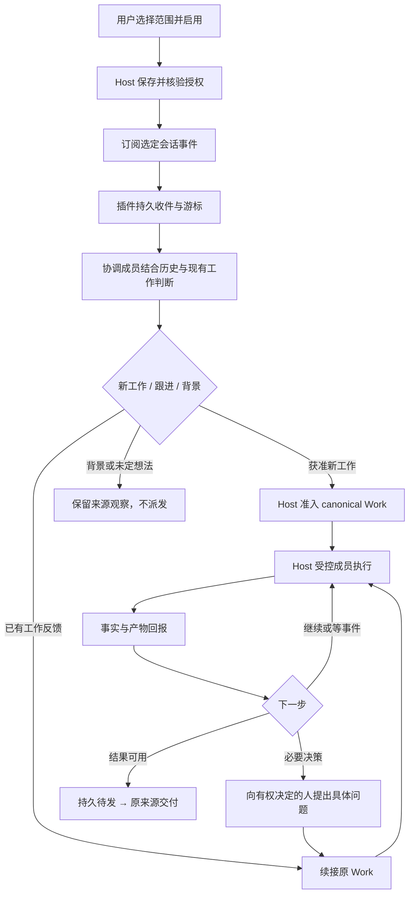

# Superagent 插件：一个入口，接住多个会话里的工作

## 用户托付与当前结论

枫哥要求：基于之前的 DSH Superagent 调研，在 Clowder AI 实现自己的 Superagent；优先以插件存在，安装后在会话列表顶部看到 Bot，能够主动监听和干活，并参考 Codex 的「你的 Dot」。

建议采用 **可安装的协调插件 + 现有成员执行 + Host 管理工作和权限**。用户向一个长期在场的 Bot 交代责任；它从获准范围发现新工作，持续维护已有工作，把执行分给现有成员，反馈续接原事项；只把需要人判断的问题和可使用结果送到人面前。

用户已确认体验方向，独立插件包与 Host 通用顶部入口已实现。隔离 Windows Host 已实跑 TGZ 安装、范围设置、两项真实文件执行、原 Work 跨会话续接、原处回流、人类接受，以及暂停和重启恢复；独立审查、macOS 与合并后验收尚未完成。`/dev/superagent-preview?shell=v2` 保留为合成体验稿。最新实现见 [implementation.md](implementation.md)，实际证据与失败边界见 [implementation-verification.md](implementation-verification.md)。

## 已确认的首版范围

枫哥已选择「个人选定的会话，跨会话跟进任务」（来源：`message:0001793721364288-000625-f53c1c95`，2026-11-03 15:56 UTC）。首版只监听本人明确选定的 Clowder 会话，统一跟进其中的多项工作；安装不默认订阅全部会话。反馈无论出现在主对话还是其他已选会话，都应续接原事项。

多人 Channel 保留来源适配路径，不作为首版交付依赖。当前先验证「两个已选会话里的两件事 + 旧反馈 + 必要决策 + 原处结果」；未来接入 Channel 时，另行验证多人的来源身份、权限和结果回流，不能以个人会话验收替代。

枫哥随后选择「按现稿落地」（`message:0001793723766392-000695-f7ccadc0`，2026-11-03 16:36 UTC），确认顶部一个常驻 Bot 入口、主对话多事项跟进、原会话反馈/结果和暂停的体验方向。正式实现沿用该方向，见 [implementation.md](implementation.md)。

范围确定后的早期接口探针见 [contract-slice.md](contract-slice.md)。正式实现改用已有普通 A2A/Queue 唤醒；该路径与早期受控 memberSessions 不同，不需要新增长期 member-session 授权。

## Before / After

- 现在：人逐个打开会话、记住承诺、转发反馈、催进度，再协调谁继续。
- 之后：人选定范围并交代长期责任，Bot 接住获准工作、持续跟进多个事项；人在需要判断或验收时介入。
- 人保留：监听范围、执行成员、授权边界、停止权和重要决策。安装本身不授予全会话读取或无限自动执行权限。

## User Journey

**Scope unit**：一个用户安装的一个协调 Bot；一个长期入口管理多个业务 Work。业务 Work 与执行 Thread 分开，Thread 不是 Work 身份。

1. 用户在插件页安装 Superagent。安装完成后，列表顶部出现「我的助手」，显示「待设置」。默认不订阅所有会话，也不触发模型调用。
2. 打开入口，在现有插件设置中选择成员、监听会话和工作范围。例如：关注发布准备与导出修复，允许调查、实现和验证，发布与范围变化找我决定。
3. 明确启用后，顶部显示当前真实状态。常驻指 Host 活着时保持订阅、按事件唤醒；不保持模型空转，也不承诺电脑关闭后仍在本机执行。
4. 用户继续在选定的普通会话交流。Bot 分清新工作、旧工作的反馈、单纯背景和未定想法。允许处理的事项进入 canonical Task；不确定的想法留在讨论中。
5. 同时接住两件事：导出修复与发布说明。执行在各自工作线程内进行；Bot 的主对话可继续交流，不被其中一个长任务占住。
6. 导出修复的 reviewer 给出意见，Bot 续接同一 Work 和执行上下文，不要求用户复制意见、重开任务。发布说明等待一个产品取舍时，只问有权决定的人。
7. 用户从 Bot 主对话回答，也可在原现场回答；答案回到同一事项，继续执行。结果回原来源，主对话保留简要交付与原处链接。
8. 用户暂停后，停止新接单和新派发；已运行工作如需停止，应明确取消对应事项。停用撤销插件激活权，保留用户工作与历史。重启后核对真实任务、投递和执行状态，再恢复允许的订阅与跟进。

## 顶部入口与对话

- 位置：会话列表顶部、普通会话分组之前，保留原有新对话、作品和记忆入口。classic 与 v2 都应有对应位置。
- 一个紧凑行：头像、用户可改的 Bot 名称、真实运行状态；徽标仅表示待处理决定和未读结果，不表示模型回合数或全部任务数。
- 点击打开 Bot 长期主对话；首屏围绕当前对话和需要人处理的事项。执行日志与完整活动按需展开，避免默认铺设统计仪表盘。
- 运行状态至少区分：待设置、监听中、暂停、不可用。状态点不闪烁；连接失败显示原因及修复入口。
- 设置仍归现有插件卡片。主对话的「监听范围」是进入同一配置的快捷入口，不能再维护第二份配置真相。
- 移动端提供主对话内的同等入口；不能要求窄屏同时展示完整侧栏与聊天。
- 名称「我的助手」只是体验稿占位，Superagent 是能力名；不要伪装成 OpenAI Dot，也不占用现有 `gpt-dot` 云端身份。

## 现有源码与缺口

核对基线：Host `upstream/next@0fb68bc03455507836a0a35a706985a1ccc66058`；本机安装目录不是开发仓，不在那里修改产品代码或配置。

| 能力 | 当前入口 | 可以复用什么 / 仍须证明什么 |
| --- | --- | --- |
| 安装、配置、启停 | `packages/api/src/domains/plugin/manager/`、`official-catalog.ts` | 复用安装代际、grant、状态投影；需最终包与空白 consumer 验证 |
| 消息订阅 | `host-surface/plugin-messaging-subscription-host.ts` | 已有指定 thread 的订阅与撤销；需验证持久消费、断线补读和停用行为 |
| 历史与成员目录 | `host-surface/plugin-thread-host.ts`、`plugin-members-host.ts` | 已有 list/readMessages/getCats 与成员查询；不能由此推导用户已授予全量监听 |
| 受控成员执行 | `member-sessions/host.ts`、`types.ts` | 已有 prepare/execute、executionId、semanticCursor 与真实执行查询；需从最终发布 SDK 核对原生上下文授权路径 |
| 工作记录 | `host-surface/task/plugin-task-host.ts`、`task/plugin-task-data.ts` | 已有 Task 读写和 Work 数据边界；创建记录不等于准入或派发，不能绕过工作授权 |
| 插件私有持久化 | `host-surface/plugin-private-storage.ts` | 复用存储与 CAS，保存订阅配置、游标、来源关联和待投递动作；不复制整份工作数据库 |
| 定时唤醒 | `declared/declared-schedule-task.ts` | 复用 schedule 与持久运行账本；事件驱动优先，定时只补查明确外部等待或恢复缺口 |
| 插件 UI | `declared/declared-plugin-ui.ts`、Web `components/plugins/PluginUiEntries.tsx` | 当前只投影 `activity-bar.bottom`，且打开沙箱面板；顶部长期对话入口需要通用 Host 扩展 |
| Channel 续接 | F290 J4、插件 `collective-work-wake.ts` | 已有 Work/Assignment 到原 Task 的续接；需真实多人验收，不能直接宣称新 Bot 自动兼容 |

Host 的 contract 依赖是 vendored candidate；插件源码另有版本。后续必须比较 Host 实际 tgz 与插件最终依赖的 exact bytes，不能从 `main` 上存在一个接口推断已安装版本支持。

## 责任边界

| 层 | 负责 | 不负责 |
| --- | --- | --- |
| Superagent 插件 | 订阅来源、持久游标、分拣协调、模型指令、来源与 Work 的关联、主对话活动呈现 | 自行决定读取全项目、伪造用户授权、直接写 Host 存储、管理 provider 凭据 |
| Host | 安装与授权、可读范围、入口投影、任务准入、执行监督、消息与工作真相、撤权和持久化 | 插件专属接单策略和业务提示词 |
| 现有成员 | 理解被委派工作、实施、验证、报告和处理获准反馈 | 以一次 turn 结束代替业务交付 |
| 来源适配 | 普通会话 / Collective 的事件、身份、原处链接 | 把可读上下文当作执行授权 |

插件可保存自己的工作关联索引和执行关联，业务状态以 Host Task/Work 为准。避免另建一套 Ticket/Assignment/Needs Me 数据库，然后要求人同步。

落地位置建议：业务插件放在 `clowder-ai-plugins` 独立工位的 `packages/superagent/`，使用现有 SDK 打包；本 Host 工位只承担通用入口、绑定与确实缺失的受控接口。公共 contract/SDK 的变化随插件仓版本发布，不在 Host 私造一份契约。首版可选择现有成员承担协调与执行，不限定 Codex/provider；Bot 外观与原成员身份分开，真实响应和执行来源始终可追溯。

## 拟议执行链



这不是承诺所有接口已经可组合。开工剖面必须先验证：插件订阅事件进入协调执行时，Host 能携带并核验原授权与来源；协调结果进入 Work 的准入接口；后续执行和结果回流都沿同一授权链。若现有链不支持，补通用受控契约，而不是塞一个无限权限 API key 或私调 AgentRouter。

## 最小 Host 扩展

1. **通用会话顶部入口**：在既有 UI contribution 上支持一个明确的 sidebar group，并投影指向 Host 所有的持久主 Thread。现有 UI registry 只列活跃插件；要展示「已安装、待设置/已停用」，还须从安装 inventory 投影入口与绑定，不能仅复用 active registry。用户安装者、插件代际、展示状态和目标归属由 Host 核验；徽标读取可追溯的问题/结果状态，前端不写 `pluginId === superagent` 的业务分支。
2. **受授权的订阅到协调执行**：先做契约剖面，确认现有 memberSessions + messaging 是否足够。仅补缺失的 source/grant 传递或执行入口，不另造所有成员调用面。
3. **来源明确的 Work 准入与跟进**：复用 Task 的 admission / existing Work 更新 owner；自动判断不能凭任意插件内容生成权限。需要拓展时提供通用、范围受限、可撤销的授权来源契约。

第一项涉及公开 UI contract 和长期入口，是实际改动；第二、三项目前是必须用真实调用证伪的组合风险，不能提前报成「零 Host 改动、纯插件即可」。主业务与策略仍可独立打包。

## 主动性、成本和恢复

- 不硬编码关键词派工。确定性代码负责来源、范围、去重和授权；语义判断交给选定协调成员，并保存原文引用、判断和关联对象。
- 不每条 token 或自身进度再唤醒自己；消息按稳定来源 ID 收件，重复投递不重新建工作。多个独立来源谈同一事项时，仍需语义关联，不能只靠 eventId 去重。
- 不默认定时全量扫描所有历史。新事件唤醒，短窗口合并同源突发输入；具体窗口和并发上限在实现前以实际使用成本校准。
- 用户跟进、取消和问题回答先于新工作处理；执行并发复用现有成员约束。需要等待外部条件时保存等待状态，不占模型空转。
- 接收、已读、接责、执行成功、业务交付分别记录证据；执行结果不由插件伪造。
- 对外结果先持久化待发送身份，再发送并记录回执，重启核对现有原消息后补发；不要仅写内存队列。
- 用户可见工作、历史与配置永久保存（TTL=0）；日志保留策略另论，不能把 TTL 用来清除未完成工作。
- 暂停、停用和取消分别定义；插件停用不删除正在执行工作的事实，也不保留一个无效「监听中」标记。
- 本机 Host 停机期间不能主动干活。未来云端部署属于部署选择，不把它混同于插件常驻。

```yaml
in_context_observability:
  primary_surface: 顶部入口状态与 Bot 主对话中的问题、结果；失败回到受影响事项
  why_not_dashboard_only: 用户不应为了解它是否接住工作而另开监控台
  deep_dive_surface: 事项活动详情与原执行线程，仅用于追溯和接管
  noise_dedup_policy: 同一事项的问题与结果更新原对象；普通内部进度不逐条外发
```

## 实施顺序与完成证据

| 步骤 | 可检查产物 | 验证 |
| --- | --- | --- |
| 体验确认（当前） | 真实壳顶部入口、主对话、范围设置、暂停和决策续接体验稿 | 桌面、390px、默认/空/暂停/不可用；标明合成数据 |
| 契约剖面 | 最终 SDK/Host 版本矩阵、单事件进入协调执行并读回真实结果 | 隔离用户与数据，真实成员；拒绝越范围和停用后的输入 |
| 可安装纵向路径 | 插件包、顶部入口、一个监听来源、canonical Work 和成员执行 | 从最终 tgz 安装，不能靠 monorepo hoisting 假绿 |
| 多事项与跟进 | 两件并行工作、一条旧工作反馈、一项必要决策、原处结果 | 无手工复制消息、无重复建单；未定想法不执行 |
| 生命周期 | 暂停/恢复、撤权、重启补读和待发恢复、停用卸载 | 合成事件故障演练 + 真实执行状态回读；工作与历史保留 |
| 交付 | exact HEAD 非作者审查、目标环境实际旅程、回退说明 | Windows 与 macOS 分别采证；未执行的验收明确留空 |

测试先从外部行为建立 RED，再实现 GREEN。首个有价值的测试应重放「已授权会话里两件事 + 旧反馈」，断言恰好两个 Work、反馈回到原 Work；不要只测试 helper 或对象字段存在。

回退：停用插件，撤销订阅与后续执行权限，移除活跃顶部入口；普通会话、canonical Work、消息和产物保留可查。Host 扩展单独可回滚；不删除用户数据作为回退动作。

## Codex / Dot 参考与来源审计

| 来源 | 版本 / 原文 | 本提案使用范围 |
| --- | --- | --- |
| 原 DSH 调研 | `G:/AIwork/clowder-ai/artifacts/dsh-superagent-prototype-research-20261102/feature-discussions/2026-11-02-dsh-superagent-prototype-deep-dive/README.md` | 多事项注意力管理、任务/会话分离、主动发现与持续跟进 |
| DSH 源码 | [deepseek-ai/dsh-superagent-prototype@6337fc8](https://github.com/deepseek-ai/dsh-superagent-prototype/tree/6337fc823ce20251c8de8085948165c81aaa701e) | 已有调研固定快照，不代表生产可靠性或 Windows 验收 |
| 用户截图 | 原消息附件中的「你的 Dot」顶部行 | 仅证明入口位置、名称与徽标外观，不由截图推断后台实现 |
| OpenAI 官方产品说明 | [Meet dots](https://learn.chatgpt.com/docs/dots)、[computers and apps](https://learn.chatgpt.com/docs/dots/computers-and-apps)，本次已打开原文 | 长期责任、并行工作、必要时找人；产品说明是厂商自述，不是开源实现证据 |
| Codex 官方公开仓库 | [openai/codex@079e17a](https://github.com/openai/codex/tree/079e17a422347e49d02501304f79fade7e569362) | 已通过 gh 读取完整 tree（truncated=false）、app-server README、ThreadStartSource 和 ScheduledTaskSummary |
| 可复用协议参考 | [app-server README](https://github.com/openai/codex/blob/079e17a422347e49d02501304f79fade7e569362/codex-rs/app-server/README.md)、[thread.ts](https://github.com/openai/codex/blob/079e17a422347e49d02501304f79fade7e569362/sdk/typescript/src/thread.ts) | 持久 thread、恢复和回合事件应独立于产品主入口 |

**尚未定位到截图中 Dot 的完整云端协调服务或桌面侧栏源码。** 公开 Codex harness 与 Dot 产品不能画等号；本次树检索和已读文件也不能证明所有其他仓库都不存在相应代码。如果提供具体仓库，继续核对 exact commit。不会以「Codex 开源」推出「Dot 完整开源」。

外部来源均记录主体、版本或读取日与适用边界；无性能、成本节省或误接率数字支撑，因此不作此类收益承诺。

## 当前未完成

- 体验方向已确认；仍需在完整 Host 中实现并验收。
- 体验稿当前只覆盖 v2；classic 顶部入口和完整 Host 内的集成验证仍待正式实现。
- 发布 SDK 与 Host exact bytes 的组合验证；完整 Dot 服务源码定位仍未确认。
- 真正插件包、自动识别/准入/执行/结果回流、重启恢复和非作者审查。
- macOS 与 Windows 的真实成员端到端验收；当前依赖安装和体验稿浏览器检查不替代它们。

体验稿运行方式、已执行验证和实例台账见 [verification.md](verification.md)。
