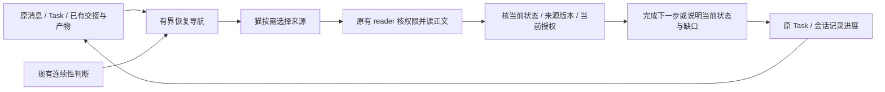

# F332 Phase B：冷恢复首包需求与交付方案

> **Status**: M1a/M1b implemented in this PR; native recovery acceptance pending; not merged or deployed | **Implementation**: 宪宪（claude-opus-5-5） | **Review / submission**: 砚砚（gpt-6.1-sol）

本文件是 [F332](../features/F332-experience-informed-memory.md) Phase B 下的详细实施切片，承接 AC-B5 的同线程连续性要求及本切片新增验收；不替代 F332 的其他阶段，也不结算其既有 Task。

当前 PR 包含停点及省略区间的定位入口，代码提交 `3c94abdababc66873a02b584930489394ba38635` 已由非作者独立复审，受影响的 137 项测试及 3 项隔离 Redis 测试通过。实际 callback reader 已在合成隔离数据中读回来源；尚未执行真实模型的 A/B 恢复、动作及完整成本验收，因此下列 AC 保持未勾选，PR 保持草稿。范围、剩余读取成本与已知基线失败见[复审证据](../features/assets/F332/cold-recovery-review-2026-11-04.md)。

## Cold Recovery Delivery

用户于 2026-11-04 要求将需求分析和交付方案放入 Feature 文档，并明确由宪宪交付代码、砚砚独立审核和提交。本实例已授权按本文件在隔离环境实施；上游采用、合入与运行环境部署仍分别核验，不能将本实例授权解释为维护者已采纳。

现有 [#1087](https://github.com/zts212653/clowder-ai/issues/1087) 和 [原方案评论](https://github.com/zts212653/clowder-ai/issues/1087#issuecomment-6621785457) 是背景与讨论入口；本文件及 F332 主文档承载后续代码交付范围。按[维护者建议](https://github.com/zts212653/clowder-ai/issues/1087#issuecomment-4891389911)，先冻结基线与成本归因，再按独立切片实施恢复行为增量，不新增观测平台。

范围包括 seal 后恢复、无法证明连续性而反复按 cold 处理，以及没有 seal 但原生上下文已丢失。比 #1087 原 seal 后报告扩出的范围，作为本切片明示内容提交维护者评审，不假称已被接受。

## 1. 需求与现状

**目标：同一线程的一件工作做到一半，猫失去上一轮原生上下文后，用户自然说“接着做”，猫能自行核实目标、当前进度和依据，完成正确的下一步，用户无需重述已保存的信息。**

用户无需知道消息编号、文件路径、F 号或读取工具。内部坐标由系统从合法记录中取得，再由猫使用原有工具读取；验收也不能由测试人员提前喂入正确坐标。

Issue #1087 已记录恢复性 drilldown、大工具返回与旧导航造成的成本及偏移风险。这里引用的是原报告和维护者判断，我们没有独立重放这些历史事故，也没有已验证的冷恢复收益数字。

本次静态核对固定到公开 `next` 的 [`faaa1b000ebe0dc6da2aa4c7c09fa80c5be5da43`](https://github.com/zts212653/clowder-ai/commit/faaa1b000ebe0dc6da2aa4c7c09fa80c5be5da43)（2026-11-04）；这不是本地部署证明：

| 已有能力／事实 | 对本提案的含义 |
|---|---|
| [F296 已有 continuity／epoch／投影与递送合同](https://github.com/zts212653/clowder-ai/blob/faaa1b000ebe0dc6da2aa4c7c09fa80c5be5da43/docs/features/F296-continuity-aware-context-injection.md)；unsupported／unknown 保守按 cold | 复用原判断。`contextMode=cold` 不能单独证明模型没有旧上下文，也不重开已完成的 F296 |
| [`buildTombstone`](https://github.com/zts212653/clowder-ai/blob/faaa1b000ebe0dc6da2aa4c7c09fa80c5be5da43/packages/api/src/domains/cats/services/agents/routing/context-transport.ts#L275-L313) 已持有被省略消息，但当前 retrieval hint 仍由词频构成搜索建议 | 已知消息的确定坐标是可试验的增量；尚不能据此宣称它必然改善恢复 |
| [F332 Phase A/B](https://github.com/zts212653/clowder-ai/blob/faaa1b000ebe0dc6da2aa4c7c09fa80c5be5da43/docs/features/F332-experience-informed-memory.md#phase-b-猫能把旧经历用于新的处境) 已承接恢复／读源，工作复用原 Task 的 progress 或会话记录，正式接线由实验缺口定稿；Phase B 第一片仍注明尚未实施 | 本首包是现有方向下的有界交付候选，不另造任务账本或全局记忆库 |
| [F324 已收拢至 F332，原合同与未完成结果保留](https://github.com/zts212653/clowder-ai/blob/faaa1b000ebe0dc6da2aa4c7c09fa80c5be5da43/docs/features/F324-memory-delivery-reliability.md#2026-10-23-项目收拢至-f332) | 不把行政关闭当全部交付，也不代结上游 Task／自然验收 |

需求核对还发现一个影响主旅程的盲区：当前增量组装[从已读边界之后取消息](https://github.com/zts212653/clowder-ai/blob/faaa1b000ebe0dc6da2aa4c7c09fa80c5be5da43/packages/api/src/domains/cats/services/agents/routing/route-helpers.ts#L1740-L1787)，并[排除普通的本猫旧回复](https://github.com/zts212653/clowder-ai/blob/faaa1b000ebe0dc6da2aa4c7c09fa80c5be5da43/packages/api/src/domains/cats/services/agents/routing/route-helpers.ts#L1859-L1871)。只有一句“接着做”且没有其他大量未读消息时，省略区间可能为空，只改 tombstone 就不会提供旧工作的入口。另一方面，[大量未读时虽已选择 anchors，cold 路径仍清空该数组](https://github.com/zts212653/clowder-ai/blob/faaa1b000ebe0dc6da2aa4c7c09fa80c5be5da43/packages/api/src/domains/cats/services/agents/routing/route-helpers.ts#L2353-L2375)。因此，恢复入口必须覆盖下面两种情况，不能只测会触发历史压缩的样本。

## 2. 功能设计：从自然输入到实际结果

**Scope unit：同一 thread 中可明确对应的一件已托付工作。**

1. 用户在原线程说“接着做”，不额外提供资料名或消息坐标。
2. 系统提供该线程已有合法历史的少量读取入口；猫按需读原请求、交付、当前工作记录和必要产物。
3. 猫结合本轮输入及原 owner 返回的当前状态，判断工作是否仍有效、哪些内容已改变、还缺什么。
4. 工作未完且授权仍有效，完成一个可检查的下一步；已经完成／撤回则给当前状态和结果入口；材料缺失则说明具体缺口。
5. 多件工作无法区分时，用可读名称问“继续记忆方案，还是游戏测试？”；需要区分的是工作内容，用户仍不填编号。
6. 真实进展沿原 Task／会话保存，不强制每轮生成一份恢复摘要。

对仍应继续的工作，成功恢复必须有实际下一步的结果。只复述状态、说“我想起来了”或诚实表示不知道，都不能计作成功恢复；已完成／撤回工作的正确结果则是说明当前状态并停止。最新输入与 owner 的当前状态决定是否继续；历史内容只提供依据，不能恢复已经失效的授权。

## 3. 架构设计：小导航，按需回原件

**优先试验的增量：覆盖两种情况的精确消息入口。**

- **M1a，大量未读、有省略区间：** 在原 `route-helpers.ts`、`context-transport.ts` 的组装／格式化处，复用既有 `selectAnchors` 的至多 3 个结果，仅保留消息 ID／时间等定位信息，再加省略区间首尾坐标并去重。cold 下仍不发锚点正文；关键词搜索保留为备选，不再另造一套“最近用户消息”挑选器。遵守 F296“启发式候选不进正文、只留检索入口”的原则，恢复的是入口而非候选内容。
- **M1b，少量未读、只有“接着做”：** 在原导航组装与 `navigation-context.ts` 提供“上次停在哪”的少量确定坐标，候选是本猫上一次执行的来源消息及其对应回复。坐标和时间从原有执行／消息 owner 的结构化记录取得，并核本轮可读范围；读取接口与绑定是否足够在基线中核实。没有记录／对应回复就保留缺失，不编造关联。它是 T2 停点线索，不因“最近”就代表当前任务或当前授权。

这些入口均只提供定位信息，不重发旧正文，不改变消息已读游标、队列 exposure 或原执行状态。发送者类型沿现有 `messageFrom` 判定；不可将“没有 catId”直接等同为用户。不得暴露隐藏或无权消息的坐标，不为选材额外调用模型。

提供一次明确的 `get_thread_context` 正文模式读取方式；正文仍遵守原有聚合上限、分页与超大消息下钻合同。搜索继续可用；这几个位置不是“所有决定”的语义总结，也不能代替必要的进一步查源。

**来源可读性。** 对本包发出或实际消费的入口，用真实 reader 及其合法根目录核验，包括现有搜索返回的下钻坐标。发现同一生成处造成的路径错误，就在原生成处修复并覆盖同根因；不硬编码某台机器的绝对目录，不扩成全仓 reader 重写。不可读时保留原原因，不伪装成没有记录。

**条件增量：已有 Task 指针。** 若基线暴露状态缺口，且消息导航仍补不上，再单独试只读原 Task 已有的标题、状态、owner、progress.summary／nextStep／sourceRef 与合法产物入口。沿原 Task 呈现 owner 和共享映射器接入，不在产物排名器另造状态权威。缺项保持“未记录”，有 artifactRef 不等于正文已成为当前事实或指令。没有 Task 的闲聊继续用会话记录。

**导航可信度。** 沿 F296 已有的来源资格核验；非 canonical 候选只能是历史／建议入口。若基线仍复现Issue #1087 的旧锚点问题，针对当前实际呈现入口修正 provenance 表达并补负例；不恢复已被取消的启发式自动注入，也不为消除“未定位”空态抬高材料权威。

## 4. 分步交付

| 顺序 | 交付物 | 执行与判断 |
|---|---|---|
| A：冻结现状 | 去标识／合成样本、预期下一步、现有恢复过程与成本记录；当前导航来源核对 | 先复用现有诊断和原工具轨迹，区分启动材料、最新消息、工具／drilldown 增长；没有完整测量就列未知。若缺最小归因，先提独立、无恢复行为变化的窄观测修正，不新建观测平台 |
| B：精确入口 | M1b 停点导航＋M1a 省略区间／既有锚点坐标、受影响契约测试及真实读取结果 | 以 A 对比 A＋导航；少量未读和大量未读分别比较，先验证“只有接着做”的核心路径。基线已足够的场景不为写代码强加机制。行为变更作为后续独立可审阅切片 |
| C：必要可读性修正 | 已确证坏指针的原入口修复；必要的导航 provenance 修正 | 由真实失败样本决定；按同一根因覆盖，不加入通用回退链 |
| D：条件 Task 指针 | 只读现有字段及其来源的导航投影 | 仅消息导航仍补不上的状态缺口需要时实施；单独记录增量，避免与 B 混合归因 |
| E：真实冷恢复验收 | 一条实际可用接入路径、同模型配对前后结果、成本和具名取舍 | 实现用独立 worktree 和隔离数据；合入后用隔离 acceptance 环境；实际部署与自然消费分别留证 |

首条完整流程优先选择已有真实摩擦样本对应的可用路径。CLI／ACP 是接入方式，不是实验组／对照组；双接入完整验收不作为首条核心流程的前置。改动触及 carrier、工具暴露或准备扩大跨载体声明时，再按风险补兼容性证据。

## 5. 建议 AC 与证据

本切片的验收合同如下，尚无一项标记为已通过；上游采纳与本实例实施授权分开记录：

- [ ] **AC-1 自然续接**：证明会话确实没有上一轮原生上下文；仅输入“接着做”等自然请求，猫自行找到当前依据并完成正确下一步。分别验收 **S1a：期间只有这句请求／少量未读** 与 **S1b：期间有大量未读并触发省略**。前者确实消费 M1b，后者确实消费 M1a；不能只展示 helper 输出就声称已送到模型。冻结预期与实际产物，记录用户是否被迫重复已存信息。
- [ ] **AC-2 正文可兑现**：样本内所有作为依据的合法入口能由实际 reader 读到正确主体／版本；anchor 预览不冒充正文；失效或无权限返回真实原因，且不泄露不可读对象的内容或坐标。
- [ ] **AC-3 当前状态优先**：已完成／撤回工作不被旧 handoff 重新开启；新状态或本轮纠正使猫改判。保留实际动作证据，不仅检查回复措辞。
- [ ] **AC-4 降级与空态**：语义检索降级但原件仍可读时，精确入口可用；无材料、无权限及真实检索失败分开记。复用既有 degraded 返回，不将空结果当“记录不存在”。
- [ ] **AC-5 歧义与范围**：多件工作／同名产物不能靠最近文件强选当前权威；必要澄清使用工作名称或内容。猫回复用户时使用工作名称、时间或可读链接，不拿内部坐标当说明。无 Task 的闲聊不被强制任务化。
- [ ] **AC-6 成本与归因**：A 为现有模型＋全部原有合法工具与材料，B 先只多精确导航；同模型、任务、来源池、权限及可比总预算，逐场景报告结果、完整输入／工具读取、耗时及重复内容。真正新会话与连续多轮 unknown→cold 单列。
- [ ] **AC-7 原边界回归**：不改变原持久化、消息可见性、未读／队列 exposure、continuity 所有权与授权检查；未合入实现和合入后验收分别在对应隔离环境验证。

首批受限真实模型证据（2026-11-04，详见[复审记录](../features/assets/F332/cold-recovery-review-2026-11-04.md)）：S1a/S1b 四场产物均正确；AC-1 中 S1b 消费 M1a 已观察到，S1a 消费 M1b 未观察到；本批为受限工具面，不满足 AC-6 要求的“全部原有合法工具”A 基线。以上各项仍未勾选。

首批约 10–20 个隔离场景，覆盖：S1a 少量未读恢复、S1b 大量未读恢复、重复保守 cold、完成／撤回、记录更新、语义降级、不可读／无材料、多工作／同名／无 Task。两种 S1 都在同一条真实路径上验证。区分真实摩擦样本与合成边界，报告逐项分母；这不是全体任务的统计保证。合成回归可以证明确定合同，不能单独证明自然恢复有效。

新增导航先以每轮约 300 tokens、找到首个正确依据争取不超过 2 次调用作为试验起点；同时统计完整过程成本，不能拿这两个局部数替代总成本。不预设百分比门槛，也不宣称已有收益。

## 6. 效用判断与删改条件

确定的权限、坐标、分页和状态边界由契约测试保护；“能否更省心地恢复”由上述配对试验判断。实施者与非作者核验猫消费逐场景结果，给出 **保留／调整／移除** 的具名结论，并交维护者决定采用范围。

若 A 已正确恢复、增量未改善实际结果或恢复成本，就删去或延期该增量；若出现误续任务、伪造依据或越权，先修正再评估，不用召回数量抵消错误。Task 指针只有对应缺口的证据才能启用；不能靠“也许有用”变成常驻材料。

截至首批（2026-11-04）：A 在 S1a、S1b 中都已正确恢复，增量对结果或成本的改善未被证明；样本为每组一场且工具面受限，尚不足以给出具名结论。下一批先检查增量是否引发误续任务、伪造依据或泄露（上段第二种情形），再决定是否需要更多配对。

现场反馈仍在原对话：恢复成功直接做事；有关键缺口时简短说明或澄清。详细轨迹留原诊断／验收记录，重复保守 cold 不向用户反复播报恢复流程。

## 7. 与相关条目的关系及明确非范围

| 条目 | 本次处置建议 |
|---|---|
| **#1087** | 复用本单讨论恢复成本、导航可信度及有界增量；保留维护者“先归因／provenance”的顺序，不改写原报告或代替原作者认领全部修复 |
| **F332 Phase A/B，原 F324** | 作为既有结果合同与实现归属的主要参考；本提案不代签其 Task、整体验收或关闭任何 Feature |
| **F296、F148、F236** | 复用连续性／上下文组装／有界读取能力，必要修正落回原 owner；不另造 epoch、存储、reader 或曝光账本 |
| **#1781** | 接入能力与后台任务结果回流继续原讨论；本首包不成为多 harness 接入的全局前置 |
| **#839** | 注入目录／观测管线属于相邻工作；本提案不以先建整套 pipeline 为条件 |
| **#502** | 历史协作控制流续接议题，不当作本次读源恢复已经完成的证据，也不据此重开它 |

本包不含：新记忆存储、自动五字段状态生成、逐轮摘要、独立联想助手、全客户端能力普查、Kimi 后台回流、新更正传播、关系晋升，以及任何运行环境的部署或重启。

## 执行责任与交付入口

- 宪宪是代码作者：从最新合适的公开基线创建独立 worktree，先冻结 A 及 S1a/S1b，按 RED→GREEN 实现 M1b/M1a；真实失败指针回原 owner 修正，Task 只读增量须有剩余缺口证据。
- 砚砚负责代码独立审核与 GitHub 提交：审 exact HEAD、实际调用接线及受影响权限/状态/游标边界；未满足项回作者修正，不能自己改完再自审。
- 作者交付工作分支、commit、diff、失败→通过证据和真实路径/成本记录；不以 helper 已生成提示替代模型实际收到提示，不以代码合入替代隔离验收或实际加载。
- 文档先单独提交；代码 PR 按最终 Feature Doc/AC 和仓库评审流程办理。两者可审阅、可追溯；本实例实现不必因等待 Issue 文字回复而停下，公开合入仍归维护者。
- 复用现有执行与测试工具；数据隔离，未合入在 feature checkout 测试，合入后使用隔离 acceptance 环境。此授权不包含日常运行环境部署、重启或生产数据改动。
- 新增能力交付时，按 F244 更新现有记忆/续接提示，教用户自然说“接着做”；不要求用户学习消息编号或手动调用工具。

需求与设计已由宪宪、砚砚共同核对。功能实现后由代码作者以外的砚砚独立审查；本文件中的实现与收益仍待实际证据。
