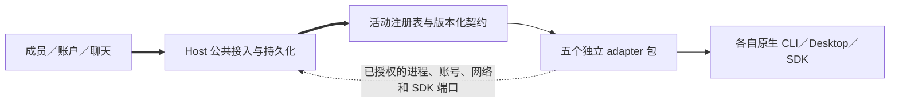

# Agent 按客户端独立发包与首批切换

来源 0001795743558495-002095-7f3a57dd。首批为 Codex、Claude Code、DSH、AGY、Kimi。砚砚实现，鲸鲸独立评审。继承任务 0001795019876209-000010-9079f5f3 与 [PR #2030](https://github.com/zts212653/clowder-ai/pull/2030)。开始基线 30cb5de51f0282893f4726cb04dae522abce6c44。旧方案中的官方 Agent Access 单包是切换基线，本文定义首批独立发包的交付终态。

Architecture cell 为 identity-session 与插件运行时。Map delta 是把具体 Agent 的发现、额度、会话和事件适配，从 Host 私有客户端分支及共享活动包移到各自包。Why 是让兼容 Host 能独立安装、启用、替换、回退一个 Agent，并继续使用同一套契约、账本、角色与历史。

## 接入与发行边界

| 层 | 负责 | 验收约束 |
| --- | --- | --- |
| Host 公共接入 | 解析成员与已激活实现，注册、准入、权限、凭据、有限进程/网络/SDK 承载，验证原生会话和终态证据，持久化历史及生成公开 UI DTO | 五个 Agent 的发现、成员设置、模型、额度和聊天走同一注册入口。首装目录和旧 ID 迁移表是数据。运行路径不按这五个 client 名称分支。 |
| 每个独立 adapter 包 | 检测与登录、成员与模型选项、额度、原生协议或 SDK 参数与输出翻译、会话协议 | 五个独立包和生命周期。单包停用后检测、额度和新会话失效，其他包继续工作。 |
| 原生 client | CLI、Desktop、SDK 或上游协议 | 保留原生状态与协议。Host 对工作区、账号和原生会话的授权不能由插件自行授予。 |
| 产品 UI | 现有成员、设置、账户额度和聊天页面 | 消费 Host 结构化状态、实际字段选项和消息，不按各 Agent 写一套通用控件。 |

计划中的发行 ID 为 official.agent-codex、official.agent-claude-code、official.agent-dsh、official.agent-agy、official.agent-kimi。每个归档有 manifest.json、版本化 agent-adapter.json 和独立 Worker 入口。均可通过 Manager 单独安装。五包随兼容 Host 的官方目录及首启初始化一同提供，每包仍有独立版本、实例和安装动作。保留原 agent-provider.json 声明和稳定绑定。原官方 agent-access.json 和共享包仅用于存量迁移与未切换承载，不能算五个独立包的验收。

采用版本化声明和 Worker 动作，Host 以包实例、摘要、生命周期版本绑定操作。包声明与动作表在准入/激活检查，旧代际回调撤销。Host 通过现有 AgentSessionProvider / AgentService 与 AgentSessionEvent / AgentMessage 向业务层输出一致形状。Worker 不传入 AgentServiceOptions、原始凭据、任意 Host 执行对象。第三方同一机制须通过明确准入，不能借 SDK/CLI 的名字隐式提权。独立包没有导入 Host 私有实现的依赖。

## Phase 0：公共接入先交付

本阶段的交付物包括独立包声明 schema、归档准入、模块动作核验、实例注册/注销、公共调用桥、版本化能力 DTO 和真实归档契约测试。全部通过后再切五家。详见下列范围。

- **声明与注册。** agent-adapter.json v1 为协议版本、稳定贡献 ID 和封闭动作表。基础动作固定为 describe、detect、openSession、startTurn、cancel、release。login、modelCatalog、quota、input、inspectInput 和 compact 按能力声明。验证 schema、归档出处、入口与实际动作表。没有公开的“插件自己调用 Host 注册表”。由 Host 在激活时用 plugin:<pluginId>/<id> 注册，绑定实例与摘要。停用、失败或换代撤回路由和旧回调。Worker 动作只传公开 DTO，Host 里的代理实现 AgentSessionProvider，由 RegisteredSessionAgentService 输出 AgentService 和 AgentMessage。
- **统一能力。** describe v1 输出固定能力键及判别分支。supported 有具体 payload；unsupported 无值；unknown 有原因。Host 用当前账号、载体和活跃实例决定有效能力。modelCatalog 使用带可选项的已有 DTO。quota 可用数据包括 owner 绑定的账号引用、来源、观测时间和窗口列表（窗口 ID、计量类型、使用比例或数量、刷新时间若有）。未登录、凭据失效、限流、未观测和不支持分别表达。相同数据投影给共享前端，未知不变成零、空历史或成功。登录、回合输入、投递查询、压缩分别声明支持状态与可用数据。describe 和 detect 的等待上限为 5 秒，取消通过执行上下文传给 Worker，业务 DTO 不含控制信号。旧 v1 升级后缺省的新能力字段表示尚未报告。第一版测试冻结字段和状态的语义，后续向后兼容扩字段。检测结果只给状态、候选短名、标签和版本信息。归属由 Host 按实际调用绑定补入，检测结果本身没有进程命令或凭据。
- **解除静态依赖。** 当前约 61 个 API 源文件从共享 @clowder-ai/agent-access 导入，API package 也有 workspace 依赖。以 Git 清单为迁移输入。协议和 DTO 的 schema 放在已存在的 @clowder-ai/agent-contract，Host 与各包均可依赖。通用 ACP I/O、受控进程和历史存储由 Host 承载，通过公开端口提供。客户端侦测、默认参数、模型/额度解析、角色表单选项、事件解析及专用 profile 迁入各发行包。首批脱离的运行与产品入口不得静态导入旧共享包或各插件，也不得用其私有客户端分支。仅未迁移的 OpenCode、CatAgent、A2A 等兼容层保留具名例外。每个例外必须有文件、现有调用方和退出条件，最终整仓删除旧依赖。
- **旧成员迁移与优先级。** 显式 adapter ref 优先，包括失效 ref。没有显式绑定时，Host 读取每个 client 的持久化切换记录。legacy 继续旧路径；validated 仅允许隔离验收走候选包，普通入口仍走旧路径；active 才用完整的 pluginId 和贡献 ID 映射解析独立包。由 Host 迁移命令在隔离验收证明真实发送与旧会话续接后，记录证据与适配器版本并原子切到 active。适配器贡献 ID 只在声明它的包内唯一。官方切换用官方目录已经验证的包来源和完整引用，不能按贡献短名匹配。保留原角色 ID、工作区、账号、会话链、native ID、模板覆盖、墓碑和创建回执。新包安装、健康且调用成功后再切换单个 client。未到切换点，仅旧包用于存量和回退窗口；切换后，缺包/停用/失败明确 unavailable，Host 不再启动 CodexAgentService、Claude*AgentService、KimiAgentService、AgyNativeAgentService 或 DSH 专用启动逻辑。降级需通过显式版本回退。AcpAgentService 的通用 ACP 承载继续服务声明式第三方，不保留 DSH 专用兜底。
- **角色所有权。** Host 持有跨 client 的单一角色目录、CAS、身份/别名/墓碑、数据迁移和写入事务。每个 adapter 只贡献本 client 的配置 schema、检测结果、可选模型/账号以及客户端字段校验。不会有五份目录写入逻辑。过渡期共享包原来的 readRoles/writeRole 由同一公共角色边界接管。
- **旧入口一起切。** /api/cats/native-runtimes、/api/agent-access/v1/detect 与 client 列表都消费同一活动注册表。旧四个额度 URL 过渡成公共 dispatch，同账号选同一个 adapter，不再调用已迁移的旧探测函数。

### 执行授权与额度

| 包 | Host 授权到本包的能力 | 额度正向结果和特别负例 |
| --- | --- | --- |
| Codex | 已批准本机 CLI、App Server 管道、只读官方额度 HTTP、账号隔离 HOME | 官方账号窗口及来源可核对。过期触发续期提示；原账号换代不读取旧观察。 |
| Claude Code | 已批准 CLI 或 SDK 承载，选定 HOME/凭据引用，Host 管审批 | 官方推理响应样本可用才显示窗口。无样本显示未观测，非授权账户不启动采样。 |
| DSH | 已批准 Desktop/CLI 与 ACP、限定 profile 读写及私有启动补丁 | 明确不支持独立原生额度查询。无额度采样、无伪值。 |
| AGY | 已批准本机 CLI 及进程范围隔离 profile、对应账号的额度数据读取 | 正确 profile 的窗口数据可核对。错误 profile/账号不读额度。 |
| Kimi | 已批准本机 CLI 的会话与额度 probe、限定账号与 HOME | 对应 profile 的原生额度窗口。空响应、失效凭据和交叉账户均明确失败。 |

上表是首批已知的允许范围。端口在启用调用之前，由 Host 的逐包动作策略授予。需要原生 I/O 的扩展必须有具体的动作与已批准端口映射，v1 声明的 operations 自身不产生执行权限。空策略只允许无 I/O 的声明与协议投影。Host 向 Worker 提供绑定本次调用的窄回调及受限句柄，原始账号密钥只进入已核准的具体承载。任意 exec/网络/文件系统、其他账号与活跃包代际均无默认授予。用 fake 子进程和记录型端点验实际拒绝，再由隔离产品实跑验正确行为。

## 公共接口与 UI 数据

| 组 | 计划动作 | Host/UI 的一致语义 |
| --- | --- | --- |
| 发现、登录、配置 | describe、detect、login、modelCatalog | 报就绪/未安装/未登录/探测失败，以及模型 ID、标签、档位和来源。仅对确有能力的操作给出入口。 |
| 额度 | quota | 可用时给来源、时间、窗口、单位和账号归属。未知、不支持、未登录和失败区分。账号换代不能复用旧观测，不展示假零值。 |
| 会话 | openSession、startTurn、cancel、release；按能力提供进行中输入等动作 | 会话绑定、取消、正文、工具相关 ID、用量、终态和错误有统一类型。能力支持且有对应 payload 才向 UI 提供该操作。Host 校验真实回合身份与终态证据。 |
| 生命周期 | 激活、卸载、禁用与替换 | 管理器按实例替换，兼容性拒绝保留旧包。包无权访问未授权账号、数据或其他实例资源。 |

## 五个客户端的影响范围

| Agent | 探测、角色、额度 | 会话与历史专属断言 |
| --- | --- | --- |
| Codex | CLI 检测和登录，模型目录，原生额度窗口、续期与身份校验。区分正常、过期和替换的账号。 | App Server 验证真实 thread/turn、文本、usage、取消、原 thread 续聊。exec 分开验证。错误 thread 通知不得成为当前终态。 |
| Claude Code | CLI/SDK 检测和账号、模型目录、官方推理响应额度样本。分别验证订阅与 API key 型态，兼容现有窗口和来源。 | Claude CLI 与 Agent SDK 分别走正常产品入口，保持原生 ID、L0/MCP、审批和终态语义。核现有 PTY/后台载体的支持状态与存量配置。 |
| DSH | Desktop/CLI 检测、profile、连接检查、隔离 HOME。现行没有同其他四家等价的原生额度刷新，验证明确不支持和 UI 不诱导刷新。 | 每个已支持载体单独验证 ACP 续接与停止。0.2.2-rc.1 的回合输入补丁与 0.2.2-rc.5 / 0.2.3-alpha.2 原生 L0 路径分开。后两版验证原生 ID、system、当前 user 与历史前缀。 |
| AGY | Native 检测、登录、profile、模型和账户额度。验证配置与本机作用域，保留已退役 IDE 的真实状态。 | AGY Native 和 --pure 的真实进程、两轮、取消、原生 ID 与绑定。存量 AGY ACP 变体验证原可用能力和数据。 |
| Kimi | CLI 检测、登录、模型和原生额度 probe，隔离账户与凭据代际。 | 原生 NDJSON、工具与 usage、停止、原 session 续聊。会话沿用首次原生 L0，下一新会话应用角色更新。 |

在正常入口复用 /api/agent-access/v1/detect、/api/cats、/api/cats/runtime-models、/api/agent-providers/models、四个 /api/accounts/:profileId/{codex,claude,agy,kimi}/quota 接口与聊天。已知用例参考 routes/accounts-*-quota.ts、providers、native-team-live.harness.mjs 和现有 Manager 归档集成测试。

## 五个包各自必过的端到端用例

| 编号 | 操作 | 明确验收标准 |
| --- | --- | --- |
| E00 公共安装与注册 | 空 Host 启动；从真实 Manager 安装两个互不认识的测试归档，第二个声明不兼容协议或入口少动作 | Host 可先启动，已有历史可读，所缺 Agent 不可用。合法包热注册两个实现；不兼容包拒绝安装，缺动作包拒绝健康；首个包与 Host PID 不变。 |
| E01 安装、停用 | 兼容 Host 空隔离库核首启五包的安装记录；另用不加载首启目录的验收实例，从 Manager 单装一个并启用，再装余下四个，停用一个 | 五个包和实例均唯一。只安装一个时仅该包可检测和接入。停用目标后不再探测、读额度或开新轮，旧历史可查，其他包的实例、请求与 Host PID 不变。 |
| E02 检测 | 默认主题和简约主题的真实检测入口；准备就绪、未安装、未登录及探测失败 | 候选显示实际 client、可用性、版本和包实例，失败原因可见，其他候选继续返回。复测不复制候选。 |
| E03 角色 | 从检测添加，再手工添加、编辑模型/账号、重复保存、重启 | catId、显示名、@、账号、模型与聊天卡一致。同一请求去重。旧角色可以重绑且不丢历史，重启后可继续调用。Kimi 连续会话沿用初始 L0，下一个新会话才采用编辑后的 L0。 |
| E04 额度 | 账户页刷新，两个账号分别测正常和凭据变化场景，再测限流、不可用和不支持 | 账号归属、窗口、重置时间、比例、来源可核对。限流不可伪造成功。DSH 不支持时无假额度且不启动配额探测。保留原用户操作路径。 |
| E05 聊天 | 正常线程 @，观察流式、工具、usage 和终态；至少做一次工具批准与一次拒绝，区分无审批能力；续聊、停止长流、停止后再发 | 真实客户端收到输入，回复在正确消息且有序，终态和取消有原生证据；工具拒绝不会产生相应副作用。续聊复用原生 ID，成功停止后无残留输出，新的发送可以成功。 |
| E06 历史 | 用旧版隔离 Host 生成五类角色、至少两轮聊天和 native 会话。拿停写副本升级，读旧线程、继续聊、重启再读 | 保留角色、账号引用、历史、消息和会话链坐标。支持续接时确认真实下游收到前轮且 ID 不变。无法续接显示明确原因，不能静默另开或覆盖旧历史。 |
| E06b 共存迁移 | 从旧共享包和旧存量生成状态，再先装新独立包，核 legacy → validated → active，停共享包的首批路径 | 同一候选与同一成员只路由一次。切换后的所有入口仅消费新包。关闭共享路径后历史可读、原生 ID 不变。回退必须显式且读原记录。 |
| E07 单包替换与回退 | 同一打包 Host 中逐个替换 A→B→A，B 保持 pluginId、贡献 ID 和动作集合，提升发行版本。另一 Agent 同时跑长流。再尝试协议 v2 和缺声明动作两种夹具 | Host build、PID、另一 Agent 的实例与代际相同。目标旧回调停止消费，历史保持。失败时原可用包保留或恢复，旧角色无需重建。 |
| E08 权限与数据 | 使用越界工作区、不同账号或退役代际尝试执行，再比较五个 Agent 的渲染状态 | 无越权调用或凭据泄漏，拒绝有证据。相同状态/事件进入相同 UI 数据结构。 |
| E09 公共契约 | 用合成第六 client 装新包，提交合法/非法能力、配置、额度与事件数据，并检查 Host 的依赖/分支 | 通用 Host 和 UI 无需改一行即可按能力显示。非法 DTO 被拒，未知不当作不可用或已完成。针对首批可执行入口验证无静态库导入、无具名 Host 实现 fallback。 |
| E10 授权 | 分别按上表尝试允许和禁止的 exec、网络、SDK、文件、账号引用或旧代际 | 只允许预先授权的端口，错误操作不触发原生工作。日志和事件无凭据。 |

各 Agent × 场景分别记录，禁止用一个 Agent 的成功替代其他 Agent。停用时在两个检测入口和额度入口都核对没有探测或假数据。只有实际证明不支持，才能以明确状态验收。真实账号及供应商验收使用经授权的隔离账号。注入 fixture 证明数据与错误路径，真实原生和浏览器回执证明产品可用。记录 Host SHA、每个包版本与摘要、客户端版本、PID、绑定的账号引用（脱敏）、会话 ID 和对应 UI/API/原生事件回执。

## 测试先行及交付顺序

评审依据为鲸鲸 0001795743763611-002134-10f00208 与 0001795744081778-002158-1d6c2642。已补公开契约、静态依赖消除、禁用后的唯一路由、角色归属、额度授权及共存迁移。

1. 首先运行真实归档准入/生命周期测试，建立第二个独立 adapter 被拒或未注册的失败。复用现有 Manager、声明 ACP 安装、quota 与事件投影夹具，不以读源码当端到端通过。
2. 在各客户端改动前写对应 E01–E08 脚本与具体断言。先做一个客户端纵切确认公共面，再逐个迁移其他四个，避免出现五个空壳包仍把行为转发回 Host 的情况。
3. 每个客户端通过独立构建、安装、权限、历史与替换检查。最后用同一个桌面候选运行全部矩阵。旧单包阶段的测试和实跑保留为基线。提交 PR 并让鲸鲸独立审查确切 HEAD。合并、正式替换和发布按已有授权。

### 已准备的可执行用例

- API 归档用例 `packages/api/test/plugin-agent-adapter-admission.test.js` 使用真实 Manager、归档与 Worker，覆盖 E00、E07 的不兼容与启动失败分支，以及 E09 的能力数据校验。第二个包必须有不同的实例和稳定贡献引用，替换失败必须恢复原摘要。
- 浏览器入口 `packages/web/test/browser/agent-per-client-cutover.journey.mjs` 是五包候选的目标用例，目前尚无产品接线和实跑证明。用例包括单装到装齐、检测、创建角色及读回、四个既有额度入口、真实发送、旧线程与原生会话续接、单包替换及停用隔离。E04 的异常账户、DSH 无额度、E05 的审批与取消、E06 的逐载体与重启、E08/E10 授权回归仍需逐包补运行用例。候选的检测、角色绑定、额度和消息回执必须从实际 dispatch 投影 adapterOrigin。它包含完整 ref、包实例、摘要、生命周期版本和 active 切换状态。未切换、空壳包、旧执行路径或仅有状态标签均不能通过。仍需写入一条运行行为为空但声明齐全的整包负例。
- 浏览器运行方式为 `node --test packages/web/test/browser/agent-per-client-cutover.journey.mjs`。沿用 `native-team-live.harness.mjs` 的独立实例 URL、证据目录、真实调用授权及 Codex 历史隔离前置条件。环境变量 `CAT_CAFE_PER_CLIENT_CUTOVER_FIXTURE` 指向独立环境的绝对 JSON 路径，`clients` 按五个发行键保存 `archive`、`upgradeArchive`、`detectId`、`adapterRef`、`member`、所需的 `account.id/expectedRef` 和 `legacy.threadId/catId/sessionId/historyMarker/messageIds/mention`。JSON 只记录引用和测试数据，不存凭据。旧版先在隔离实例用真实客户端生成历史及原生会话，停写后再导入候选验证。首启安装测试和手工单装测试分别使用新隔离库。后者关闭首启自动安装，用已完成产品切换接线的候选运行，切换命令在该版本接入后补到脚本。
