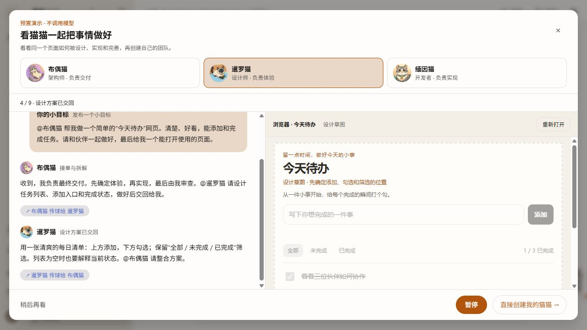
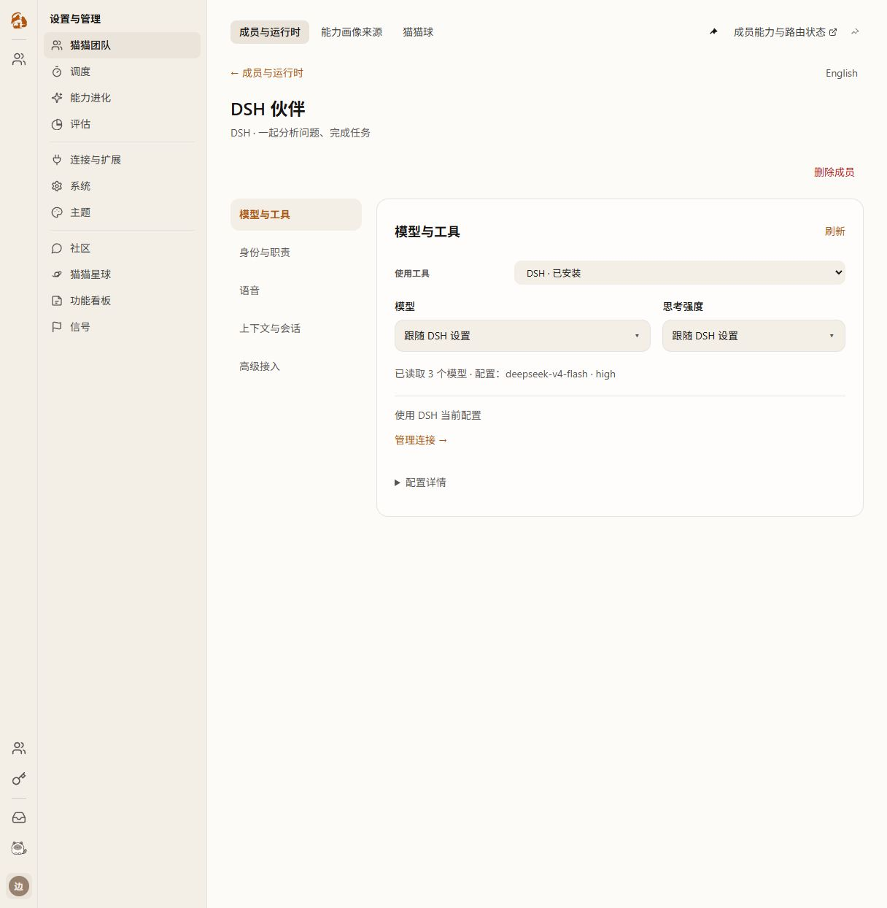
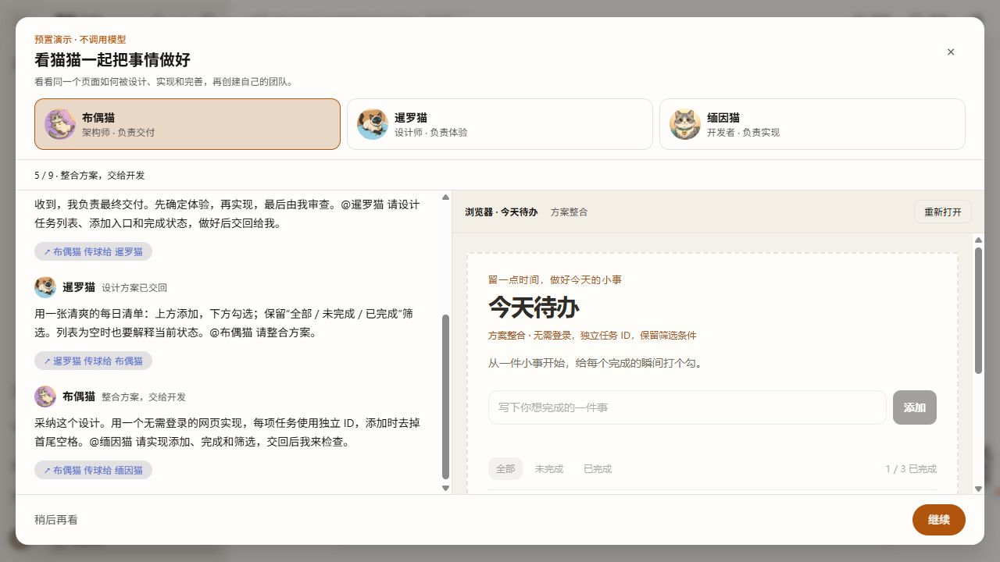
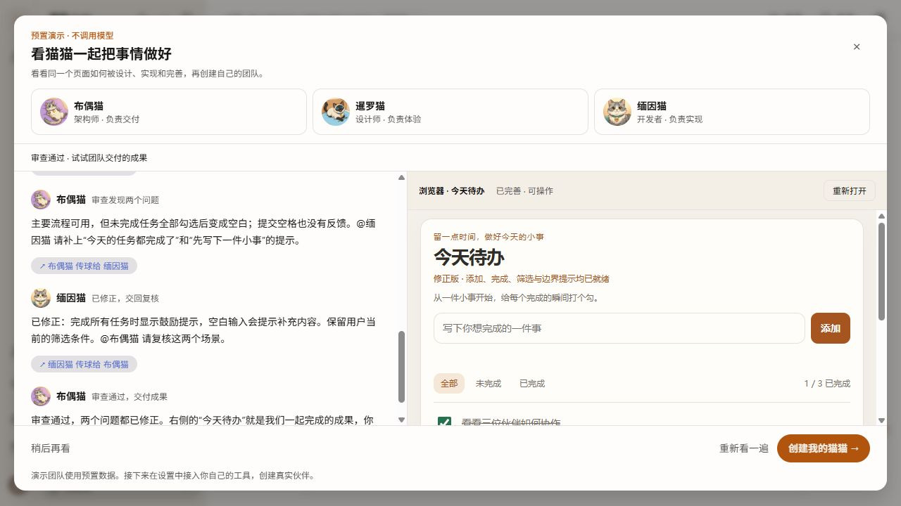
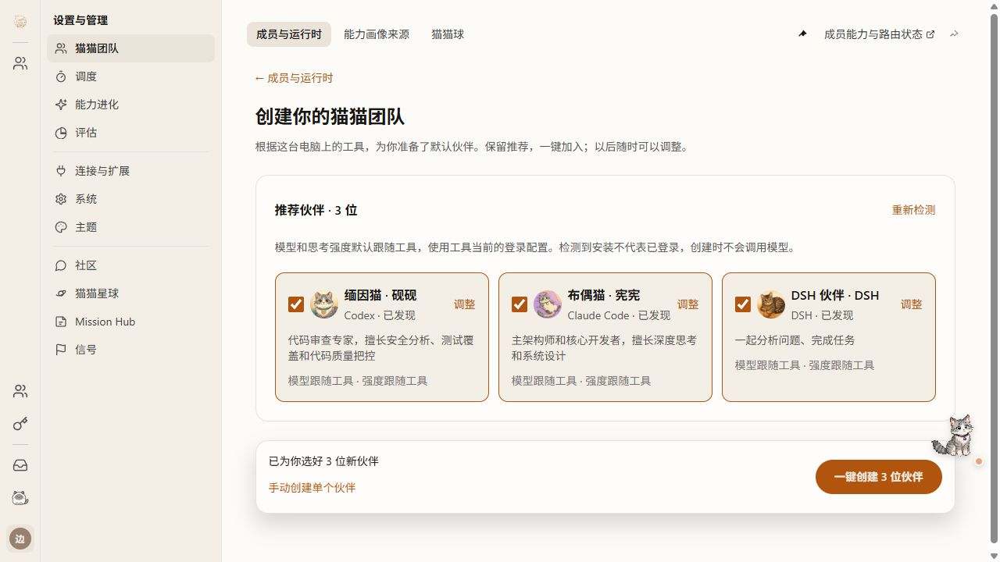
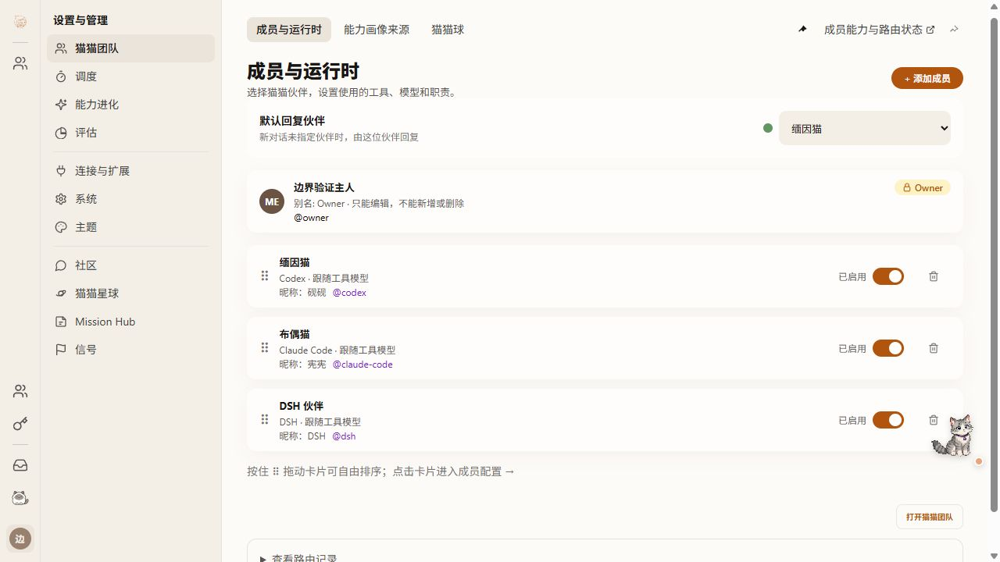
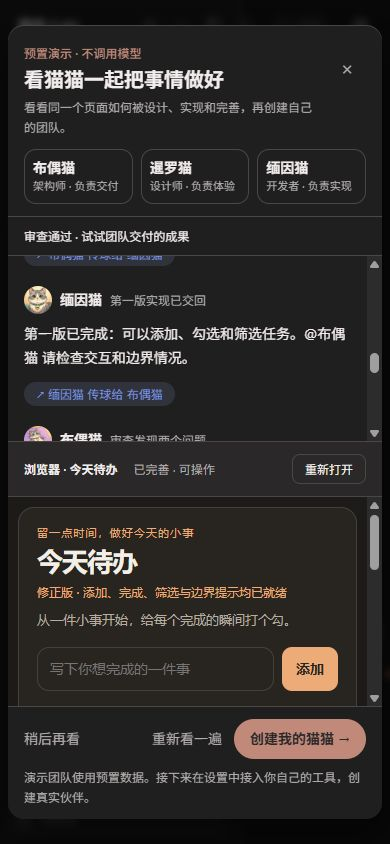
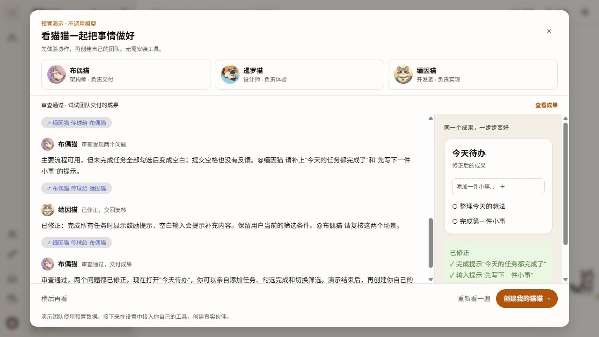
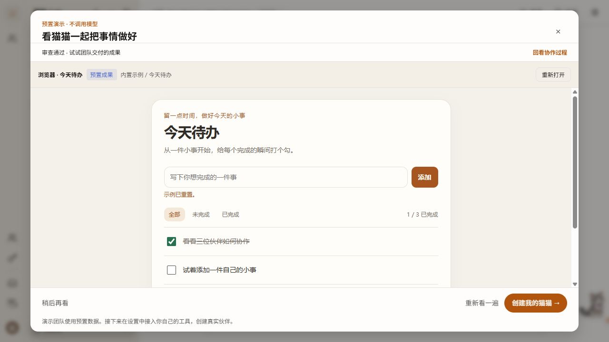
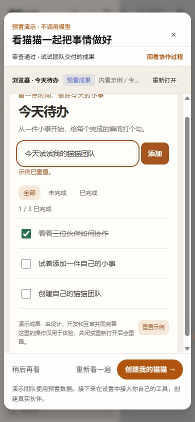

# #1466：先看一次完整协作，再创建自己的猫猫

## 已确认的方向

本地用户转述与作者讨论后的最新决定，并授权覆盖本日早先“先配置真实 client 才能体验小目标”的入口：引导全程使用提前准备的数据，用户点击首页入口后，自动完成示范伙伴准备、发布任务、A2A 传球、设计、开发、审查、修正和成果交付；成果在右侧内置浏览器连续完善，设置内一键创建推荐的真实猫猫团队。演示是可选的，首页及演示各阶段都能直接进入真实配置。

上游 [mind 的限定产品 advisory](https://github.com/zts212653/clowder-ai/issues/1466#issuecomment-6120296955) 认可预置演示价值，并明确要求配置入口不依赖演示。该意见已采纳；这不代表上游批准删除 F229、真实认证/回复或用户持久状态等原范围。

原因：无客户端、工具不受支持、运行异常、响应过慢，均不能阻止用户理解产品。来源为本次用户原话，以及 [mind 的场景回应](https://github.com/zts212653/clowder-ai/issues/1466#issuecomment-5690816786)、[issue 原文](https://github.com/zts212653/clowder-ai/issues/1466)。保留“同一个成果因协作改善”“示范成员与真实成员分开”的原则。

## User Journey

### 体验修订（2026-10-12，用户第二轮反馈）

- 成果从开始即留在右侧预览区，同一个 iframe 随设计草图、架构整合、初版、审查标注、修正版逐步变化；结束不再切换整块视图或突然打开新页面。窄屏采用上下分区，同时保留消息和成果。
- 演示后的入口改为设置内的“推荐团队”：自动探测现有支持的工具、套用默认角色并预选，一次确认批量添加。已有成员显示已加入，不覆盖；用户可取消某个推荐或展开调整。首次直接进入添加页也进入推荐路径，手动创建仍可选择。
- 复用 native runtime 发现、角色模板、推荐和幂等创建合同；新增 members-only 消费方式，创建后回到成员列表，不创建会话、不发送消息。沿用逐项成功记录，部分失败可重试且不重复创建。无工具、探测失败分别提示安装/重新探测；已安装不冒充已登录或可调用。
- Architecture cell：首启 UI / Workspace browser / Settings members；Map delta：固定预览增加阶段投影，既有创建 hook 增加仅创建成员的入口；不新增配置权威或后端接口。
- Canonical source：`native-onboarding.ts#recommendNativePartners`、`useNativeOnboarding.ts`、`/api/cats`。Claim guard：一次确认创建所有已选项、不写 threads/messages、失败恢复不重复、现有成员不改写、连续预览 iframe 身份不变。
- 验证：行为测试先 RED 再 GREEN；实页观察设计到修正的连续预览，实际一键创建并核对成员列表；补无工具及失败状态、移动端、已有成员普通编辑回归。隔离实例继续独立，生产保持不动。

Scope unit：一次用户主动启动的演示旅程，不是真实 thread、成员或 invocation。

1. 从实际首页“看看团队如何协作”进入，看见三位示范猫及其角色。
2. 窗口打开后立即自动准备示范团队、输入并发布一个“今天待办”网页任务，无需再次点击开始。
3. 布偶猫作为架构师接单拆解，将设计交给暹罗猫；设计师回传布局与交互方案。
4. 架构师整合状态与实现方案，交给缅因猫开发；开发者回传初版。
5. 架构师指出“全部完成时缺少反馈、空输入处理不清楚”的具体问题；开发者修正，再回传审查。
6. 从开始即在右侧内置浏览器预留成果位置，设计时出现草图，开发时启用交互，互审时标注问题，修正后完善提示。同一个 iframe 始终保留，完成时不再切换视图；可添加、完成、筛选任务。
7. “直接创建我的猫猫”始终可用，进入现有设置中的 `/settings?s=members&shell=v2&view=setup`，自动检测并推荐默认团队，一键添加。完成演示且最终阶段加载成功只改变成果就绪提示，不作为配置门禁。首次直接进入 `view=add` 也提供推荐，已有团队普通添加沿用单个编辑器；手动创建可主动选择。真实探测与配置只发生在设置中。

首页点击“看看团队如何协作”后直接进入演示并自动播放，不再显示三选项弹窗或“开始引导”按钮；支持暂停、继续、重播、稍后再看。关闭后重新打开或刷新恢复未完成步骤并自动继续；已完成的书签重新从头播放。没有模型等待、安装或登录门禁。

## 技术方案与改动范围

### 减少确认操作（2026-10-12，用户第三轮反馈）

- 删除 `DemoInvitation` 三选项弹窗及其首启自动展示状态。首页“看看团队如何协作”直接打开 `GuidedOnboarding`，首页的真实配置链接仍然独立可用。
- `useDemoPlayback` 读取书签后立即播放：新用户从第一步开始，未完成的演示从原步骤继续，已完成的演示从头重播。读取损坏或不可用的存储时也能自动开始，不依赖本机客户端。
- 删除窗口内“开始引导”按钮，保留暂停、继续、重播、关闭和真实配置。关闭清理计时器；暂停仍冻结当前步骤及文字，不因自动播放改动而失效。
- 验证：先观察 5 条自动播放失败回归，再补已完成重播的失败回归；最终首启、聊天宿主、普通浏览器面板共 18 文件 / 94 测试通过。Web 应用/测试源码类型检查通过，未扩大为全量 tsconfig 通过。
- 实页 `http://localhost:5144/?shell=v2`：首页一次点击直接到第 1 步并出现“暂停”，随后自动推进；在第 5 步暂停、关闭、再次打开，立即从第 5 步继续。测试实例继续使用 API 3144 / Redis 6370 和原独立数据目录。



- 唯一宿主继续是 `ChatContainer` 的首启入口；演示作为该宿主中的隔离界面，不另造独立 HTML 原型或第二个应用壳。
- 前端静态事件序列驱动确定性播放；事件包含接单者、交接对象、职责、内容和成果阶段。明确显示“预置演示 · 不调用模型”。
- `onboarding-demo/` 的播放器只持有演示状态，不导入 native onboarding hook，不调用 cats/messages/threads/agent API，不往正常聊天 store 写示范记录。
- 内置浏览器 `BrowserPanel` 增加有限的打包页面模式，固定白名单的编译内置 HTML（srcDoc）；通常的本地服务预览链路保持原样。成果随 Web 包提供，不启动第三方服务、不依赖预览网关，也不新增静态网页路由或修改安全响应头。
- 成果 iframe 使用 sandbox；仅允许示例交互脚本，禁止访问主应用 cookie/storage、外部网络和顶层导航。阶段消息仅接受固定枚举，验证 parent/window 来源；只有当前阶段确认后才更新就绪状态。失败或超时提供重新打开，不伪装交付成功；阶段推进不会重载 iframe 或清空用户在成果页的操作。
- 演示进度使用独立、带版本、独立命名空间的浏览器本地状态（不声明账号隔离或跨设备完成）；不复用或改写旧真实引导草稿、线程、成员、账号。读取损坏则回到开始，已完成后仍可主动重看。
- 此阶段不新增服务端引导持久化合同，不把本地播放记录称为跨设备完成记录。真实成员设置、runtime 修复及现有数据继续保留。

Architecture cell：首启 UI / Workspace browser。Map delta：内置浏览器增加白名单打包页面输入；不增加运行时、账号或消息存储权威。

### 2026-10-13：衔接公开 main 的集成契约

上游 `0fc7e3747`（#1584）与本分支 `5ac02398b` 的 24 个内容冲突在本 PR 内合并处理，保留两个父提交，不重写已有 review 所引用的提交。集成目标是延续已验收的用户路径，并消费上游新能力，不关闭整个 #1466。

- 新版“新对话”首页保留上游的草稿/首条消息准入、作品入口、搜索与阅读控制，接入独立的查看协作及真实设置入口。查看协作仍直接打开并自动播放；失败的真实身份准入不阻塞预置演示，也不阻塞独立配置入口。
- 新版成员列表保留上游筛选、排序、状态与 Codex 账户绑定控件；详情与新用户创建仍使用本分支已确认的模型/工具快速配置、推荐团队与草稿保存页面。列表保持挂载，返回时恢复位置；继承模型显示“跟随工具设置”，不显示为“未设置”，DSH 使用实际工具名称。
- 账户 API 使用上游已拆分的项目根、视图、登录/绑定/额度路由；仅默认别名标为 builtin，历史自定义 OAuth 记录继续通过 authType/clientId/旧名称推断可用客户端。CLI 自管的 syntheticNative 身份在新 Codex launch descriptor 中采用 auto，显式账户继续采用指定模式；保留上游配置/身份/状态根校验，避免升级把 CLI 当前 provider 强制改成 OAuth。
- CSRF 初始化和重试读取上游的当前令牌，同时保留保存诊断；配置写入采用上游授权和用户偏好持久化入口，保留 span；成员更新保留 revision 冲突保护，并纳入 Antigravity 新字段。共享成员 registry reconciliation 保留两侧事实与后台 L0 预热，不将预热重新放到保存等待中。
- 普通新对话的 body UUID 幂等键与旧引导的 header/journey 幂等键分开消费，两侧历史与 owner 校验继续保留；DSH 工具事件原始数据、调用关联与状态修复不回退。
- 预览清理在 POSIX 继续使用上游 supervisor/owner 结果合同。Windows 无法用 SIGTERM 驱动 Node 的 POSIX drain：仅对已证明归属的进程树实施停止；没有 owner 结果时报告失败并保留证据，不把强制停止宣称为 Redis 正常保存。Windows 平台检查与 POSIX Bash/进程组检查分开，后者须在 Linux/macOS/CI 执行。

Architecture cell：原有首启 UI、成员设置、账户 launch 与预览生命周期。Map delta：none；仅在既有 owner 间衔接，未新增身份、认证、消息或持久状态权威。

zts 最新冲突通知与限定复核均采纳；mind 先前对 HTTP LAN journey、独立配置入口、暂停文字的局部结论继续保留。登录/按需安装、用户＋引导版本的持久状态、F229/F320 连续交接与第一次真实有用回复、跨平台安装及原 11 秒慢保存归因仍未完成，不将“发现＋创建伙伴”当作这些验收。

## 状态与验收

### 2026-10-13：认证测试前提与 dc582b899 衔接

采纳 zts 新测试环境 P2，详见 [认证前提与 main 集成诊断](../bug-report/issue1466-auth-test-environment.md)。OAuth 拒绝和假 API key 继承分开测试；测试环境固定并精确恢复，补齐同型 CRUD/resolver/F320 OAuth 前提。清空和故意污染认证环境两种进程各 151 条通过；产品认证及已修 ACP 逻辑不改。

main 更新到 `dc582b899` 后 PR 的冲突状态重新核实，保留 #1587 Windows 路径及输入框自适应修复，解决唯一 thread-utils 冲突。上游相关及原引导/成员/ACP Web 77 文件、491 条通过，完整前端类型通过；不沿用旧 main 的可合并或旧 HEAD CI 结论。

维护者 macOS 首次预览整组 30/33 的失败保留，单独重放绿不替代首次失败；本机 Windows 9 pass / 24 POSIX skip 也不能替代 Mac。待首次失败的完整运行材料和同环境整组复验，未凭猜测修改 POSIX 清理合同。当前阶段不合入、不关闭母 issue。

### 2026-10-13：集成后的反馈修复

- 采纳 zts 对 ACP 最终输入未进入用户历史的 P1，详情见 [DSH 工具事件诊断](../bug-report/issue1466-dsh-acp-tool-events.md)。终态输入通过同一调用进入实时/持久历史及回放，不重复建立工具调用。
- 非作者对集成提交 `71dd3e27e` 发现两处 P2：v2 详情删除入口丢失、已有配置时启停失败提示被隐藏。恢复详情删除，复用原确认与 DELETE；取消或失败留页，成功刷新后返回。已有列表和详情均展示操作错误，不要求配置先变成空值。
- 新增行为反例先观察 4 条成员操作 RED、3 条 API 历史 RED 和 4 条前端历史 RED。修后成员操作测试覆盖真实处理器的确认取消、HTTP/网络失败与成功；只发送 mock 请求，不操作实际伙伴。
- CI Build 的精确失败为 ChatContainer 两个未使用解构变量，删除残留解构后按 Next ESLint 及完整生产构建复验成功。生产构建使用独立 `.next-test-*` 和 tsconfig，避免覆盖预览缓存。
- 受影响前端回归：87 文件 / 572 通过 / 1 私有资料依赖明确跳过；工具历史/引用/追踪 API 回归：110 通过。共享与 API 编译通过；完整前端构建 exit 0，已有 warning 没有冒充归零。非作者须复核本次提交，不沿用前一版本审查通过声明。
- 作者在现有独立实例 5144/3144/6370 只读验证自动演示、推荐团队、v2 列表和 DSH 详情；不改生产 3003/3004/6399 的配置、历史或登录资料。整个 #1466 的剩余项仍按上文逐项验收。
- 非作者对 `8a4b0882b` 确认两处成员 P2 闭环，另找出回放/轨迹的输入跨调用覆盖 P2。补齐 execution 身份、具体 use event 关联与显式 orphan 不回退；5 新反例 RED→GREEN，9 文件 / 81 通过。前述 572 项为前一提交范围，最终增量使用这组受影响证据；整 PR 的正式批准仍由上游决定。



| 状态 | 用户体验与不变量 |
|---|---|
| ready | 用户主动开始；不检测或创建真实伙伴 |
| playing | 依次出现真实组件渲染的预置消息和交接；不需要逐步点下一步 |
| paused / 刷新恢复 | 暂停停留当前步骤；重新进入或刷新自动从未完成步骤继续，仅播放预置数据，不发送请求或创建真实成员 |
| preview loading / failed | 已结束脚本但成果尚未确认可见；可重试，不标记完整交付 |
| delivered | 成果可操作；更新成果就绪提示，真实设置入口在所有阶段均可用 |
| close / replay | 关闭清理 timer；重播只重置演示自身，无持久业务删除 |

测试：定时器自动旅程、暂停/恢复/损坏缓存、StrictMode 无重复步骤、无 API 调用、iframe source/ready 校验、既有远程浏览器回归、真实设置入口。浏览器验证默认首页进入→自动完成→操作成果→设置推荐团队，并覆盖移动、深色、暂停刷新。英文完整体验仍待验收。

检查命令使用当前仓库：`pnpm --filter @cat-cafe/web run test:first-run-onboarding`、定向浏览器组件 Vitest、Web 源码 TypeScript；格式化仅本次文件 `pnpm biome check --write <files>`，保留现有 CI。

本轮在 `feat/onboarding-first-run` worktree 和独立测试环境实施，不更新生产。是否接受具体演示节奏与视觉，交由用户在实际页面审查；不以自动化测试代替体验验收。

## 实际验证记录（2026-10-12）

- Worktree：`worktrees/feat-onboarding-first-run`；演示地址 `http://localhost:5140/?shell=v2`，API 3140、独立 Redis 6372。复用已有隔离实例，未修改生产 3003/3004/6399、CLI 配置或真实历史。
- 实页路径：首页入口 → 自动团队准备与任务发布 → 六次传球 → 互审与修正 → 沙盒内成果 → “创建我的猫猫” → 现有添加页。已亲自添加任务、处理空输入、勾选全部未完成任务并核对完成提示。
- 390px 窄屏可播放与操作成果；关闭/刷新后在原步骤暂停，点击继续才恢复。截图归档于工作区 `artifacts/issue1466-scripted-20261012/`，不放仓库根。
- 原始 RED：缺少引导实现时两个行为测试失败。页面集成发现普通 iframe 被全站防嵌入响应头拦截；最终使用编译内置 srcDoc，未保留任何响应头例外。沙盒拒绝表单提交，改成按钮和 Enter 本地交互，浏览器复验通过。
- 最终定向回归 35 文件、118 测试通过（首启、成员配置、旧引导、侧栏密度、保存 trace、现有浏览器），见 `web-final-reviewed.log`。Web TypeScript 无错误；本次文件 Biome 无 error，保留既有 warning。
- 非作者审查发现 P2：成果列表重绘丢失键盘焦点。先补测试确认失败，再按任务 ID 保留焦点；筛选移除任务时移到邻项，最后一项移到当前筛选按钮。`focus-red.log` / `focus-green.log` 留存，作者实页用 Tab 和空格复验三种场景，DOM 与可访问性焦点一致。
- 本轮 tips 定向检查通过；默认跨历史分支范围的 tips 检查有既有文档缺失/过期项，未修改其它 feature 的真相声明来消除它们。
- 五轴风险：行为=首启入口替换；数据=仅新增浏览器本地书签；安全=固定 HTML + allow-scripts 沙盒、禁止网络/表单、校验 ready 来源；契约=无后端 API 变化；不可逆=无。
- Architecture ownership 命令在当前分支 package.json 中未提供；采用现有首启宿主与浏览器输入扩展，未新增 Store/Queue/Router。
- Fallback 检查的播放 hook 四项分别处理书签不存在、读取损坏/受限、写入受限、无运行步骤；属于独立边界保护，不串联替代身份、账号或模型来源。

## 连续预览与一键建队验证（2026-10-12，第二轮）

- 真实项目隔离实例 5142 / API 3142 / Redis 6371：从空成员首页进入演示，预览经历草图、整合、初版、修正；没有结束切屏。iframe 的 DOM 身份与用户添加内容在阶段推进中保持不变（行为测试）。
- 演示结束进入推荐团队，实际检测 Codex、Claude Code、DSH 并预选默认角色；点击一次创建三位伙伴，回到真实成员列表。没有创建任务会话或调用模型。已有成员再次添加仍进入原单个编辑器；手动入口往返保留。
- 桌面 1280×720、移动端 390×844，浅色和深色均检查。手机预览实际添加并完成任务成功。推荐团队桌面三列呈现，角色、继承配置和创建按钮直接可见。
- 定向回归分两次执行：33 文件 121 测试 + 4 个既有 BrowserPanel 文件 8 测试，合计 37 文件 129 测试通过。覆盖无工具、探测失败、已有成员保护、部分创建失败重试、首次入口及原目标流程。
- Web 应用与测试源码 TypeScript 通过。本轮全量 Web tsconfig 存在既有的 `vitest.config.ts` Reporter 重复依赖类型冲突，未以源码检查冒充全量类型检查通过。本次变更文件 Biome 无 error。
- RED/GREEN 与最终回归日志保存在工作区 `artifacts/issue1466-continuity-20261012/` 和 `artifacts/issue1466-scripted-20261012/`，不入库测试凭据或用户配置。
- 用户验收使用另一份未创建伙伴的独立实例；已验证实例的数据保留。生产 3003/3004/6399 及已有 CLI 认证配置未修改。

## 最新 review 的处置（2026-10-12）

采纳 [zts 最新两项 P2](https://github.com/zts212653/clowder-ai/pull/1519#issuecomment-6120467135)、[HTTP LAN P1](https://github.com/zts212653/clowder-ai/pull/1519#issuecomment-6119339815) 和 mind 的直接配置建议。三个未开始/暂停/成果超时的入口反例、暂停文字反例、两种真实创建模式的 LAN 反例，修前共 6 条 RED；修后及欢迎提示回归均通过。

- 欢迎提示、演示各阶段、跳过后的空首页提供同一个推荐团队目标；不会用预览失败阻塞真实配置。
- 打字进度和播放计时分开：暂停保留前缀，继续不回退。刷新恢复仍以原步骤为书签，并非逐字持久状态。
- UUID 使用 HTTP LAN 可用的 `getRandomValues` 生成；不再直接调用 `randomUUID`。真实目标与仅创建成员两种模式均验证首次创建、卸载重挂后 journey 不变。没有声称已在真实 LAN origin 完整验收。
- 最终本地回归 **38 文件 / 136 测试通过**，Web 应用/测试源码 TypeScript 通过。原全量 tsconfig 的 Vitest Reporter 依赖冲突仍单列为本机限制。
- 实际项目 5144 验证欢迎提示直接入口、跳过后首页入口、未开始演示直接进入设置，并发现三位推荐伙伴。留给用户的验收环境为 **5144 / API 3144 / Redis 6370**，尚未点击创建；5142 的三成员验证数据保留，进程停止以避免重复占用。
- 旧 `FirstRunQuestWizard` / `/dev/first-run-onboarding` 保留为真实小目标的开发兼容入口；本轮修复其共享 hook 的 LAN 问题，但不把开发入口当新的首页主线。旧 `onboarding/` 原型组件也不作为生产交付证据，后续清理须保留旧 R4/R5 数据与恢复合同。

## mind 定向复核后的验证优化（2026-10-12）

已通读 [mind 最新复核](https://github.com/zts212653/clowder-ai/pull/1519#issuecomment-6121401373)：它针对 `509f4286` 确认真实配置独立入口、HTTP LAN journey、暂停文字三项修复局部通过，没有新增 P1/P2，也没有改变账号、按需认证、持久用户状态、F229 或 F320 的既定范围。后续 `c6bb52f09` 的一次点击自动播放继续保留上述入口与恢复能力。

- 实际运行原 `useNativeOnboarding` 测试：11 条通过，但出现 188 条 React `act` 环境警告。根因是此测试未声明 `IS_REACT_ACT_ENVIRONMENT`，且 LAN 用例提前 `unstubAllGlobals` 会清除该声明。
- 改为测试开始时声明 React act 环境；LAN 用例仅恢复 crypto，卸载之后统一还原 globals。没有屏蔽 console，也没有减少断言。相同 11 条通过，警告归零。
- 按 mind 的六文件定向范围重跑当前源码：6 文件 / 35 条通过，act 环境警告为 0。数量与其历史 SHA 的 34 条不同，来自已落地的自动播放/重播和前置弹窗删除。
- 当前完整工作区依赖下 `pnpm --filter @cat-cafe/shared build` exit 0；这不反证 reviewer 独立环境的准备构建诊断，也不代表新机器或其他系统已验收。
- `c6bb52f09` CI 已终态：17 成功 / 0 失败 / 1 项预期跳过；后续测试/文档提交单独核其 CI，不沿用此 SHA 的绿灯。

独立复验应从该提交自己的 checkout 开始，先安装锁文件对应的完整依赖，再生成共享包导出产物，最后运行首启测试：

```sh
pnpm install --frozen-lockfile
pnpm --filter @cat-cafe/shared build
pnpm --filter @cat-cafe/web run test:first-run-onboarding
```

共享包 exports 指向 `dist`，只安装 React/Vitest/jsdom 不能代替工作区依赖准备。构建有诊断时应保留其 exit code 与原日志；产物存在不等于构建通过。此优化仅涉及验证环境和说明，产品界面及演示流程沿用上一轮，生产环境无需更新。

## 第二轮入库截图

以下为实际项目 5142 隔离实例截图：











## 第一轮历史截图

以下为真实项目 5140 隔离实例截图，随分支入库，可由 GitHub 直接访问：







## 边界

演示中的接单、设计、开发和审查均为预置情节，不宣称执行了真实模型或审查。演示操作不会创建业务线程或真实成员；待办页体验数据不持久化。用户进入设置以后，才使用已有 native runtime 配置能力。安装/登录进一步引导、跨设备完成同步和整个 #1466 的最终验收不由本轮演示替代。
