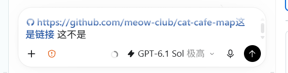
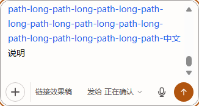
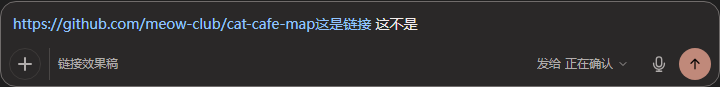

# 发送前看清链接范围：v2 输入框探索效果稿

关联 [Issue #1863](https://github.com/zts212653/clowder-ai/issues/1863)。本稿回应维护者提出的“真实效果与解析语义验证”，提交探索分支供讨论，不表示已获正式实施、排期或合入批准。

## 推荐采用的体验

保留原生输入框，用蓝色文字提示“这段源文本发送后会生成网页链接”，普通文字保留原色。用户自己用空格、换行或 Markdown 调整边界。原文、发送、草稿和气泡语义不变，classic 不增加新标记。

2026-11-06 修订：枫哥指出暖色细线削弱了链接本来的辨识度。上一版只借鉴了 Codex 的原位可见，没有采用其蓝字反馈；这一取舍不再推荐。当前探索稿改用浅色 `#2563eb`、暗色 `#93c5fd` 蓝字，正常字重，不加图标或改变字宽。此修订不是维护者对正式产品范围的批准。

参考 Codex GUI 的原位链接提示，我们认为它的优点很直接：输入时就看得见系统把哪些字算进链接，不用发送后才发现说明文字被吞进去。建议认可这个体验优化，并以本稿的实际效果继续确定视觉和正式范围。

### Codex 参考

用户提供的 Codex 图形界面截图：



截图里“这是链接”仍被算进链接，空格之后“这不是”恢复正文颜色。借鉴点是**边界在编辑时可见**，并非 Codex 能自动理解中文说明。

公开源码取证限定在 [Codex `695961ee` 的 TUI URL 检测](https://github.com/openai/codex/blob/695961ee88a2c84c0919814a4345b94a2d10f3ca/codex-rs/tui/src/terminal_hyperlinks.rs#L593)，[输入区](https://github.com/openai/codex/blob/695961ee88a2c84c0919814a4345b94a2d10f3ca/codex-rs/tui/src/bottom_pane/textarea/hyperlinks.rs#L24)与[用户历史](https://github.com/openai/codex/blob/695961ee88a2c84c0919814a4345b94a2d10f3ca/codex-rs/tui/src/history_cell/messages.rs#L333)复用检测。没有定位到截图 GUI 输入框的公开实现；本原型借鉴截图的蓝字反馈，没有复制其 GUI 代码或图标。

### 我们的实际输入框

直接挂载生产 `ChatInput`，保留原生 textarea 编辑。链接范围呈蓝字，普通文字保留原色，字宽不变：

| URL 紧贴中文：整段显示标记 | 插入空格：说明脱离标记 |
|---|---|
|  |  |

长 URL 跨行和内部滚动：



暗色：



原生选区仍显示系统高亮和可读文字：


[完整自动化操作录像](../assets/issue1863/blue/editing-demo.webm)。录像来自 Windows 上的无头 Chromium 自动化，不是人工 Windows 输入法选词录像。

## 标记含义与实现范围

裸网址标当前解析范围；显式 `[标签](URL)`、尖括号链接、引用式链接使用处及会转成链接的完整 URL 行内代码，标记整个源构造。标签与定界符不称作“地址”。引用定义修改或删除后，使用处的结果跟随解析变化。网页 URL 经聊天插件转成引用仍属于范围；邮箱、本地路径和 commit 不扩展。

输入提示与消息组件共用 GFM/breaks、聊天引用/数学配置，以及命令前缀和数学预处理。只给必要的 AST 转换补源位置；不更改链接目标或断词规则。无法定位的节点写入 `unmapped` 诊断，演示宿主在输入框之外明确提示缺口，产品输入框不增加正常流提示或重复朗读。

在 v2 中，镜像层位于原生 textarea 后方且不接收鼠标事件、不参与读屏。存在可定位链接时，镜像绘制正文和蓝字链接，textarea 文字透明，但光标、系统选区文字与编辑历史仍由原生 textarea 提供；没有链接或正在组字时，镜像隐藏，恢复原生文字。宽度按 `clientWidth`，滚动与尺寸变化同步。没有增加长期产品开关、后端接口或持久化格式。

## 已取得的操作证据

环境：Windows，Chromium `149.0.7827.55`。入口为 `packages/web/test/browser/issue1863-preview.mjs`，默认端口 4174；操作脚本 `issue1863-browser.mjs`。

- 网址紧贴中文 → 原生键入空格 → 撤销 → 重做；选区替换成换行：标记与内容随编辑更新。
- 在 1180 / 760 / 390px 窗口下，长 URL 跨行、内部滚动和末尾换行通过；未出现页面横向溢出。
- 关闭无头浏览器的隐藏滚动条后，三种宽度都实际出现 15px 常规滚动条；textarea 与镜像的 `scrollHeight` 分别同为 1232 / 1232 / 3032px，滚到底的 `scrollTop` 分别同为 1032 / 1112 / 2912px。
- Chromium CDP 原生 composition 事件与提交通过，输入值和标记一致。这个结果不代替实体 Windows IME 候选词验收。
- 将普通 URL、中文 query、显式/引用式链接、完整 URL 行内代码、`www.`、代码块及数学负例从真实输入组件提交给真实 `MarkdownContent`＋`ChatReferenceScope`：标记目标与渲染链接 `href` 一致。
- 演示消息刷新后保留；暗色可见；切换 classic 后没有标记层。
- 新解析/渲染、原有数学、聊天引用及编辑/草稿/高度检查通过，具体数量见下方独立验收记录。Biome 对改动文件无 error。全仓 TypeScript 检查存在未构建 API 声明及其他既有组件错误，不能宣称全仓类型检查通过。
- 浏览器内纯解析测量：52 / 1000 / 16600 字样本的中位数约 0.3 / 1.5 / 12.8ms，p95 约 0.6 / 2.5 / 13.6ms。这是纯解析开销，不是整条输入响应时间；未据此添加缓存或调度层。

[蓝字版浏览器原始结果](../assets/issue1863/blue/browser-results.json)。本轮 13 组浏览器操作与三种宽度几何检查通过；4 文件、76 项受影响自动化测试通过。蓝字版额外检查了原生选区、可见光标、组字期间恢复原生文字、提交后恢复蓝字，以及暗色蓝字色值。独立验收与作者自测分开记录。

### 上一版独立验收记录

鲸鲸对产品代码版本 `2645d8f3bd24b50732409492e400fabcefd84d1b` 完成独立运行与差异审查：40/40 输入样例、5/5 编辑操作、3/3 几何检查通过，含 15px 常规滚动条；CDP composition、演示刷新、暗色和 classic 检查通过，pageerror 为 0。作者最终受影响测试为 16 文件、169 项通过。

独立结论是“可交探索稿，非正式产品验收；没有真实 blocking”。[完整独立审查记录](../assets/issue1863/independent-verdict.md)与[独立原始结果](../assets/issue1863/independent-acceptance-results.json)保留了正式实施前的 P2/P3、验收边界和修正过的测试假阳性。该结论针对旧版 `2645d8f3`，不能代替本轮蓝字绘制与选区变化的独立核对。

## 尚不能据此宣称的事

这是**真实产品组件的隔离宿主演示**：输入、草稿和 Markdown 组件来自产品；提交边界及 API 响应为演示夹具，不调用猫猫或运行版服务。宿主里的新建会话、消息保存/刷新是本地演示，不能冒充完整产品 API 创建线程、真实消息存储与重启恢复的端到端验收。

实体 Windows IME 候选词选择、macOS，以及完整产品创建线程/后端持久化旅程尚未验证。还有已知源位置缺口：例如 `https\://example.com` 或 `说明 https\://example.com 后`，GFM 对转义正文重建的链接节点可能没有源位置。原型报告 `unmapped`，不猜位置、不静默忽略，也不宣称完整目标已交付。普通带位置的 GFM 链接、引用式和行内代码已保留源位置。这些结论留给实际稿评审，不写成正式能力已完成。

## 复现

在探索分支安装锁定依赖并构建 `@cat-cafe/shared` 后：

```sh
node scripts/preview-process.mjs start --port 4174 --cwd /absolute/checkout --lifetime-seconds 14400 -- node packages/web/test/browser/issue1863-preview.mjs
# 另一个终端，工作目录 packages/web：
node test/browser/issue1863-browser.mjs
```

预览只运行隔离组件，默认四小时到期，不会修改运行中的安装版。确认实际稿后，再决定正式产品范围与后续 PR；当前不申请合并或部署。
