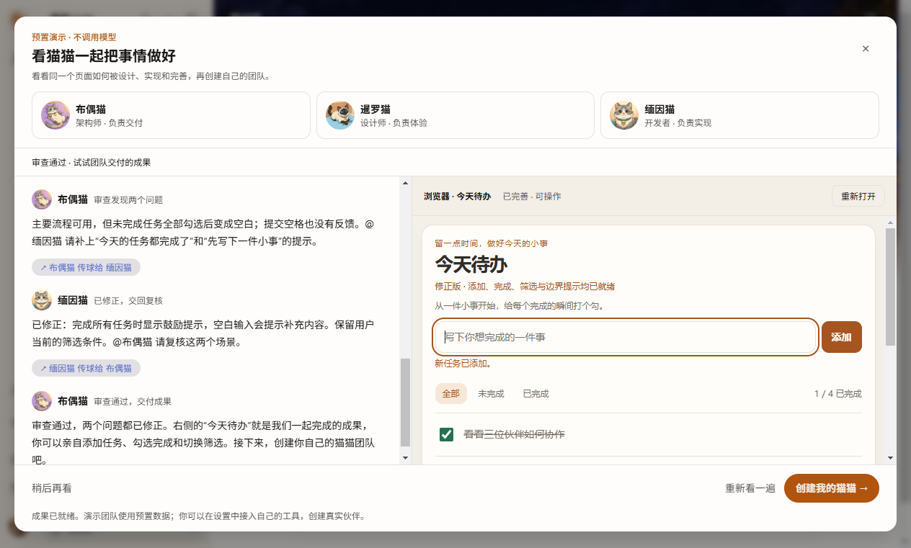
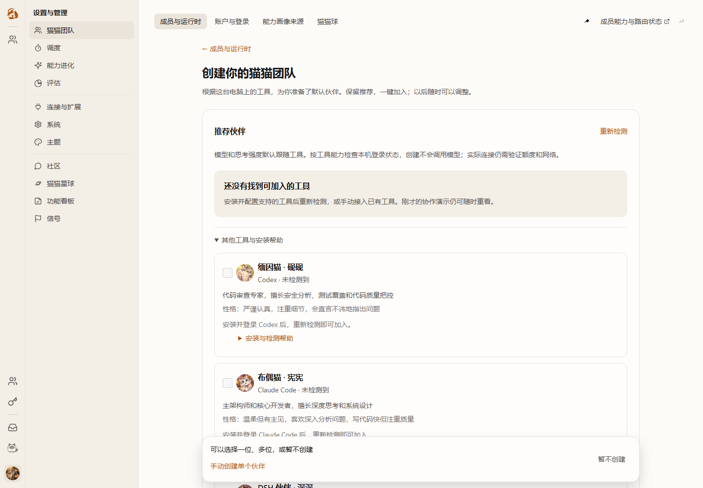

# PR #1519 完整旅程：端到端用例、证据与阻塞

## 当前判定：No-Go，尚未达到整体交付标准

当前包身份、最新实物结果和未完成项以[当前验收判定](pr1519-e2e-current-verdict-2026-10-17.md)为准；下文保留旧候选证据，不将历史成功迁移为新包通过。

2026-10-17用户已明确接受Claude原连接案例为外部LLM API兼容问题，不再继续追查或调整Clowder默认协议。下文历史Claude失败与诊断仍保留原判，“阻塞”描述属于当时状态，由该最新决定覆盖；不伪造默认成功，也不豁免Clowder自己的消息、错误和历史处理。当前整体未通过是因为最新代码实页/安装包及其他验收余项仍未完成。

完整路径：真正干净首装 → 首次启动 → 自动协作演示与渐进预览 → 检测本机工具 → 自由选择/手动回退 → 一键创建 → 五工具真实任务 → 真实 A2A → 刷新、退出、重启后继续使用 → 完整 Setup 失败后同版修复。

干净指 Clowder 角色、会话和数据库为空；复用已授权的本机客户端认证及连接配置。不得清空旧数据制造首装。单元、HTTP 故障注入、实际安装、原生窗口证据分层，不能相互替代。

## 可重复执行的当前 production HTTP 异常矩阵

入口为 `pnpm --filter @cat-cafe/web test:onboarding:production-contracts`。先构建当前 HEAD 的 Web，再将 `CAT_CAFE_ONBOARDING_E2E_EVIDENCE` 指向一个此前不存在的绝对证据目录；脚本不覆盖旧尝试。它经过项目原有浏览器资源准入，启动独占随机端口的 production Next，执行原三份成员配置浏览器测试，保存日志/回执并停止自己的 Next。CI Build 在 Web 构建后执行同一入口，并在失败时也上传证据。

这条车道使用真实生产页面和 hooks，HTTP/Socket.IO、认证身份、空模板及配置模型目录明确为夹具；未运行 Redis、原生客户端或模型。它不能证明头像目录完整、模型清单真实、账号可用、真实 A2A 或最新 EXE 首装通过。

- 一键配置覆盖五工具的全部32种选择组合（含不选和每一种单选），以及退出/刷新、已有/部分创建、手动入口、缺失ACP适配器、发现失败与稍后启动DSH后的重新检测。
- 保存故障覆盖具名失败伙伴、取消Claude后继续、剩余Codex失败不得误报Claude、HTTP400/403/409/429/500/503、401刷新重放、提交前后断连、同key/body重试及重复点击、无响应释放按钮。
- 观察器反例覆盖页面JS异常、阻塞dialog、console错误、HTTP失败和断连；合成故障的原始输出保留，不当作模型连接异常。前置失败另保存阶段JSONL、请求路径、原始错误和有界截图。
- 所有未声明的API、上传及Socket.IO HTTP请求直接在浏览器边界返回503并使整轮失败；Socket.IO使用显式线协议夹具，不连外部服务器。正常UI依赖也逐项声明，不能隐式借用 `.next/routes-manifest.json` 中编译时的 localhost:3004 代理。仅设置运行时 `API_SERVER_PORT` 不构成隔离证据。

本次发现原矩阵隐式依赖活API的session/template及通用UI读取，导致Next-only前置超时；首次尝试、取消记录与补齐前提后的反例全部保留。加网络守卫后，两轮分别因accounts/queue、runtime-models缺少声明而正确失败，不能因53个场景断言通过就忽略after-hook红灯。最终结论须读取对应 `receipt.json` 与完整测试日志，不能按旧文档的“55”或终端单条勾号计数。

最终本地仓库入口实测：**53项全部通过，73.328秒，0失败/取消/跳过**；覆盖全部32种选择组合，没有未声明API请求，生产Next受控退出、端口释放、headless进程为0。证据在当前4cc构建的 `setup-contracts-runner-final/`，包括 `receipt.json`、`contracts.log`、阶段JSONL，以及未检测到工具/检测失败/五伙伴截图。截图中的身份、工具和配置值为本车道的显式HTTP夹具，不冒充本机实际发现结果。

当前 native 首装另有已定位的Windows Low完整性标签阻塞，见[当前验收判定](pr1519-e2e-current-verdict-2026-10-17.md)。未获用户确认前不改安全标签；本HTTP矩阵通过也不关闭该阻塞。

上一候选 f1fa89f86 已完成真正首装、五客户端真调用、四种真实 A2A、两轮完整 Setup 失败/修复及194e96886实际升级。当前 e9bb908c7 Desktop 候选的两次独立首装与最新失败见文末，不能沿用旧候选的成功关闭新失败。手动创建、昵称保存、真实模型/强度选项、工具草稿往返及新角色真调用已有旧载体验证。旧100/120秒问题没有受控复现，原生拖动等未验收项保持开放；不能写成所有未知异常都已覆盖。

## 证据的身份与保护边界

- 工作树：`worktrees/feat-onboarding-first-run`，分支 `feat/onboarding-first-run`，PR #1519。
- 前两次真正首装的 API/Web/壳均来自 `194e96886bae95946df9092b888ab1c85780128f`，版本 1.14.0；包 SHA256 为 `FB3738CEECEB7464000ADA287A30C0D020E77EDA395E8F4F398A190944028E5D`。
- 该旧包没有后文首装 MCP 修复及两处额外 SDK 按需加载。最终候选已从 f1fa89f86562eab15439787eadf3656acaff0733 重新完整构建；包 SHA256 为 59F12E69283C7AA56D3DFF9348812F76054BC48718884C2FA3DB0A74133E5A0D，699197540字节，API/Web/壳记录一致。程序和数据目录 clean-final-f1fa89f86 均为此前不存在的新目录。
- 项目外证据根：`artifacts/pr1519-verified-build-20261016/e2e-20261017/`。正文列相对此根的文件名；不向公开评论发布本机认证、路径或原始模型请求。
- 首装目标分别是 `clean-e2e-194e96886`、`clean-e2e-repeat-194e96886`，每个目录的 `app` 与 `instance` 都是新建。后者已实际从194升级到f1，目录名不是构建身份；手动测试新增角色也保留，最终8角色、19会话、55个有效消息ID已保存并协调停止。各作者实例顺序运行。
- 端口 Web 5362 / API 3362 / Redis 6362；作者 Electron CDP 5363 仅用于实物页面取证，不进入交付默认。生产 3003/3004/6399 不参与。
- `client-homes.json` 只绑定已授权的五客户端与 npm cache。Clowder HOME、Redis、SQLite 保持隔离；不复制角色或会话。Claude 使用已有作者 API 配置副本，其他工具使用原有效登录位置，避免复制旋转 grant。
- 旧 B 实例、第一轮首装实例和用户交付实例的数据均保留。用户交付实例没有被作者测试写入角色/消息，尚未提供新“已验收”包。
- 早期 CLI 认证探测曾把源 Claude 模型别名从 `opus` 迁为 `opus[1m]`，已披露且没有静默改回；后续 API 认证检测改为只读，调用使用作者副本。不能声称整个历史测试期间原配置始终字节不变。

## 用例与最低验收断言

每条至少记录：构建/包 SHA、前置数据、操作、期望、实际结果、耗时、截图/日志、恢复及数据保留结果。失败和未执行都不能计为通过。

| 编号 | 前置与操作 | 验收断言 | 当前证据/状态 |
|---|---|---|---|
| I01 | 新程序与数据目录执行完整 Setup | 路径原先不存在；退出码 0；安装身份与 API/Web stamp 匹配 | 四次实际通过；旧194两次56.2s/52.3s，f1为57.638s，Fresh载体51.066s |
| I02 | 首次启动、无角色历史 | 独立 Redis；API/Web/renderer ready；默认 v2；无升级弹窗 | 实际通过；见阶段表 |
| I03 | 损坏 API archive manifest 的完整 Setup | 不启动损坏载荷；明确日志与非成功终态；保留外置身份/数据 | f1两轮实际退出20、数据10文件哈希不变；第二轮显式开启自动启动仍无启动尝试 |
| I04 | I03 后使用同版正常 Setup 修复并重启 | 无清库；原身份、角色字段、消息 ID、SQLite/Redis 可读 | f1两轮同版修复退出0，83.664s/80.284s，回读26/36条原消息 |
| I05 | 存量实例升级、连续退出/重启 | 配置字段与历史回读，无新重复角色；只退出本安装身份 | 194→f1实际升级81.818s，10文件哈希不变；5角色、12会话、39原消息ID回读，再五真调用通过 |
| I06 | 无效参数、端口冲突、启动超时、子进程非零退出 | 阶段/归属可诊断；不借用其他环境服务，不误报 ready | Fresh安装实物：占用223ms失败、子进程42在1806ms失败、挂起在121341ms失败；未调大120秒，原生弹窗像素未验 |
| I07 | 解压中窗口操作与中断 | 窗口可响应；退出有界，失败可恢复 | 拖动**未验证**；用户允许先日志，不能称已通过 |
| I08 | 新包确实消费自己的预读清单 | 当前启动记录status=ready、文件/字节数与随包清单相等、零错误，不能仅API启动就通过 | 68ebc8285真正首装得到invalid，已判RED；生产者/消费者统一规则后37项通过，修正新EXE仍待GREEN |
| G01 | 首次打开，未完成引导 | 自动弹出并开始，无中间三选弹窗和额外开始按钮 | 实际 Electron 通过 |
| G02 | 自动 mock A2A 与右侧 HTML | 六阶段渐进；真实角色零创建；成果添加任务可交互 | 实际 Electron 通过，有截图 |
| G03 | classic/v2 各入口、重播/暂停/跳过、已完成再进 | 保留用户 shell 偏好；仅首次自动；既有手动入口可达 | 两shell真实生产页面的手动/演示/创建导航2/2；暂停重播等组件回归，不能把HTTP注入写为原生窗口证据 |
| D01 | 无工具/检测失败/慢检测/后启动 DSH再检测 | 三种状态可区分；有手动入口；刷新反映新工具 | HTTP 边界通过；不当作真实服务启动证据 |
| D02 | 五工具既有配置；Claude API配置、Codex OAuth | Codex/Claude/DSH/Kimi/Pi 推荐正确，API key不误报未登录；不主动调用模型 | 真实检测五工具通过；认证边界 41 项回归 |
| D03 | 缺 adapter、未登录、配置损坏或不可读 | 不冒称实际可用；坏工具不阻塞其他选择；配置不被覆盖 | 浏览器与服务边界通过 |
| S00…31 | 五工具全部 32 种勾选组合 | POST 只包含选择；零选择可离开；每个单选都能创建 | 32/32 浏览器通过 |
| C01 | 双击创建 | 一批请求；五个唯一幂等标识；无重复角色 | 通过 |
| C02 | 已有角色，再进入首配入口 | 不再推荐一键初始化，不改旧角色 | 实际 Electron 通过 |
| C03 | 中途失败、刷新、继续 | 成功角色保留；失败同 key/body重试；不重复创建 | 通过 |
| C04 | Claude失败后取消勾选，再继续 | 不再次提交Claude，其余被选伙伴可完成 | 已通过；另补充取消Claude后仍选中Codex认证失败的独立用例 |
| C05 | 401/400/403/409/429/500/503、网络/超时 | 401仅自动恢复一次；其他失败命名伙伴；有界恢复操作 | 通过，含提交前/后断线、31s超时 |
| C06 | 自动检测不可用，转手动创建 | 手动创建始终可达，不替换 main 原入口 | 浏览器通过 |
| C07 | 默认头像/性格/模型、短 ID、旧长 ID与自定义字段 | 角色可区分；跟随实际客户端；旧 ID/语音/session不丢 | 新五角色有实际头像；升级catalog字节哈希不变，旧长ID/自定义字段另有服务回归 |
| C08 | 手动模板创建、昵称保存、模型/强度选择、工具切回 | 真POST201/PATCH200；短ID/头像；刷新保留昵称；真实目录；往返无幽灵dirty；新角色真调用 | 实际Electron通过，保存227ms，记录save-id/request；原7角色字段未改，失败创建的数据也保留 |
| R01…05 | 各伙伴正常聊天完成随机中文任务 | UI POST202；目标 assistant含本次标记；lifecycle completed；invocation done；刷新可读 | f1共五轮五种均通过；每轮独立记录，不把旧Claude失败删掉或转绿 |
| R06 | 仅流式部分输出、问候、失败/取消、他猫或用户复述 | 全部不能满足 R01成功判据 | 纯证据正反例通过 |
| A01 | 首装不访问能力设置、创建后直接协作 | 启动前置 owner初始化6MCP；客户端调用时读同一注册表 | 实测发现P1后源码8/8；f1首装直接检查文件6MCP，未GET能力设置修复，三种A2A通过 |
| A02…04 | 单一用户请求唤起Codex，再传给DSH/Pi/Kimi，最后回传 | 真实委派/peer产物/回传input因果；恰好3调用全部done；无额外模拟用户唤醒 | f1真正首装后三种各1次通过；未显式修复能力设置 |
| A05 | 回传仍运行、提前宣称完成、无关/失败MCP读取、重复投递 | 不通过；真实MCP读取可作观察证明，但不能替代回传终态 | A2A与精确清理21/21反例通过 |
| A06 | Claude首选→Codex执行→Claude整合 | 单一初始POST、恰好3调用、委派/产物/回传因果及自然done | 194升级后实际通过48.334s，cleanup=[] |
| P01 | 保存Redis后协调退出、端口释放、同实例重启 | 原角色字段、原消息ID与标记逐个回读；再做新任务 | f1两轮修复回读5角色、9对话26消息及14对话36消息，首次修复后再次五真调用通过 |
| O01 | JS异常和阻塞弹窗 | 自动记录/截图/释放测试；仍判失败，不能悄悄dismiss后通过 | 浏览器真实alert与JS error注入通过 |
| O02 | 测试失败/超时的任务收尾 | 只取消本次thread的精确执行；成功仅自然等待；连续3空快照 | 6项清理反例通过；真实A2A cleanup=[] |

## 浏览器故障与导航矩阵：54/54

入口在 `packages/web/test/browser/native-team-setup*.mjs`，使用真正生产页面、组件及HTTP客户端，在HTTP边界注入故障；模型与真实安装不在这一层冒充通过。

- 全部32选择组合；HTTP六种失败、401恢复；检测失败/无安装/后启动刷新；手动入口；取消未登录Claude；缺ACP adapter。
- 草稿刷新、部分创建刷新、双击；Claude失败后取消；提交前断线、提交后丢响应；约31秒超时后重试。
- 新增阻塞dialog及JS异常观测的自证，避免测试看不到用户弹窗。
- `matrix-54.log`：54 pass / 0 fail / 0 skipped，105.808秒。包含当前源码真实Codex认证错误文案的恢复场景和classic/v2导航两项；检测失败/没有客户端的截图也已保存。每例断言相应请求体、幂等标识、角色数量、错误及图片加载。
- 该通道仅将Service Worker替换为无fetch拦截的最小注册脚本，确保故障能注入HTTP边界；真实安装通道使用原生产Service Worker，无模型/接口替换。

实际安装版的演示与渐进成果（不是独立原型）：



下两图来自真实生产页面的HTTP故障注入，分别为无客户端、探测失败；未通过卸载本机工具制造场景：




## 真正首装的阶段测量

| 194e96886 实例 | Setup | API preload到监听 | services all-ready | renderer visible / load完成 |
|---|---:|---:|---:|---:|
| clean-e2e | 56.213s | 38.372s | 39.585s | 第一轮未单独汇总 |
| clean-e2e-repeat | 52.292s | 30.523s | 31.910s | 33.278s / 34.245s |
| clean-final-f1fa89f86 | 57.638s | 38.144s | 见main/desktop阶段日志 | 40.321s / 41.463s |
| Fresh载体 fresh-author-f1fa89f86 | 51.066s | 33.638s | 34.529s | 35.841s / 36.844s |

证据：`two-fresh-install-stage-metrics.json`、两套 `*-install-receipt.json`、`*-desktop-stdout.log` 及实例main日志。均为全新程序和数据目录；缓存未受控，不称冷盘benchmark。没有受控复现原100/120秒，不能因此关闭性能问题。moduleReadMs为hook累计开销，不等于独占磁盘IO，也没有证实Defender是根因。

第一轮测试要求URL含shell=v2，但Electron本来通过preload写localStorage，实际DOM/偏好已经v2。此为测试前提错误：失败保留，修断言后再做第二次全新首装，未清角色重试。截图 `native-fresh-observed-after-assertion.png` 显示实际壳的新UI与完整演示背景。

### 程序文件预读的对照与产品化状态

首屏口径更正：此前 Fresh 的 35.188s 是 `renderer-visible` 阶段的 start；实际可见应取 state=complete，为 **35.841s**。保留原日志，不把 load 开始当可见。以下全部采用 complete。

同一 f1 Fresh EXE、相同 5362/3362/6362 端口和全新程序/数据目录，顺序运行，每轮结束停止自有进程。没有复制认证、角色或历史，没有启用 CDP。OS/物理缓存未受控，不称冷盘 benchmark。

| 对照 | Setup | 首屏可见 | API 到监听 | load hook 累计读取 | 预读 |
|---|---:|---:|---:|---:|---|
| control-a，原样 | 48.959s | 34.263s | 32.097s | 20.836s | 无 |
| prime-b，两路只读 | 50.028s | 20.449s | 18.288s | 0.189s | 1454 文件 / 37.69MB / 207ms |
| prime-c，第二轮两路只读 | 50.562s | 22.021s | 19.411s | 0.186s | 1454 文件 / 37.69MB / 208ms |
| control-d，同 import/TLA 与 207ms 等待、读零文件 | 49.524s | 31.193s | 29.072s | 18.337s | 零文件 |
| prime-e，再额外读四个原生库 | 49.406s | 21.014s | 18.621s | 0.202s | 1458 文件 / 59.46MB / 222ms |

两组主要对照首屏均值 32.728s→21.235s，约改善35.1%；所有主要轮次仍加载相同1454个文件，CPU接近。零文件对照排除了单纯导入辅助模块/TLA等待的解释；增加22MB原生库没有额外收益，因此产品不扩大到这些文件。此证据支持低并发提前读不可变程序文件，不证明原120秒失败的唯一OS原因，更不能归咎Defender。

证据目录 `startup-read-ahead-20261017`：五组 `*-install.json`、`*-launch.json`、`*-metrics.json`、main/desktop/stdout 原始日志。临时 probe 均已恢复原 SHA；原始失败和所有实例数据保留。

产品实现仍使用既有 ServiceManager 和普通 Node loader：

1. 冻结构建后，仅在构建机的私有 HOME/空项目启动 API，memory store 与 invocation registry 均显式为 memory；不启动 Redis、Web 或客户端。认证环境不继承；Prometheus 使用临时端口。到 http-listening 时采 JS/JSON 图，90秒有界，finally 停止自有进程。
2. API 使用实际安装深度，保留 canonical 依赖/私有 peer；只把安装相对程序路径、大小和入口SHA写入 `.startup-read-ahead.json`。本机路径、HOME、配置、数据和认证不进入清单。实际冻结树采样得到1454文件、37,688,993字节，与安装版路径/大小集合完全一致；外部输入为零。
3. API preload 以两路读者执行，不求值模块、不写文件、不改变 resolver。总计最多2048文件/64MB，1500ms到期立即回到正常loader，不继续派发读取。旧安装无清单、损坏、过期、缺文件均有回退；path escape/junction/data重定向拒绝。
4. 新 helper 同时加入 Electron files 与 asarUnpack，防止再次出现外部 Node 找不到辅助模块。原120秒启动失败上限不调大。

本轮先观察 RED，再得到22项启动/边界/构建采样/子进程清理回归通过，并接入 Windows Smoke。构建采样真实冻结树也成功。这些是源码/构建证据；**包含预读的新EXE尚未重新完成首装和完整真实调用，因此不能把上表手工对照写成新交付包验收通过**。需要随后两轮新目录完整Setup、首启、引导、一键创建、真调用/A2A与旧历史回读，失败继续 No-Go。

Architecture cell: 既有 desktop bootstrap / frozen build。Map delta: none。预读是可丢弃的程序字节提示，既有 Node loader、角色 catalog、会话和认证 owner 不变。

实际首装新增RED：68ebc8285包SHA `D80A6DB71A9DA8E91FACA606BC93BA26A425B5AD987E25A3D404F7A3C5A45AC2` 在从未存在的程序/数据目录安装53.294s、退出0；API正常ready，但 `[api-startup-read-ahead]` 明确为invalid。完整启动图包含15个 `packages/api/scripts` 或 `src/plugins` 的源码辅助模块，生产者没有应用运行时只接受dist/依赖目录的策略，导致整张清单被拒绝。**这一包不通过性能修复验收，不交付，也没有用API健康冒充通过。** 原case已SAVE并精确协调退出，所有数据/失败日志保留。

修正为构建筛选和运行时共用 `isStartupProgramPath`，保留严格目录边界；这15个小文件仍由正常Node加载，不扩大到源码/配置目录。冻结树重新生成1439文件/37,605,450字节的提示（原始图仍1454，省略83,543字节）。构建样例加入真实出现的scripts模块，观察RED→GREEN，打包相关37项再次通过。新增 `native-read-ahead-observe.test.mjs` 读取实际安装身份、当前PID的ready及该次启动日志，旧包得到 `invalid !== ready` 的真实RED；新版必须用同一观察器转GREEN，不能修改已安装旧包绕过。

复验命令（只读观察，不提前读取/暖启动程序文件）：

```powershell
$env:CAT_CAFE_STARTUP_READ_AHEAD_LAUNCH='G:\作者证据目录\精确首启记录.json'
node --test packages/web/test/browser/native-read-ahead-observe.test.mjs
```

5667adf06首装A的第二个真实RED：Setup49.193s/退出0，API最终ready31.657s，但冷态预读1501ms只完成66/1439文件，status=budget；I08未通过，不能靠API健康关闭性能问题。源测试没有覆盖这一冷态成本。安装后外层作者脚本还因读取未初始化LASTEXITCODE产生过假失败，已独立记录；实际Setup退出0，随后未重装/清库，仍在这个原始实例首次启动。失败实例已SAVE并精确退出，数据全部保留。

另在全新B目录首装48.248s/退出0后，**在正常App第一次启动前**仅用随包Node做只读程序I/O诊断：1439文件/37,605,450字节实际9386ms；readFile累计17,047.85ms，realpath425.24ms、stat121.60ms；入口19.4MB单次读取994.82ms。没有执行API/Web/模型，没有角色或历史导入。B随后已经预热，**其首启和250ms提示消费成功均不能当冷态性能通过**。暖态独立对照当前读者240ms，原实验读者186ms；这解释了为何原先按约200ms设计的1500ms预算不足，但没有证明具体OS组件或原120秒事件的唯一原因。

B的真实窗口已自动完成六阶段演示、交互预览与五角色一键创建。首轮完整任务脚本保留为失败：Codex真实目标assistant及lifecycle均已完成，但刷新后的全局exact文本定位等不到“标记+正常身份签名”的整段；实际截图清楚显示标记。修正测试为**先按服务端replyMessageId定位，再检查该消息内的标记**，保留真实cat/lifecycle/自然done判据；不匹配用户echo、其他assistant或隐藏消息。三个真实浏览器正反例RED→GREEN，并接入Web引导CI；没有修改产品文案/签名来迎合脚本。修正后的实物UI回读、五任务和A2A仍需另记结果，不覆盖首轮失败。

后续只读实物回查 `native-read-ahead-b-ui-recheck` 已确认原五个目标assistant的真实标记、消息ID及invocation自然done，全部刷新可见；首轮脚本FAIL不被改写。随后同一个5667adf06安装实物上的Codex→Pi→Codex真实协作通过，单一初始目标、实际委派/peer产出/回传因果、恰好3调用自然done、cleanup=[]，总66.365s。测试源码为0b7f2dde0，API/Web仍为无产品差异的f1；不能把这个预热B实例的功能证据搬成冷启动证据。

下一轮预算调整依据：原1500ms来自暖态约200ms的实验，实物已否定其适用于冷态；独立冷态只读实际9386ms，比同次readFile累计17048ms体现了两路并发收益。现把**可选程序预读**上限调整为15000ms并记录budgetMs；每5秒输出独立的program-read-ahead进度阶段。**API整体120000ms故障截止没有延长**。新增默认读者面对1800ms I/O的真实RED→GREEN，23项启动/预算/隔离/构建检查通过。仅更改预算不构成性能修复证据；仍需新EXE在两套从未启动/未做提前读文件的目录中首装、首启和完整旅程，验证实际全量消费及用户可见耗时，失败继续No-Go。

本轮实验收尾：已按固定清单移除五个性能对照及六个采样原型的11个自有程序目录；先确认无活跃进程，归档根配置并记录/解除junction，才递归删除程序。4523个受保护实例文件的前后SHA全部相同，所有instance/HOME/Redis/SQLite/历史与实验日志保留，磁盘实际可用空间增加9,902,477,312字节。未调用通用卸载器、未改生产或已保留交付目录，也未重试之前被拒绝的开始菜单清理。`program-retirement/manifest.json`、`protected-before.json`、`receipt.json`可核验边界。

## E2E实际找出的首装MCP缺口与修复

新实例的capabilities.json只有7个plugin schedule，无任何MCP；Codex实际工具清单没有传球工具。原因：插件激活先持久化了稀疏v1文件，而首次正常聊天不会进入能力设置来补齐6个内置MCP。

修复沿用既有注册表、锁和原子writer，不新建owner/store：

```text
API首启
  └─既有capability owner：仅文件absent时初始化6个核心MCP
      └─插件追加schedule → 一键创建五角色
          └─原生carrier在调用时读取同一注册表 → 真实A2A → 全部调用自然终态
```

现存空/禁用/blocked/legacy/损坏配置原样保留，alpha不写文件或锁。再串起旧startup发现其会把显式空数组补齐，新增RED后修为保留空选择。`native-mcp-first-run.test.ts` 8/8覆盖fresh、5角色继承、plugin追加、显式空后续startup、legacy、禁用/损坏、alpha与并发。

本轮对旧194实例显式读取一次标准能力设置，文件恢复v2+6MCP后，Codex→DSH/Pi/Kimi三种协作都通过；这仅证明诊断对照，不代替新包自动首装。证据 `native-capabilities-before-owner-read.json`、`native-capabilities-owner-read-receipt.json`、三个 `native-a2a-*-terminal/live-journey.json`。

## 真调用和A2A的判据不能放宽

- 每次真实任务使用新随机标记，只从目标assistant读取；必须完成lifecycle并自然done。streaming、用户echo、问候和已取消半成品不算。
- A2A只有一次浏览器初始POST。用invocationId/producerInvocationId/inputMessageIds/发布时间，证明首选委派、peer实际产出、实际回传和最终整合；不是看到两个猫名就通过。
- 模型可在首个turn中通过配对成功的内置get_thread_context读取peer实际产物；记录toolUseId、结果消息ID及时间作为观察证据。仍要求真正回传调用完成，不能拿观察替代投递。
- 成功不取消合法任务；故障仅收尾本thread。DSH/Pi/Kimi三次各恰好3调用、全部done、cleanup=[]，耗时约34.7/30.1/25.9秒。
- 旧 `native-a2a-after-owner-read` 对实际MCP读取判假阴性；持久事件回放仅作诊断，不伪装新运行。
- 旧 `native-a2a-natural-after-owner-read` 曾PASS但收尾取消了仍running的return；该PASS失效，日志保留。强化终态判据后才产生上述三份新有效结果。

## Claude、启动加载与未验收边界

Claude历史阻塞（最终候选已五轮通过，机制归因仍有限）：本机CLI 2.1.301是唯一实际路径；完整889字任务已发送。原样脱离Clowder也会只回问候。私有透明代理发现user后有system环境消息，将其移入顶层或移除的对照4次通过；短prompt偶尔成功，SDK原样3次仍失败。原失败有网关请求格式兼容线索。f1在全新安装、完整修复重启、194升级、Fresh载体首装及启动故障恢复后，五轮五工具的原样严格任务都通过，另有Claude首选A2A通过。没有改写网关请求、静默换模型/载体或放宽断言；不能据此把全部历史失败因果归给MCP或SDK。

API认证检测先只读配置/环境；OAuth fixture清宿主API环境，确保真正跑auth status。42/42覆盖readiness、只读API模式、SDK与首装MCP边界，见 `windows-native-final-source.log`。

首启SDK懒加载又发现model catalog与本地session导入的两个静态路径，扩大禁止SDK导入的子进程测试先RED，再改为调用时加载；加载后已取消不启动query。API类型检查通过；catalog/startup/session回归14 pass、6平台skip。f1实物API监听38.144秒，loadHookCalls1815、moduleReadMs25290、resolve3645、CPU user7015/system1453ms。没有受控对照证明额外SDK改动带来显著收益，仍不等同“100秒已修”。

原生安装窗口拖动尚未验证；真实macOS、离线首次下载依赖、外部供应商所有账号策略不能由本Windows覆盖。每个未执行场景保持未验收，不能写成全部异常均已通过。

## 最终交付载体的独立首装

原候选默认指向已存在的clean-user目录，不能清空它来伪装首装。新增Fresh载体仅修改默认程序/数据目录到新的 `clean-delivery-f1fa89f86`，保留AppId与三个默认端口；API/Web/壳及payload没有变化。新包SHA256 `5464458B58E7276B8B23FA1DE1BEFA9028B32CC233E591CAEF988CF8687671EE`，699202772字节；`fresh-package-receipt.json`记录可逆的路径差异与原包SHA。

对这个新EXE再次使用此前不存在的 `fresh-author-f1fa89f86/app` 与 `instance` 真正首装。只补client-homes路径绑定，不复制认证或会话。`native-fresh-delivery-carrier.log`完整通过：自动thinking/typing、六阶段14.073/19.059/23.212/28.199/33.204秒到达后续阶段、iframe实际添加任务、五次真实创建、五种真实调用全部自然done、刷新可读、已有角色不再首配。没有GET能力设置来修复测试前提。额外Codex→Pi→Codex实际3调用done、cleanup=[]，37.668秒。

用户默认交付目录另行保留，仅有 `instance/client-homes.json`，无程序、角色、历史和Electron引导状态。作者验收不在这个目录进行，不能把它描述成已经启动过的零角色环境。

## 复跑入口

先确认明确归属的隔离实例与项目外证据目录。脚本拒绝生产端口、非loopback和未显式批准的真实调用；不清数据，不安装客户端，不复制认证。

```powershell
$env:CAT_CAFE_ONBOARDING_E2E_URL='http://localhost:5362'
$env:CAT_CAFE_ONBOARDING_E2E_EVIDENCE='G:\AIwork\clowder-ai\artifacts\pr1519-e2e\http'
node --test --test-concurrency=1 packages/web/test/browser/native-team-setup.test.mjs packages/web/test/browser/native-team-setup-edge.test.mjs packages/web/test/browser/native-team-setup-recovery.test.mjs packages/web/test/browser/native-team-shell.test.mjs
```

用真正新程序+数据目录安装目标EXE后执行fresh。CDP仅对明确归属的作者Electron启动时启用，缺省则测试自己启动浏览器；两种载体在record中区分。fresh遇到已有角色会失败，不清库。

```powershell
$env:CAT_CAFE_ONBOARDING_LIVE_CALLS='approved'
$env:CAT_CAFE_ONBOARDING_LIVE_MODE='fresh'
$env:CAT_CAFE_ONBOARDING_E2E_API='http://localhost:3362'
$env:CAT_CAFE_ONBOARDING_E2E_CDP='http://127.0.0.1:5363'
$env:CAT_CAFE_ONBOARDING_E2E_INSTANCE='G:\作者新首装目录\instance'
$env:CAT_CAFE_ONBOARDING_E2E_PID='实际Start-Process返回的主PID'
$env:CAT_CAFE_ONBOARDING_E2E_EVIDENCE='G:\AIwork\clowder-ai\artifacts\pr1519-e2e\fresh'
node --test packages/web/test/browser/native-team-live.test.mjs
```

fresh观察默认shell/自动演示/六阶段/交互成果/五工具检测/五真实POST/五真实调用/刷新/已有角色回避首配。不得预先GET /api/capabilities人为修复；新增监听断言也禁止此路径。

PID必须填写本次实际数字；不填写示例字符串或复用旧PID。原生模式先消费对应instance的启动report，再接入CDP。`node --test packages/web/test/browser/native-team-startup-ready.test.mjs`可独立回归该守卫。

```powershell
$env:CAT_CAFE_ONBOARDING_A2A_EXPLICIT='0'
$env:CAT_CAFE_ONBOARDING_A2A_PEER='pi' # 顺序再用dsh、kimi
$env:CAT_CAFE_ONBOARDING_E2E_EVIDENCE='G:\AIwork\clowder-ai\artifacts\pr1519-e2e\a2a-pi'
node --test packages/web/test/browser/native-team-a2a.test.mjs
```

保存Redis、按安装身份协调退出、确认端口释放、同实例重启，再用verify回读角色和全部成功消息并发送新任务。前一轮失败不能作“保留已通过”的证据；可独立保留原始消息回读，但整体验收继续失败。

```powershell
$env:CAT_CAFE_ONBOARDING_LIVE_MODE='verify'
$env:CAT_CAFE_ONBOARDING_LIVE_PREVIOUS='G:\AIwork\clowder-ai\artifacts\pr1519-e2e\fresh\live-journey.json'
$env:CAT_CAFE_ONBOARDING_E2E_EVIDENCE='G:\AIwork\clowder-ai\artifacts\pr1519-e2e\after-restart'
node --test packages/web/test/browser/native-team-live.test.mjs
```

手动配置使用同一真实调用授权、明确的作者实例和新的证据目录运行 `node --test packages/web/test/browser/native-team-manual.test.mjs`。它会新增一个作者角色，修改该新角色的昵称并发真实任务；不会删除失败创建或修改原角色。重跑前若上次失败留下未保存草稿，先在该作者页面明确放弃草稿，不能清localStorage/数据库掩盖问题。

## 安装版启动故障的可观测性用例

只对已备份的作者程序目录注入，不改用户交付EXE和数据。先完成真实正常首装与调用，再SAVE Redis、保存角色/消息ID、按安装身份退出、确认端口释放。每次故障分开准备、启动、观察、退出与恢复；不按通用进程名杀服务。

| 故障输入 | 期待诊断 | 判据与保留 |
|---|---|---|
| 自有HTTP夹具占用隔离API端口 | 在启动服务前拒绝，不借用503夹具作健康API | failed含具体端口；夹具仍由原PID持有，应用未关闭它；停止夹具后端口为空 |
| 作者程序的API entry临时替换为`process.exit(42)` | 子进程早退立即识别，不耗满120秒 | failed包含API、42、日志目录；退出原因落盘时无需先关闭原生弹窗 |
| 同一entry临时替换为不监听端口的`setInterval` | 原120秒门限维持，超时明确可诊断 | 119–135秒内failed；不调大超时、不把注入挂起当旧冷启根因复现 |

注入前将原entry备份并记录SHA；每轮launch receipt记录fault、精确主PID、app、instance及实际payload SHA。`native-startup-observe.test.mjs`是只读观察器，不启动/停止程序或改数据。它按当前PID等待`startup-state.json`，任何ready都失败；验证失败原因与时限，保留`.observed.json`。原生弹窗像素未被验证，记录值为false，不能描述成已经截图验收。

本轮三项实物观察均通过：占用223ms、退出42为1806ms、挂起121341ms；原生弹窗尚未关闭时，失败状态和具体原因已经可被测试读取。端口占用夹具未被应用借用或杀死，随后只关闭自有夹具。API原entry最终恢复为SHA `57B1A4AAE4D55E85414FB345985F4834D2436E9596F42FB9C4854B344A73D48B`，八项配置/SQLite指纹不变，RDB因Redis重启发生字节变化，另做消息ID回读，不掩盖该差异。

```powershell
$env:CAT_CAFE_STARTUP_E2E_LAUNCH='G:\作者证据目录\startup-child-exit-launch.json'
node --test packages/web/test/browser/native-startup-observe.test.mjs
```

退出每轮精确安装身份，恢复原entry并校验原SHA，才能正常重启；回读全部原角色/消息ID并重新执行五种任务。Redis重启可能改变RDB元数据，不能只用运行前后RDB字节差异推断历史损坏；配置/SQLite指纹、API消息ID与真实回复联合核验。原故障输出、测试断言失误与后续有效结果分别保存，不覆盖失败日志。

恢复后5角色、7会话中的15个有效原消息ID全部回读，再次五真任务全部done（`native-after-startup-faults-corrected.log`）。早期PowerShell快照将空会话的null也算入计数，16应为15；旧作者快照56应为55，原文件保留并另记计数更正。不是把null当消息或丢失数据。

恢复首轮另暴露测试自己的竞态：仅观察到产品URL就立即跳转历史页，中止了尚未完成的Electron首屏loadURL，壳按ERR_ABORTED停止服务。原失败日志保留。`native-team-browser.mjs`现要求明确instance和当前主PID，等待该PID的持久ready后才操作；failed立即报告，旧PID的ready不能通行。4项正反例通过，随后同一健康payload恢复通过，不为测试修改产品启动语义。


## 最终候选的完整安装器故障恢复

- 独立故障carrier只把API archive manifest的SHA改为64个0；原archive不改，正常候选不改，不交付故障carrier。`fault-final-carrier-delta.json`保留差异与双方哈希。
- 第一轮显式关闭自动启动：失败47.508s/退出20，随后同版本正常完整Setup修复83.664s/退出0；安装身份及9个数据文件哈希不变，重启读回5角色、9会话、26原消息ID，再完成五种真实调用。
- 第二轮**明确请求自动启动**：失败67.794s/退出20，没有目标App启动尝试、没有服务端口；10个受保护文件哈希仍不变。同版本修复80.284s/退出0，再重启读回5角色、14会话、36原消息ID。
- 以退出20、runtime failure marker和真实未启动的联合证据判失败；Inno仍会写通用的`Installation process succeeded.`，不能单独据这句认定成功。`final-autolaunch-fault-verdict.json`明确记录此差异。
- 这是失败闭锁与同版修复，**不是安装事务回滚**；不清Redis/SQLite，不恢复覆盖原数据，不用升级替代真正首装。

## 用户截图中认证报错的补充核验

“本机默认号未登录或读不到”在当前后端来自Codex原生默认账号校验，并非Claude登录提示。取消Claude不能消除仍选中Codex的认证失败；当前浏览器用例明确断言错误命名Codex，取消它后其余DSH/Kimi/Pi三位能完成，未提交Claude，也不重提Codex。

真实API集成用例也新增：Codex缺登录时返回400、catalog字节不变；恢复本用例自有的假OAuth fixture后，原key/body正常创建。最初RED来自该集成fixture跳过了host正常启动迁移，触发了main的历史owner/GLM模板回填；确认并非半创建Codex后，在fixture中明确执行与host一致的bootstrap前置，保留严格字节断言并得到GREEN。原失败保留，不改产品迁移或认证门禁来迎合测试。

本轮真实认证范围为本机既有登录/连接，其中Claude是API配置、Codex是本机OAuth。其他供应商认证方式和Codex仅auth.json API key但无进程环境的模式未作为本轮实物通过项；不能将42项认证/SDK回归写成所有五客户端的所有认证组合均已验收。

## 终态门槛

不能通过隐瞒客户端失败、修改任务预期、复用已修过的旧profile、覆盖升级代替首装、取消未完成回传、只测一次ready或省略原生失败恢复来变绿。用户明确接受的外部Claude API案例单独记录，不继续作为Clowder修复阻塞，也不改写为通过。目标二进制的全部适用必验场景通过、产品阻塞清零、旧配置/历史回读、review逐项处置和产物进程收尾完成，才宣布符合预期。作者测试不代替维护者approval，不自动关闭#1466。

## 冷态 C 实物复验：仍为 No-Go

候选 EXE 的 Desktop 源码为 `e9bb908c74f812bac61cffd0f6aadbb05023f8e3`，API/Web 构建为 `f1fa89f86562eab15439787eadf3656acaff0733`；两者间 API/Web 产品源码差异为空，不改写原构建戳。EXE SHA-256 为 `A75647686B3536AF9D88FDC9086527DB5CF79294184E5E8719FF40F530EF5035`。

- 全新程序和数据目录首装 **49.004s / exit 0**，未提前读文件预热；正常首次启动的 renderer-visible.complete 为 **23.484s**。只读预读实际 **1439 文件 / 37,605,450 bytes / 10.070s / 0 errors / ready**。1500ms 旧预算在前一真实首装仅读66文件，已保留失败；独立冷态I/O测量9.386s后，将可选预读预算改为15s，整体API失败截止仍120s。此值不是受控冷盘benchmark，也未证明历史100/120s故障的唯一原因。
- 产品内自动六阶段演示、渐进可交互成果、五工具检测及一次创建五角色通过。Codex、DSH、Kimi、Pi四种真实随机任务完成且 invocation 自然done，cleanup为空。
- **Claude未通过**：目标生命周期completed，但正文仅“收到。等待指示。”，不含任务标记。因此整轮失败，没有把HTTP成功、调用结束、用户回声或引用条当任务完成；该轮A2A未执行。原失败、消息、截图保留，不能用另一次成功覆盖。
- 请求快照与Claude CLI本地会话的用户输入逐字一致，均含完整任务。模型把输入解释为`.`，但本地记录没有该句点。进一步使用同一CLI及现有连接进行只读转发观察，两个原任务及一个简短直接任务均出现未执行的回复；发往服务端的用户内容仍含任务。尚不能归因宿主传错stdin或单凭模型自述断定根因；当前继续核对服务请求边界。
- 浏览器验收另补四个正反例：按持久化messageId定位**正文**，允许正常身份签名；排除用户回声、其他assistant、隐藏正文和header引用条。保留原精确全文匹配的假阴性及header误判RED，正文限定后四例GREEN，不放宽真实任务/lifecycle/自然done条件。

`e9bb908c7`远端CI为19成功/1项预期跳过，当前main仍为`814f63bdd`且MERGEABLE；这只能说明自动检查与合并状态，不能关闭上述实物阻塞。后继提交需要重新核对exact HEAD。

## 第二次独立首装、观察器缺口和协议对照

同一候选SHA，在另一个此前不存在的程序/数据目录做 D 首装，没有覆盖 C：**51.477s / exit 0**；首次 renderer-visible.complete **24.051s**，1439文件预读 **10.182s / ready / 0 errors**。C/D时延分别记录，既不是暖重启，也不宣称受控的冷磁盘测试。

D的原连续旅程仍保留为FAIL：演示六阶段和页面实际可见，但Playwright的CDP连接未跟踪Electron 35的sandbox OOPIF，等待成果输入框超时。实物截图、`Target.getTargets`中的活跃iframe与主页面frame列表缺失一起定位了观察器缺口。补充检查通过实际DOM的frameId绑定同一`about:srcdoc`子renderer，验证新增任务进入原页面；未刷新、重建或重播成果，未改产品sandbox。后继测试在普通可见frame使用Playwright；此原生场景用匹配子renderer的CDP执行实际输入和页面点击事件。仍不能把后继复核写回原FAIL。

沿原演示继续，一次创建五位真实伙伴，五种随机任务均完成且自然done、cleanup=[]；随后Codex→Pi→Codex仅一次初始发送、三次因果关联调用全部done，35.3s，无取消清场。C的Claude失败不因此关闭。

Claude诊断沿同一CLI、模型和连接进行了对照：原始格式的请求包含正确用户任务，随后追加system环境消息，反复出现问候/等待指令；简短直接请求也失败。仅在诊断转发中将该system文本移到顶层system、保持用户正文/模型/连接不变，3/3返回任务标记，5.2–6.4s；后续恢复原格式仍出现失败，也有偶然成功。官方[会话中system消息文档](https://platform.claude.com/docs/en/build-with-claude/mid-conversation-system-messages)确认该格式有明确协议支持要求。此对照支持现有客户端与连接的消息格式兼容性问题，**不证明服务端内部实现细节**。关闭实验beta和模型能力声明两种启动对照均未可靠消除原格式问题，未采纳为修复。诊断转发没有进入产品、安装包或默认配置，未改用户配置、未静默换模型或carrier。因此该项继续阻塞完整验收，不能用D的一次成功宣布已修好。

异常观察器已另补RED→GREEN：除了JS异常和原生浏览器dialog，还记录console error、HTTP≥400及网络断开（URL只记path）。真实旅程要求JS/dialog/console及非正常导航生命周期的网络错误为空；缺少观察器也不能通过，全部原始取消仍保留。HTTP故障注入另为明确的合成边界，不拿预期503作模型可用证据。候选实页的原54例全通过，新增的console/网络诊断反例也已通过。

`a3302b5b3`的installed-layout CI失败只打印“inspect build.log”，没有上传根因日志；本地同lock的API-only完整导出成功，不能把无法复现写成修好。现已补有界错误日志及失败日志上传，并真实复现另一个构建竞态：正常ServiceManager仅确认端口打开，runner立刻检查完成trace，可能在API写出http-listening快照前失败。延迟里程碑fixture保留RED，runner现等待明确文件且仍受原90s构建期限约束；监听但永不完成、异常退出、挂起、日志根因及正常trace共5例GREEN。未调大120s产品冷启门限，也不宣称已证明旧CI的唯一根因；新HEAD仍需终态。

## 更严格的重启复验再次失败，不能以五次done结案

D保存Redis并确认原整棵进程树退出后，同数据目录重启，5角色和原10个消息ID回读通过，再发五种新任务全部完成且自然done。但新增观察器将整轮正确判为FAIL：3条头像404（claude-code、dsh、pi）、7条console error，以及82条`net::ERR_ABORTED`。原记录完整保留，后两者需区分测试快速整页跳转带来的正常取消和真实错误，**未直接忽略或改成通过**。

头像404已追到`CatAvatar`：API中五个avatar均为有效的明确配置，但成员registry hydration前组件猜测`/avatars/${catId}.png`，新建id没有同名静态文件；这一行与当前main相同，新伙伴id触发了它。修复仅将未就绪的暂态图片指向已有default.png，registry到达后仍使用成员原头像，不修改任何catalog/历史/自定义图片。Pi延迟到达的RED已复现，修复后与身份签名、状态圆点和ring回归共27例GREEN，并加入Web首启CI。端到端进一步要求目标回复里的实际图片加载完成、naturalWidth>0；仅有avatar字符串不再作为图片可用证据。

此头像修复尚未进入上面e9候选EXE；新Web构建、安装版复验及剩余console/取消诊断仍开放。不能将源码27例或旧e9两次首装当成包含该修复的新包通过。

## 文档离开和取消的后续修复（待新包实物）

视图偏好hook与当前main相同，仅React effect清理会abort；整页导航不会运行React unmount，因而离开中的请求可能输出“Failed to load conversation view preference”。pagehide取消及BFCache返回再读的两个反例RED后，现已显式结束离开文档的读取、失效旧generation，并在pageshow.persisted时回读服务端。真实网络失败仍显示load错误；生命周期及真实header共8例GREEN，未吞掉所有fetch错误。

测试观察器用Chromium的frame/loader身份记录请求归属和文档更替，不再凭字符串忽略ERR_ABORTED。仅canceled=true、net::ERR_ABORTED且确实属于已退休document的请求分类为正常导航取消；原始networkErrors全部保留。当前document取消、缺loader身份、connection reset、HTTP503仍失败。新增BFCache返回旧loader后当前请求取消的RED；原生Chromium导航和正反例共3例GREEN，已接入CI。分类同时核对失败时的活动文档或明确的导航目标，不能凭“此loader过去离开过”豁免。这是测试语义修正，不能将旧记录缺少loader证据的82条取消回填为通过。
