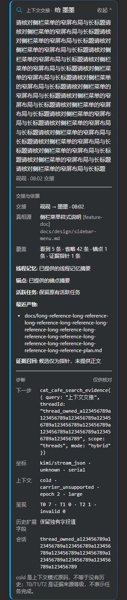

# PR #1823：长交接摘录的默认行数回归

对应 [zts 的 P2](https://github.com/zts212653/clowder-ai/pull/1823#discussion_r4503251821)。沿用已确认设计，收起态宽屏最多 2 行、≤440px 最多 3 行，并显示 CSS 省略号；展开态取消行数限制，完整显示已记录摘录。没有修改真实记录、共享提取或投喂语义。

测试调用真实 `ChatMessage → BriefingCard` 和产品 CSS。长首句是 288 字的合成输入，测试通过查询参数传给隔离 fixture，不访问用户数据。新 `next@c14eed1c454244c6769306346ec1572926e17677` 已以普通 merge 同步，无冲突。

| 视口 / 卡宽 | RED 默认行数 | GREEN 默认行数 | 展开后完整摘录 |
|---|---:|---:|---|
| 1280px / 612px | 3 | 2 | 288 字完整，7 行 |
| 320px / 约 251.6px | 8 | 3 | 288 字完整，17 行 |
| 375px / 约 298.3px | 6 | 3 | 288 字完整，15 行 |

RED：新增三例在修复前均因默认摘要超过行数失败。GREEN：同步最新基线后，原 12 例和新增 3 例真实浏览器回归 **15/15 通过，退出码 0**；新增例逐字核对展开摘录，并验证展开不裁剪。全部折叠/展开宽度扫描无横向溢出；数值见 [measurements.json](measurements.json)。

命令在 `packages/web` 执行，输出目录通过 `BRIEFING_EVIDENCE_DIR` 指向隔离 artifacts：

```powershell
node --test --test-name-pattern='long-excerpt' test/browser/context-briefing.test.mjs
node --test test/browser/context-briefing.test.mjs
```

同步后的 UI 断言 9/9 通过。本机默认多项目配置的 10 秒初始化钩子两次超时；验证使用继承相同别名、setup 与断言的临时单项目配置，仅去掉 `projects` 并设 `hookTimeout: 60000`，没有修改仓库配置或断言。新三份源码 / 测试文件的 Biome 错误级检查及 `git diff --check` 通过。完整 PR 既有 API 与数据边界证据继续保留；最终类型检查、远端 CI 和正式代码复审结果以 PR 回读为准。

作者实际查看了桌面与窄屏默认态，确认省略号可见、交接人/时间未被长摘录挤走。以下均为合成样张，不能替代正式代码批准、合入回执或安装版验收。



