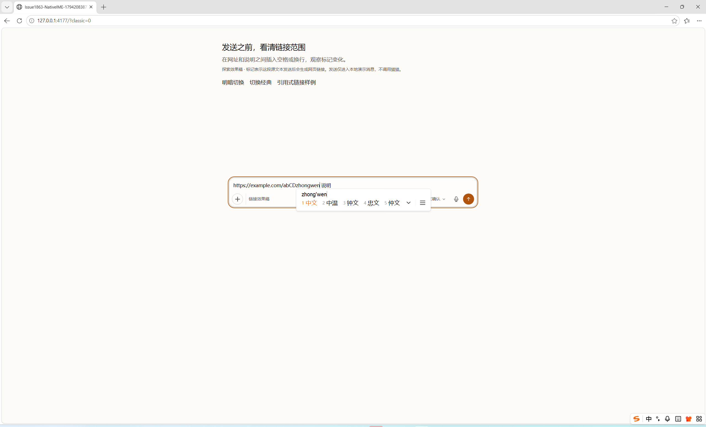
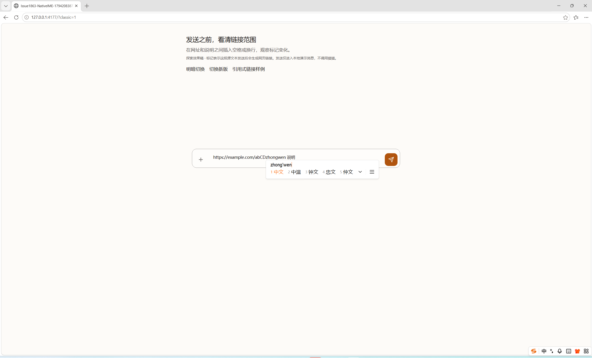
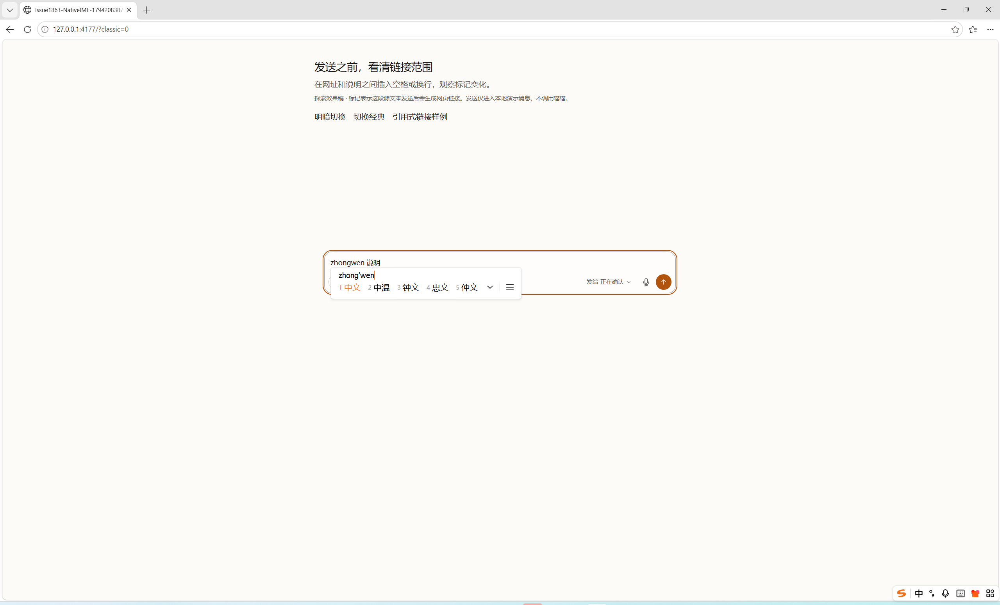

# Windows 系统中文输入法：PR #1887 补证

执行者：砚砚 / GPT-6.1-Sol，原生 OS 自动化，不是人工逐字手敲。

## 环境与证据边界

- Windows 11 专业工作站版，`10.0.26300` / build `26300`，交互桌面 `Default`。
- 可见窗口 Microsoft Edge `157.0.4341.42`，独立 Playwright 浏览器上下文，不使用操作者的浏览器 profile。
- 搜狗拼音中文模式，系统进程版本 `16.10.0.5813`。实际候选窗见下方截图。
- 固定源码 **`cb70a3ecf1e31cbaedab40bcb4611ea32e8b1ee6`**；入口 `http://127.0.0.1:4177/`，真实 `ChatInput` / `ComposerLinkMirror` / CSS 的预构建组件宿主。API、提交是夹具，**这组不是完整 API 旅程**。
- 该静态包在 2026-11-08 17:13 UTC 构建；本次恢复相同包，未改输入或绘制实现。之后合入 `next` 的 `0e6582cc99d8287e76b5928112a6a4b3c6edb626` 相对该测试 SHA 的 `ChatInput`、镜像、蓝字 CSS、`composer-web-links`、`chat-markdown`、`MarkdownContent` 和 `remark-chat-references` 均无 diff，保留对应层证据；不把旧 SHA 的实测写成新 SHA 重跑。
- 第一完整轮：2026-11-09 **07:13:07–07:13:50 UTC**；确认轮：**07:14:52–07:15:29 UTC**。两轮各 12/12（v2 六项 + classic 六项）。

初始化草稿通过 DOM 设置为合成测试文本并定位光标；**实际组字使用 Windows `SendInput` 扫描码输入 ASCII 拼音 `zhongwen`，以系统 Space 选词、Escape 取消、Ctrl+Z / Ctrl+Y 撤销重做**。没有粘贴中文或注入 DOM/CDP composition。原生键盘桥要求专用测试窗口在前台，失去前台时停止，不向其他应用继续发送操作。

两轮都核对了最终全文、UTF-16 光标/选区、组字事件、v2 组字期间的原生文字颜色和结束后的完整链接范围。classic 全程不带镜像标记。

## 实际结果

每项初始文本为 `https://example.com/abCD 说明`。下表两轮、v2 和 classic 的全文/选区一致；蓝字列仅适用于 v2。

| 项目 | 最终全文 | 光标 / 选区 UTF-16 | v2 蓝字 |
| --- | --- | --- | --- |
| URL 末尾确认 | `https://example.com/abCD中文 说明` | 26 / 26 | 完整 URL 含中文，后文不含在内 |
| URL 中间确认 | `https://example.com/ab中文CD 说明` | 24 / 24 | 完整 URL 含中文，无旧范围 |
| 末尾取消 | `https://example.com/abCD 说明` | 24 / 24 | 原 URL 恢复，无拼音残留 |
| 中间取消 | `https://example.com/abCD 说明` | 22 / 22 | 原 URL 恢复，`CD` 和后文完整 |
| 完整 URL 选区替换 | `中文 说明` | 2 / 2 | 消失，保留选区外的空格与说明 |
| 撤销 / 重做 | 一次 Ctrl+Z 恢复原文；一次 Ctrl+Y 恢复 `中文 说明` | Undo **0 / 8**；Redo **2 / 2** | 恢复 / 消失 |

撤销后是实际的 `0 / 8` 选区，不描述成折叠光标。这个分组在 classic 对照中相同；不为对齐其他平台而改写记录。

组字中 v2 的 `data-active=false`、textarea 为原生 `oklch(0.2 0.005 30)`；确认/取消后含链接时 `data-active=true`，textarea 透明，由镜像显示当前链接；替换成非 URL 后恢复原生字色。两轮逐项核对一致。

## 系统候选窗实拍

v2 组字时恢复原生字色，实际搜狗候选项 1 为“中文”：

经典输入框对照：

完整 URL 选区由系统拼音组字替换，截图为确认前的候选状态，最终全文见原始记录：

## 原始记录与不作推断的部分

- [第一完整轮](results.json)、[第二确认轮](confirmation-results.json)：保留真实事件标志，包括观测到的 `compositionend.isTrusted=false`，没有改写成 true。原生 OS 证据来自实际系统键盘路径和候选窗，不单凭一个事件标志判断。
- [记录核对脚本](verify-native-evidence.mjs)：对两份记录重算 12 项的全文、光标、组字和镜像检查，可运行 `node verify-native-evidence.mjs results.json confirmation-results.json`。
- [环境和输入桥快照](environment.json)、[原生按键桥](windows-native-keyboard.ps1)与[驱动快照](windows-native-ime.mjs)用于审计。驱动沿用当时工作目录坐标；不是通用安装命令。
- [较早的未完成尝试](initial-tail-interruption.json)保留：首项只观察到 `z` 组字，随后取消，Space 形成空格，未得到中文。另一次 classic 对照在第二项失去前台，被按键桥停止；[中断记录](classic-foreground-interruption.json)保留。没有把这些失败记录删除或称作产品修复；其具体取消原因未定位，之后**没有改产品代码**的两个完整轮次均通过。若审查认为仍需针对该早期取消进一步复现，会沿此记录核查，不以通过轮次反推其原因。
- 测试桥最早在系统 PowerShell 不识别 `[ushort]` 类型别名处退出，未完成原生操作；已在外部测试桥改为 `[uint16]`。这不是产品代码变化。
- 这组只覆盖上述 Windows / Edge / 搜狗模式，不代表所有输入法或浏览器。此前独立 Next/API/AOF Redis 的真实产品旅程、维护侧 Mac 原生系统 IME 结果分别保留。

本次补交设备证据，不宣称已获正式代码 APPROVE 或允许合入，不自动关闭 #1863。
